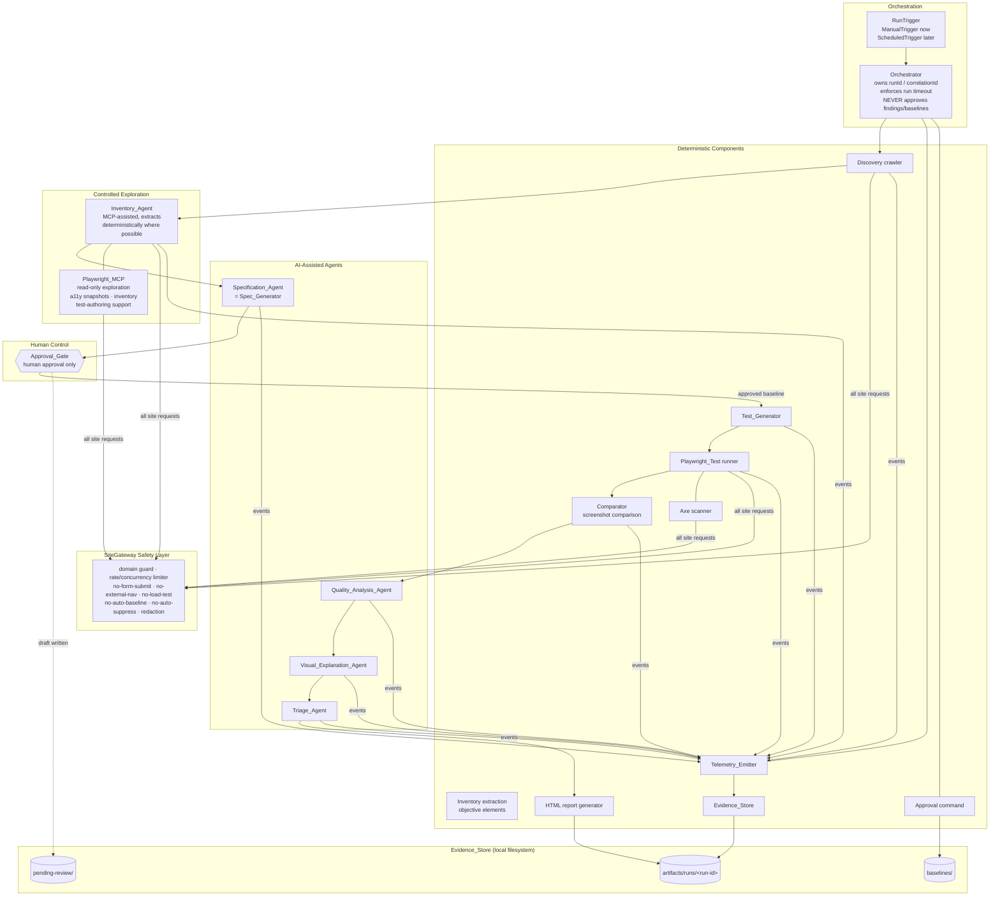
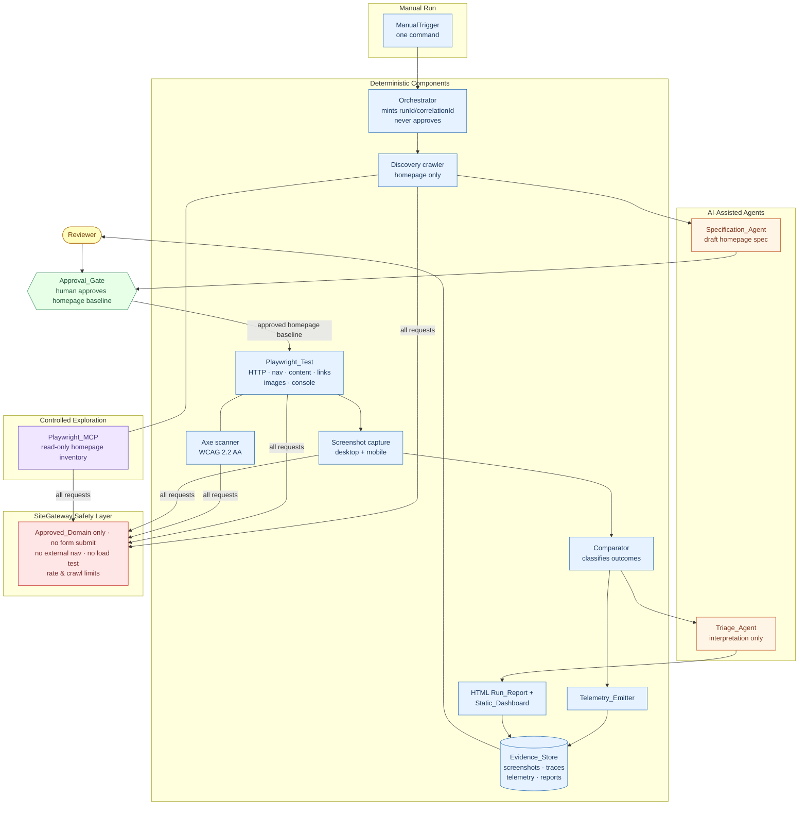

# Design Document

## Overview

Assurity Web Guardian is a human-supervised, proof-of-concept website quality system that monitors the public site `https://assurity.nz`. The first milestone is intentionally bounded: the architecture may support up to 10 approved pages, but implementation begins with a single approved page — the homepage — and expands incrementally (Req 28.10). It is Chromium only, no authentication, no form submission, no database, and no server. Every complete run is manually initiated; no scheduler exists in this milestone (Req 16.7, 29). All state lives on the local filesystem as JSON, JSONL, HTML, and image artifacts.

The system is organized as a modular, agent-based pipeline coordinated by an Orchestrator. Each agent has a single responsibility and communicates through schema-validated JSON hand-offs. The system deliberately separates **AI-assisted agents** (which propose, interpret, and explain) from **deterministic components** (which measure, check, store, and render) so a reader always knows which outputs are objective and which require human judgement (Req 31). Every transition that would change an approved baseline passes through a file-based human Approval_Gate — no agent may approve its own output, the Orchestrator never approves findings or baseline changes, and no observation, failure, difference, or screenshot may auto-promote a baseline. A Telemetry_Emitter records structured, correlated events for every run, agent task, and website check; a Triage_Reporter and a Static_Dashboard present the results, always labeling each item by its Finding_Classification so AI-generated analysis is never mistaken for a deterministic fact.

Comparison outcomes are **classified rather than treated uniformly as failures**: only a violated explicit deterministic baseline expectation is a Failed_Check; other differences are Observed_Website_Changes or Visual_Findings that require human review (Req 8, 26, 27). Deterministic, repeatable checks run through Playwright_Test, while controlled, read-only exploration uses Playwright_MCP, which is never the sole repeatable mechanism and is bound by the same SiteGateway safety layer (Req 30).

This design covers architecture and data flow, the repository layout, component responsibilities and interfaces, data models and JSON schemas, error handling and safety, testing strategy, correctness properties, and the dashboard/reporting approach. Requirement numbers are referenced throughout as `(Req N.M)`.

### Design Goals and Non-Goals

**Goals**
- A clear, auditable pipeline where every artifact is traceable to a single `correlationId` (Req 20.3, 20.4).
- Safety constraints enforced at well-defined choke points, not scattered ad hoc (Req 11–15).
- Deterministic evidence cleanly separated from AI-generated analysis in every surface (Req 26).
- Local-only storage with room to add OpenTelemetry later without changing recorded content (Req 20.12, 25.3).

**Non-Goals (first milestone)**

The first milestone explicitly excludes from scope (Req 16.8):

- **Automatic daily scheduling** — runs are manually initiated only; no scheduler is built (Req 16.7, 29.2).
- **OpenTelemetry infrastructure** — no Collector, cloud telemetry, or distributed telemetry backend; a `Telemetry_Exporter` interface leaves room to add it later (Req 25.2, 25.3).
- **Live/real-time Dashboard updates** — the dashboard is static HTML regenerated during and at the end of a run (Req 21.4).
- **Virtual_Office** visualization — deferred; the event design merely anticipates it (Req 23.1).
- **Multiple browsers** — Chromium only; Safari, Firefox, and extra mobile devices are deferred (Req 16.5).
- **External-link navigation** — external links are recorded but never navigated (Req 13.3, 13.4).
- **Production form completion / submission** — forms are inventoried, never filled with PII, never submitted (Req 11).
- **Automatic test-code generation by autonomous agents** — generated test source is produced deterministically from approved baselines, not authored autonomously by an AI agent (Req 16.8).
- **Autonomous Baseline approval** — every baseline change requires an explicit Human_Decision; the Orchestrator and agents never self-approve (Req 16.8, 31.5).

Additional structural non-goals:

- No database, distributed infrastructure, or real-time messaging (Req 25.2).
- No authentication, no Jira, no load/performance/stress testing (Req 11, 12, 16).
- No cryptographic or regulatory-grade immutability. Append-only is an **application-level** guarantee only; the underlying local files remain technically modifiable by anyone with filesystem access (Req 20.10).

### Technology Stack

| Concern | Choice | Rationale |
|---|---|---|
| Language | TypeScript (Node.js, ESM) | Type-safe hand-off payloads and interfaces |
| Browser automation (deterministic) | Playwright_Test (Chromium only) | Deterministic, repeatable website checks (Req 30.2) |
| Controlled exploration | Playwright_MCP (read-only) | Agent-driven exploration, a11y snapshots, inventory, test-authoring — never the sole repeatable mechanism (Req 30.1, 30.3) |
| Accessibility | `@axe-core/playwright` | WCAG 2.2 AA automated checks (Req 6.7) |
| Schema validation | Ajv (JSON Schema draft 2020-12) | Validates every Agent_Handoff (Req 17.1) |
| Specifications | Markdown | Human-readable drafts and baselines (Req 3) |
| Reporting / dashboard | Static HTML (string templating) | No server required (Req 21.1) |
| Visual diff | `pixelmatch` + `pngjs` | Compute Visual_Difference, store diff image (Req 27.1) |
| Storage | Local filesystem: JSON, JSONL, PNG, HTML | No database (Req 24, 25) |
| Testing | Vitest (unit) + `fast-check` (property) + generated Playwright specs | Dual testing approach |

### AI-Assisted vs Deterministic Components (Req 31)

A central design principle is that a reader can always tell whether an output was *measured* by a deterministic component or *proposed/interpreted* by an AI-assisted agent. The table below is authoritative; the component diagrams render the two groups in visually distinct subgraphs, and every item surfaced in a report or on the dashboard carries a `Finding_Classification` that reflects this distinction (Req 26, 31.1, 31.2).

| Group | Components | Role |
|---|---|---|
| **AI-assisted agents** | Specification_Agent (`Spec_Generator`), Quality_Analysis_Agent, Visual_Explanation_Agent, Triage_Agent | Draft specifications, interpret comparison results, explain visual findings, and propose a consolidated triage interpretation. Their outputs are classified `ai-generated-analysis` or `agent-recommendation` and are **never** presented as deterministic facts (Req 31.1, 26.4). |
| **Deterministic components** | Discovery crawler, Playwright_Test runner, Axe accessibility scanner, screenshot comparison, Telemetry_Emitter, Evidence_Store, HTML report generator, Approval command | Measure, check, store, and render. Their direct outputs are objective and classified `deterministic-test-evidence` or `observed-website-change` (Req 31.2). |
| **Mixed** | Inventory_Agent | MAY use Playwright_MCP for exploration, but extracts objective page elements (title, headings, links, images, buttons, form structure) **deterministically where possible** (Req 31.3). |
| **Coordinator** | Orchestrator | Coordinates agent tasks, website checks, and their dependencies under one `correlationId`. It MUST NOT approve any Finding or any Baseline change (Req 31.4, 31.5). |

Note on naming: the deterministic `Comparator` computes the objective comparison result; the `Quality_Analysis_Agent` is the AI-assisted role that *interprets* that result. Likewise the deterministic `Triage_Reporter` assembles and stores the report that the `Triage_Agent` helps interpret, and the AI-assisted `Specification_Agent` is the same role as `Spec_Generator`. AI-assisted roles are additive interpretation layers over deterministic evidence; they never replace a deterministic measurement.

## Architecture

### Component Architecture

The pipeline is a sequence of stages with two cross-cutting concerns — telemetry and approval — that every stage depends on, plus a single SiteGateway safety layer through which all network access flows. The Orchestrator owns the run lifecycle, the shared `correlationId`, and the overall run timeout, and never approves findings or baselines (Req 31.5). AI-assisted agents and deterministic components are drawn in separate subgraphs.



Key architectural decisions:

- **The Approval_Gate is a hard boundary in the pipeline.** Stages before it (Discovery, Inventory, Spec_Generator) only ever produce drafts into `pending-review/`. Stages after it (Test_Generator onward) consume only approved baselines. This makes "no auto-promotion" (Req 14, 27.5) a structural property, not a runtime check that could be bypassed.
- **The SiteGateway safety layer wraps every outbound request — including Playwright_MCP exploration.** No agent, test runner, or MCP-driven exploration talks to the network directly; all navigation and HTTP requests pass through a `SiteGateway` that enforces the domain boundary, rate/concurrency limits, the no-form-submit guard, the no-external-navigation guard, and the no-load-testing guard (Req 11, 12, 13, 30.4). Playwright_MCP is additionally restricted to read-only operations (Req 30.5).
- **Runs are manually triggered, with scheduling deferred behind an interface.** A `RunTrigger` abstraction has a single `ManualTrigger` implementation in this milestone; a `ScheduledTrigger` can be added later without changing recorded telemetry or the run directory layout (Req 16.7, 29).
- **The Orchestrator coordinates but never approves.** It mints IDs and sequences stages, but every promotion and disposition is a human action through the Approval_Gate (Req 31.4, 31.5).
- **Telemetry is emitted by every stage but owned by none.** The Orchestrator injects a single `Telemetry_Emitter` bound to the run's `correlationId`, so correlation is automatic rather than each agent's responsibility (Req 20.3).

### Milestone-One Vertical Slice (Req 28)

The first milestone is proven by a **single, manually initiated command that checks the approved homepage end to end**, before any expansion to more pages. The architecture may support up to 10 Approved_Pages, but the implementation begins with exactly one Approved_Page — the homepage — and expands incrementally (Req 28.10).

One manual command does all of the following for the homepage:

1. Checks the homepage on the Desktop_Viewport (1440×900) and the Mobile_Viewport (390×844) (Req 28.2).
2. Executes the deterministic checks of Requirement 6 — HTTP status, navigation, critical content, broken links (same-domain), missing images, console errors, and the Axe WCAG 2.2 AA scan (Req 28.3).
3. Captures desktop and mobile screenshots and Playwright traces (Req 28.4).
4. Writes structured telemetry for the run (`run.json`, `events.jsonl`, agent task records) (Req 28.5).
5. Produces an HTML Run_Report and regenerates the Static_Dashboard (Req 28.6).
6. Submits no form on the Target_Site at any point (Req 28.7).
7. Preserves the evidence in a form a human can inspect (Req 28.8).

The milestone is considered successful when criteria 1–8 of Requirement 28 all hold (Req 28.9).

The component diagram below shows only the parts involved in the one-homepage slice, with AI-assisted agents and deterministic components visually distinguished, the SiteGateway safety layer, Playwright_MCP (exploration) vs Playwright_Test (deterministic checks), the ManualTrigger, and the human Approval_Gate.



### End-to-End Sequence for One Homepage Run

The sequence below traces one manually initiated homepage run, including correlation-ID minting, the first-time discovery/inventory/spec draft, the human baseline approval, deterministic checks, the classification step, and evidence production.

```mermaid
sequenceDiagram
    actor Human as Reviewer
    participant MT as ManualTrigger
    participant ORCH as Orchestrator
    participant TEL as Telemetry_Emitter
    participant DISC as Discovery crawler
    participant SG as SiteGateway (Safety)
    participant MCP as Playwright_MCP
    participant INV as Inventory_Agent
    participant SPEC as Specification_Agent
    participant GATE as Approval_Gate
    participant TGEN as Test_Generator
    participant PWT as Playwright_Test
    participant CMP as Comparator
    participant TRI as Triage_Reporter
    participant REP as Report + Dashboard

    Human->>MT: run homepage check (one command)
    MT->>ORCH: trigger complete run
    ORCH->>ORCH: mint runId + correlationId; start run timeout
    ORCH->>TEL: open events.jsonl; write run.started (correlationId)

    alt First time: no approved homepage baseline
        ORCH->>DISC: discover homepage [taskId -> correlationId]
        DISC->>SG: fetch homepage (Approved_Domain only)
        SG-->>DISC: response (external links excluded)
        ORCH->>INV: inventory homepage [taskId]
        INV->>MCP: read-only explore (a11y snapshot, elements)
        MCP->>SG: guarded read-only requests
        INV-->>ORCH: inventory (deterministic elements; PII excluded)
        ORCH->>SPEC: draft homepage spec [taskId]
        SPEC->>GATE: write Draft_Specification -> pending-review/
        Note over GATE: PIPELINE PAUSES — awaiting human review
        Human->>GATE: approve homepage baseline (reviewId, reviewer, reason)
        GATE->>GATE: no-self-approval; atomic promote
        GATE->>TEL: audit.jsonl append (approval) + Review_ID
        GATE-->>ORCH: homepage Baseline v1 established
    end

    ORCH->>TGEN: generate tests from Baseline v1 [taskId]
    TGEN-->>ORCH: Playwright test source (tests/generated/, refs Baseline v1)
    ORCH->>PWT: run deterministic checks (desktop + mobile) [checkId per check]
    PWT->>SG: nav + HTTP + links + images + console + Axe
    PWT->>PWT: capture desktop/mobile screenshots + traces
    PWT->>TEL: Run_Record (checkIds, evidenceIds, correlationId)
    PWT-->>ORCH: Daily_Observation
    ORCH->>CMP: compare(observation, Baseline v1)
    Note over CMP: classify each outcome —<br/>violated explicit expectation => Failed_Check<br/>diff w/o violation => Observed_Website_Change<br/>screenshot diff => Visual_Finding<br/>(suppressed if a deterministic rule failed)
    CMP-->>ORCH: classified findings (findingIds)
    ORCH->>TRI: consolidate findings (each labeled by classification)
    TRI->>TEL: findings.json
    ORCH->>REP: generate HTML Run_Report + regenerate Static_Dashboard
    REP->>TEL: run.finished
    REP-->>Human: evidence ready to inspect (screenshots, traces, report, dashboard)
```

### Data Flow and Correlation

The sequence below shows a full run, the shared `correlationId`, child ID minting, and the human approval gate. Boxes before the gate write only to `pending-review/`; promotion to `baselines/` happens only on explicit human approval.

```mermaid
sequenceDiagram
    actor Human as Reviewer
    participant ORCH as Orchestrator
    participant TEL as Telemetry_Emitter
    participant DISC as Discovery_Agent
    participant SG as SiteGateway (Safety)
    participant INV as Inventory_Agent
    participant SPEC as Spec_Generator
    participant GATE as Approval_Gate
    participant TGEN as Test_Generator
    participant OBS as Observation_Runner
    participant CMP as Comparator
    participant TRI as Triage_Reporter

    ORCH->>ORCH: mint runId + correlationId, start run timeout
    ORCH->>TEL: open events.jsonl, write run.started

    Note over DISC,SG: all requests spaced >= 1s, concurrency <= 1, domain-guarded
    ORCH->>DISC: run(correlationId) [taskId]
    DISC->>SG: fetch seed URLs (Approved_Domain only)
    SG-->>DISC: responses (external links excluded)
    DISC->>TEL: Agent_Task_Record (taskId -> correlationId)
    DISC-->>ORCH: discovery hand-off (approved + pending-review pages)

    ORCH->>INV: run(correlationId) [taskId]
    INV->>SG: render pages desktop 1440x900 + mobile 390x844
    INV-->>ORCH: inventory hand-off (PII excluded, forms not submitted)

    ORCH->>SPEC: run(correlationId) [taskId]
    SPEC->>GATE: write Draft_Specification -> pending-review/
    Note over GATE: PIPELINE PAUSES — awaiting human review

    Human->>GATE: approve(reviewId, reviewer, reason) via CLI/dashboard
    GATE->>GATE: no-self-approval check; atomic promote
    GATE->>TEL: audit.jsonl append (approval) + Review_ID
    GATE-->>ORCH: Baseline vN established

    ORCH->>TGEN: run(correlationId) [taskId]
    TGEN-->>ORCH: generated Playwright tests (ref Baseline vN)
    ORCH->>OBS: run(correlationId) [checkId per check]
    OBS->>SG: navigate + axe + screenshots (desktop/mobile)
    OBS->>TEL: Run_Record (checkIds, evidenceIds)
    OBS-->>ORCH: Daily_Observation
    ORCH->>CMP: compare(observation, Baseline vN)
    CMP-->>ORCH: comparison hand-off (findingIds, visual diff -> review)
    ORCH->>TRI: consolidate findings
    TRI->>TEL: findings.json + report/index.html
    ORCH->>TEL: run.finished; regenerate dashboard
```

### Safety Enforcement Points

Safety constraints are concentrated in a small number of choke points so they are testable and cannot be bypassed:

| Constraint | Enforced in | Requirement |
|---|---|---|
| Domain boundary (same-domain only, incl. MCP) | `SiteGateway.guardUrl()` before every request | 13.1, 13.2, 12.7, 30.4 |
| Request spacing (>= 1000 ms) + concurrency (<= 1), incl. MCP | `RateLimiter` inside `SiteGateway` | 1.8, 12.1, 12.2, 30.4 |
| No form submission (incl. MCP) | `SiteGateway` page wrapper blocks submit/click-submit | 11.1, 11.2, 30.4 |
| No external navigation (incl. MCP) | `SiteGateway.guardUrl()` blocks off-domain targets | 13.2, 13.3, 30.4 |
| No load/stress/performance testing (incl. MCP) | No concurrent-burst code path; rate limiter enforced | 12.8, 30.4 |
| Playwright_MCP read-only | MCP bound to read-only operations through `SiteGateway` | 30.1, 30.5 |
| No PII in form fields | `SiteGateway` field-populate guard | 11.3, 11.4 |
| No auto-promotion of observation to baseline | Pipeline structure + `ApprovalGate.promote()` only path to `baselines/` | 14.2, 27.5 |
| No auto-approve / auto-suppress of findings | `TriageStore` rejects disposition without a `Human_Decision` | 15.2, 15.5 |
| No self-approval | `ApprovalGate.assertNotSelfApproval()` | 4.6, 10.6, 15.4 |
| Secret / PII redaction | `Redactor` applied by `Telemetry_Emitter` before any write | 20.13, 22.1, 22.2 |
| Navigation timeout (30 s) / run timeout (10 min) | `SiteGateway` per-nav / `Orchestrator` run-level | 12.5, 12.6 |
| Blocked-action audit logging | Every guard writes a blocked-attempt audit event | 11.2, 12.2, 13.2, 14.2, 15.2 |

## Components and Interfaces

### Orchestrator (`src/core`)

Single responsibility: coordinate the pipeline for one run under a single `runId`/`correlationId`, enforce the overall run timeout (Req 12.6), and construct the per-run `Telemetry_Emitter` and `SiteGateway`. The Orchestrator **coordinates only** — it MUST NOT approve any Finding or any Baseline change; every such decision is a human action through the Approval_Gate (Req 31.4, 31.5).

- **Inputs:** `AppConfig`, `Page_Seed_File`, invoked by a `RunTrigger`.
- **Outputs:** a completed `artifacts/runs/<run-id>/` directory, exit status.
- **Behavior:** mints IDs, sequences agents, halts the pipeline at the Approval_Gate when no approved baseline exists for a page, and wraps the whole run in an `AbortController` tied to `runTimeoutMs`. In milestone one it operates on a single Approved_Page (the homepage) and expands incrementally up to the configured page limit (Req 28.10).

#### RunTrigger / Execution Interface (Req 29)

The run is initiated through a `RunTrigger` abstraction. Milestone one ships exactly one implementation — `ManualTrigger` — invoked by the `run` CLI command. No scheduler is included (Req 16.7, 29.2). The interface is deliberately shaped so a `ScheduledTrigger` (e.g., a daily cron-driven trigger) can be added in a future milestone **without changing the recorded telemetry content or the run directory layout** (Req 29.3).

```typescript
// Milestone one: ManualTrigger only. ScheduledTrigger is a FUTURE addition.
interface RunTrigger {
  readonly kind: "manual" | "scheduled";   // only "manual" exists now
  start(config: AppConfig): Promise<RunRecord>;  // delegates to Orchestrator.run
}

class ManualTrigger implements RunTrigger {    // Req 29.1
  readonly kind = "manual";
  // Invoked by the `run` CLI command; triggers one complete run.
}

// Deferred (NOT implemented in milestone one, shown for interface stability):
// class ScheduledTrigger implements RunTrigger { readonly kind = "scheduled"; /* daily */ }

interface Orchestrator {
  run(config: AppConfig): Promise<RunRecord>;
}

interface AgentContext {
  readonly runId: string;
  readonly correlationId: string;
  readonly config: AppConfig;
  readonly telemetry: TelemetryEmitter;
  readonly gateway: SiteGateway;   // the only path to the network
  readonly store: EvidenceStore;
  readonly signal: AbortSignal;    // tripped on run timeout
  newTaskId(): string;
  newCheckId(): string;
  newFindingId(): string;
  newEvidenceId(): string;
}

interface Agent<TIn, TOut> {
  readonly name: string;
  readonly role: string;
  execute(input: TIn, ctx: AgentContext): Promise<AgentResult<TOut>>;
}

interface AgentResult<TOut> {
  output: TOut;
  status: "completed" | "failed" | "awaiting-review";
  handoff?: AgentHandoff;          // schema-validated payload, if any
}
```

### SiteGateway + Safety Layer (`src/core`, `src/safety`)

Single responsibility: the only component that touches the network, enforcing all request-level safety constraints.

```typescript
interface SiteGateway {
  // Resolves only if the URL is within Approved_Domain; otherwise records a
  // blocked-navigation audit event and throws (Req 13.1, 13.2).
  guardUrl(url: string): URL;

  // Applies rate limiting (spacing + concurrency) then navigates with the
  // configured navigation timeout (Req 1.8, 12.1, 12.5).
  navigate(url: string, viewport: ViewportName): Promise<GuardedPage>;

  // HEAD/GET for link + image checks, same-domain only (Req 6.4, 6.11).
  probe(url: string): Promise<ProbeResult>;

  isExternal(url: string): boolean; // classify External_Link (Req 13.3)
}

// A Playwright Page wrapper that blocks unsafe actions.
interface GuardedPage {
  readonly page: import("playwright").Page;
  // Blocks and audits any form submit attempt (Req 11.2).
  // Blocks and audits any field populate carrying PII (Req 11.4).
}

interface RateLimiter {
  // Resolves no sooner than `requestSpacingMs` after the previous acquire and
  // never allows more than `concurrency` in flight (Req 12.1, 12.2).
  acquire(signal: AbortSignal): Promise<Release>;
}

interface RetryPolicy {
  // Retries transient failures up to `retries` with backoff (Req 1.9, 12.4).
  run<T>(fn: () => Promise<T>, isTransient: (e: unknown) => boolean): Promise<T>;
}
```

Every guard, when it blocks, calls `telemetry.audit({ type: "blocked-action", ... })` so blocked attempts are always recorded (Req 11.2, 12.2, 13.2, 14.2, 15.2).

### Playwright_MCP vs Playwright_Test (`src/browser`)

The system uses two distinct Playwright integrations with clearly separated roles (Req 30). **Both** reach the network only through the `SiteGateway`, so the same safety restrictions apply to each.

**Playwright_Test (deterministic, repeatable checks)** — the authoritative, repeatable mechanism.

- Runs the generated specs derived from approved baselines (Req 30.2).
- Produces the deterministic evidence of Requirement 6: HTTP status, navigation, critical content, broken links, missing images, console errors, and the Axe scan, plus desktop/mobile screenshots and traces.
- Its results are classified `deterministic-test-evidence` (Req 31.2).

**Playwright_MCP (controlled, read-only exploration)** — an assistive layer, never the sole repeatable mechanism.

- Supports controlled, read-only, agent-driven site exploration, accessibility snapshots, page inventory, and test-authoring support (Req 30.1).
- MUST NOT be the sole daily or repeatable test mechanism — deterministic repeatable checks always run through Playwright_Test (Req 30.3).
- Operates under the **same** constraints as every other component, enforced by the `SiteGateway`: Approved_Domain only, no form submissions, no external navigation, no load testing, and the approved `Conservative_Request_Rate` and crawl limits (Req 30.4).
- Is restricted to read-only operations while exploring; it never mutates site state (Req 30.5).

```typescript
// Controlled, read-only exploration. All navigation flows through SiteGateway.
interface PlaywrightMcpExplorer {
  // Read-only page inventory / accessibility snapshot for an Approved_Page.
  // Uses ctx.gateway.navigate(...) so domain/rate/form guards all apply (Req 30.4, 30.5).
  explore(url: string, ctx: AgentContext): Promise<McpExplorationResult>;
  readonly readOnly: true;         // never performs writes/submits (Req 30.5)
  readonly isSoleRepeatableMechanism: false; // guaranteed by construction (Req 30.3)
}

// Deterministic, repeatable checks derived from approved baselines (Req 30.2).
interface PlaywrightTestRunner {
  run(baseline: Baseline, ctx: AgentContext): Promise<DailyObservation>;
}
```

MCP-driven exploration therefore flows through the identical safety choke point as Playwright_Test and the crawler: it cannot leave the Approved_Domain, submit a form, navigate externally, or exceed the conservative request rate.

### Discovery_Agent (`src/agents`)

Single responsibility: produce the set of Approved_Pages from the `Page_Seed_File` and list newly discovered same-domain pages for human review (Req 1).

- **Input:** `Page_Seed_File` (max 10 URLs, Req 1.2), `AppConfig`.
- **Output:** discovery `AgentHandoff` with `approvedPages[]` and `pagesRequiringReview[]`.
- **Behavior:** reads seed URLs; crawls to `crawlDepth` (default 2) via `SiteGateway`; same-domain links not in the seed file go to `pagesRequiringReview` and are written to `pending-review/` (Req 1.6, 1.7); external links are recorded and excluded from navigation (Req 1.4, 13.3). The receiving side rejects a hand-off that validates but omits an approved or review page (Req 1.12).

### Inventory_Agent (`src/agents`)

Single responsibility: extract a structured inventory (title, headings, links, images, buttons, forms) per Approved_Page, rendered on both viewports, never submitting forms, never recording PII (Req 2). This is a **mixed** component: it MAY use Playwright_MCP for read-only exploration, but it extracts the objective page elements **deterministically where possible** rather than relying on AI interpretation (Req 31.3).

- **Input:** `approvedPages[]`.
- **Output:** inventory `AgentHandoff`.
- **Behavior:** renders desktop 1440×900 and mobile 390×844 (Req 2.4); records form structure without submission (Req 2.3); strips PII-looking field values (Req 2.5). When it uses Playwright_MCP, exploration is read-only and routed through the `SiteGateway` (Req 30.4, 30.5), while the extracted elements come from deterministic DOM queries wherever the information is objectively available (Req 31.3). IF rendering succeeds on only one viewport, it produces a partial hand-off from the successful viewport and records which viewport failed (Req 2.4).

### Spec_Generator (`src/agents`)

**AI-assisted agent** (the `Specification_Agent`, Req 31.1). Single responsibility: turn an inventory into a `Draft_Specification` in Markdown, marked `draft`, written to `pending-review/` and the Evidence_Store (Req 3, 4.2). Its output is a draft for human review and is never treated as a baseline or a deterministic fact.

- **Input:** inventory hand-off.
- **Output:** `Draft_Specification` (Markdown) + draft metadata.
- **Behavior:** includes title, headings, links, images, buttons, forms (Req 3.2); state is always `draft` until the Approval_Gate promotes it (Req 3.3, 4.1).

### Approval_Gate (`src/approval`)

Single responsibility: the sole mechanism that promotes a draft to a baseline, approves a baseline change, or records a finding disposition — always human-driven, atomic, audited, and never self-approved (Req 4, 10.3–10.6, 15).

- **Inputs:** a `Human_Decision` submitted via the CLI (`src/approval/cli.ts`) or a dashboard action.
- **Outputs:** a promoted/updated `Baseline` under `baselines/`, an appended audit event, a `Review_ID`.
- **Behavior:**
  - File-based pending-review area: drafts/proposed changes live under `artifacts/pending-review/` until a human acts.
  - **Atomic promotion:** write the new baseline to a temp file, `fsync`, rename into place, then append the audit event — so the audit entry exists only if promotion succeeded (Req 4.3, 4.7). A failed promotion records a failed-attempt audit event and no success event (Req 4.7).
  - **No self-approval:** the decision's `reviewer` identity must be a human operator, and the agent that produced the artifact can never be the approver; a self-approval attempt is rejected and audited (Req 4.6, 10.6, 15.4).
  - **No auto-update of baselines:** failed checks, detected differences, and screenshot diffs can never trigger promotion; only this gate writes to `baselines/` (Req 14.2, 15.5, 27.5).

```typescript
interface ApprovalGate {
  listPending(): Promise<PendingItem[]>;
  approveSpecification(d: HumanDecision): Promise<Baseline>;      // Req 4.3
  updateBaseline(d: HumanDecision): Promise<Baseline>;            // Req 10.4
  disposeFinding(d: HumanDecision): Promise<void>;                // Req 15.3
}

type HumanDecisionKind = "accepted" | "rejected" | "dismissed" | "baseline-update-approved";

interface HumanDecision {
  reviewId: string;
  correlationId: string;
  reviewer: string;            // human identity; never an agent name
  timestamp: string;           // ISO-8601
  decision: HumanDecisionKind;
  reason: string;
  specVersion?: string;
  affectedBaselineIds: string[];
  affectedFindingIds: string[];
}
```

### Test_Generator (`src/agents`)

**Deterministic component.** Single responsibility: generate Playwright_Test source from approved baselines only (Req 5). This is deterministic generation from an approved baseline — not autonomous AI test authoring, which is explicitly out of scope (Req 16.8).

- **Input:** approved `Baseline` (vN).
- **Output:** generated `.spec.ts` files referencing the source baseline version (Req 5.4), exercising desktop + mobile Chromium (Req 5.3).
- **Behavior:** a specification that is not an approved baseline is excluded from generation (Req 5.2).
- **Storage of test source:** the generated Playwright test source is written into the **version-controlled repository** under `tests/generated/` and each file records the approved baseline version it was derived from (Req 5.4). The Evidence_Store is **never the sole location** of the generated test source code — it retains an execution-time manifest/snapshot of exactly which tests ran, but the source of truth for the test source is the repo (Req 5.5, 24.7, 24.8).

### Observation_Runner (`src/agents`)

**Deterministic component** (drives the Playwright_Test runner and the Axe scanner). Single responsibility: run the generated checks against each Approved_Page and record a `Daily_Observation` plus evidence (Req 6, 7).

- **Input:** generated tests (from `tests/generated/`), approved baseline.
- **Output:** `Daily_Observation`, screenshots (desktop/mobile), traces, accessibility results, `Run_Record`.
- **Behavior:** records HTTP status, navigation outcome, critical-content presence, broken links (same-domain only), missing images (only after the image check runs — Req 6.5), console errors, and an Axe WCAG 2.2 AA scan (Req 6.1–6.7). Accessibility impact maps to severity (see Error Handling). Records the disclaimer that automated checks do not establish full conformance (Req 6.10).

### Comparator (`src/agents`)

**Deterministic component.** Single responsibility: compare a `Daily_Observation` against the approved baseline and **classify** each outcome rather than treating every difference as a failure; compute visual differences without auto-failing on pixels (Req 8, 27). The AI-assisted `Quality_Analysis_Agent` and `Visual_Explanation_Agent` later *interpret* and *explain* these objective outcomes; the Comparator itself only measures and classifies.

- **Input:** `Daily_Observation`, approved `Baseline`.
- **Output:** comparison `AgentHandoff`, classified `Finding[]`, visual diff images.

#### Outcome Classification (Req 8, 26, 27)

Each comparison outcome is classified; the classification determines whether it is a failure or a human-review item:

| Condition | Outcome | Finding_Classification | Is it a failure? |
|---|---|---|---|
| A **violated explicit deterministic baseline expectation** (e.g., missing critical content, broken same-domain link, missing image after its check, missing element, overlapping content, unavailable critical CTA) | `Failed_Check` | `deterministic-test-evidence` | Yes — failed check requiring human review (Req 8.2, 27.4) |
| A difference from the baseline with **no** violated explicit expectation | `Observed_Website_Change` | `observed-website-change` | No — requires human review, **never** recorded as a Failed_Check (Req 8.3) |
| A **screenshot difference** | `Visual_Finding` | `observed-website-change` | No — requires human review (Req 8.4, 27.2) — **unless** a deterministic rule is violated in the same comparison, in which case **only** the `Failed_Check` is recorded and the `Visual_Finding` is suppressed entirely (Req 8.4) |
| An **AI interpretation** of a comparison outcome (Quality_Analysis_Agent / Visual_Explanation_Agent) | interpretation item | `ai-generated-analysis` | No — advisory only (Req 8.5) |
| An **agent-proposed action** in response to an outcome | proposal item | `agent-recommendation` | No — advisory only (Req 8.6) |
| A **Reviewer disposition** recorded for an outcome | disposition item | `human-decision` | No — authoritative human record (Req 8.7) |

**Behavior notes:**
- Observations are never used as baselines (Req 8.3, 8.8, 14.1).
- A difference without a violated explicit expectation is recorded as an `Observed_Website_Change` and is **structurally excluded** from being a `Failed_Check` (Req 8.3).
- Visual diff stores the baseline screenshot, the current screenshot, and the computed diff image, and creates a `Visual_Finding` requiring human review; it **never** auto-fails on pixel-difference percentage (Req 27.1–27.3).
- **Visual_Finding suppression:** when the same comparison also violates a deterministic rule, the Comparator records only the `Failed_Check` (classified `deterministic-test-evidence`) and records **no** `Visual_Finding` for that comparison (Req 8.4).

#### Strict Classification Precedence (Req 26.5)

When an item qualifies for more than one source type, exactly one `Finding_Classification` is assigned using this strict precedence (highest wins):

```
human-decision  >  agent-recommendation  >  ai-generated-analysis  >  observed-website-change  >  deterministic-test-evidence
```

That is, a recorded human decision overrides an agent recommendation, which overrides an AI interpretation, which overrides an observed website change, which overrides deterministic test evidence. This single precedence rule is implemented once in `classification.ts` and used by every surface (reports, dashboard, telemetry) so the mapping is consistent everywhere (Req 26.5).

### Triage_Reporter (`src/reporting`)

**Deterministic component** (the HTML report generator). Single responsibility: consolidate findings into one HTML triage report per run and keep unreviewed failures open (Req 9, 15.1). The AI-assisted `Triage_Agent` may *propose* a consolidated interpretation (classified `agent-recommendation`), but the `Triage_Reporter` deterministically assembles and stores the report itself (Req 31.1, 31.2).

- **Input:** `Finding[]` (already classified by the Comparator), run metadata.
- **Output:** `report/index.html`, `findings.json`.
- **Behavior:** consolidates Failed_Checks, Observed_Website_Changes, and Visual_Findings into one report per run (Req 9.1); associates each item with the Approved_Page, the check type, the `Finding_Classification`, and the run id (Req 9.2); every item carries exactly one `Finding_Classification` (Req 26).

### Telemetry_Emitter and Telemetry_Exporter (`src/telemetry`)

Single responsibility: produce structured, correlated telemetry (`Telemetry_Event`, `Run_Record`, `Agent_Task_Record`) and the append-only logs, with redaction applied before any write (Req 18–20, 22, 24, 25).

```typescript
interface TelemetryEmitter {
  event(e: Omit<TelemetryEvent, "correlationId" | "ts">): void; // -> events.jsonl
  audit(e: Omit<AuditEvent, "correlationId" | "ts">): void;     // -> audit.jsonl (append-only)
  runRecord(r: RunRecord): void;                                // -> run.json / results.json
  agentTask(r: AgentTaskRecord): void;                          // -> agent-tasks/<taskId>.json
}

// Designed so an OpenTelemetry exporter can be added later WITHOUT changing
// recorded content (Req 20.12, 25.3). Milestone one ships FileExporter only.
interface TelemetryExporter {
  export(event: TelemetryEvent): void | Promise<void>;
  flush(): Promise<void>;
}

interface Redactor {
  // Replaces tokens/credentials/PII/secrets with a placeholder before write
  // (Req 20.13, 22.1, 22.2). Pure function over the record.
  redact<T>(record: T): T;
}
```

`Telemetry_Emitter` routes every record through `Redactor.redact()` first, then to the configured `TelemetryExporter`. Audit and event logs are append-only: the writer offers only an append operation and rejects edits (Req 20.7–20.9, 24.5).

### Configuration model (`src/config`)

All numeric limits are `Configurable_Limit` values changeable without code edits (Req 16, 20.14), with first-milestone defaults:

```typescript
interface AppConfig {
  approvedDomain: string;        // "assurity.nz"
  baseUrl: string;               // "https://assurity.nz"
  seedFilePath: string;          // config/page-seed.json
  limits: {
    pages: number;               // default 10   (Req 1.2, 16.6)
    crawlDepth: number;          // default 2    (Req 1.5, 12.3)
    concurrency: number;         // default 1    (Req 1.8, 12.1)
    requestSpacingMs: number;    // default 1000 (Req 1.8, 12.1)
    retries: number;             // default 2    (Req 1.9, 12.4)
    navTimeoutMs: number;        // default 30000 (Req 1.10, 12.5)
    runTimeoutMs: number;        // default 600000 (Req 12.6)
  };
  retention: { maxRuns: number; maxAgeDays: number }; // Req 20.14, 24.6
  viewports: {
    desktop: { width: 1440; height: 900 };
    mobile:  { width: 390;  height: 844 };
  };
}
```

## Repository Structure

A TypeScript monorepo-style layout separates source, config, and generated artifacts. Source is grouped by responsibility; all run output is written under `artifacts/`.

```
assurity-web-guardian/
├── package.json
├── tsconfig.json
├── playwright.config.ts              # Chromium only; desktop + mobile projects
├── config/
│   ├── app.config.json               # Configurable_Limit values (Req 16, 20.14)
│   └── page-seed.json                # Page_Seed_File — max 10 approved URLs (Req 1.1, 1.2)
├── src/
│   ├── index.ts                      # CLI entry: run | approve | list-pending | report
│   ├── core/
│   │   ├── orchestrator.ts           # run lifecycle, correlationId, run timeout (never approves)
│   │   ├── run-trigger.ts            # RunTrigger interface + ManualTrigger (ScheduledTrigger later, Req 29)
│   │   ├── site-gateway.ts           # the only network path (domain/rate/form/external/load guards)
│   │   ├── rate-limiter.ts           # spacing + concurrency (Req 12.1)
│   │   ├── retry-policy.ts           # retry-with-backoff, max 2 (Req 12.4)
│   │   ├── ids.ts                    # runId/correlationId/taskId/checkId/... minting
│   │   └── evidence-store.ts         # run directory layout + atomic writes
│   ├── browser/
│   │   ├── playwright-test.ts        # deterministic, repeatable checks (Req 30.2)
│   │   └── playwright-mcp.ts         # controlled, read-only exploration (Req 30.1, 30.5)
│   ├── agents/
│   │   ├── discovery-agent.ts        # deterministic crawler (Req 31.2)
│   │   ├── inventory-agent.ts        # mixed: MCP-assisted, deterministic extraction (Req 31.3)
│   │   ├── spec-generator.ts         # AI-assisted Specification_Agent (Req 31.1)
│   │   ├── quality-analysis-agent.ts # AI-assisted interpretation of comparison (Req 31.1)
│   │   ├── visual-explanation-agent.ts # AI-assisted visual explanations (Req 31.1)
│   │   ├── triage-agent.ts           # AI-assisted triage interpretation (Req 31.1)
│   │   ├── test-generator.ts         # deterministic generation -> tests/generated/ (Req 5, 16.8)
│   │   ├── observation-runner.ts     # deterministic (drives Playwright_Test + Axe)
│   │   └── comparator.ts             # deterministic outcome classification (Req 8, 26, 27)
│   ├── safety/
│   │   ├── domain-guard.ts           # Approved_Domain boundary (Req 13)
│   │   ├── form-guard.ts             # no-form-submit / no-PII (Req 11)
│   │   ├── redactor.ts               # secret/PII redaction (Req 22)
│   │   └── guards.ts                 # no-auto-baseline / no-auto-suppress helpers
│   ├── approval/
│   │   ├── approval-gate.ts          # atomic promotion, no-self-approval, audit
│   │   ├── pending-store.ts          # pending-review area read/write
│   │   └── cli.ts                    # controlled approve/dispose command (Req 4.3)
│   ├── telemetry/
│   │   ├── telemetry-emitter.ts      # Run_Record / Agent_Task_Record / events
│   │   ├── exporters/
│   │   │   └── file-exporter.ts      # milestone-one exporter (JSON/JSONL)
│   │   ├── exporter.ts               # Telemetry_Exporter interface (OTel-ready, Req 20.12)
│   │   └── audit-log.ts              # append-only JSONL writer (Req 24.5)
│   ├── reporting/
│   │   ├── triage-reporter.ts        # consolidated HTML triage report (Req 9)
│   │   ├── dashboard.ts              # static HTML dashboard generator (Req 21)
│   │   ├── classification.ts         # Finding_Classification taxonomy (Req 26)
│   │   └── templates/                # HTML/CSS templates
│   └── schemas/
│       ├── discovery.handoff.schema.json
│       ├── inventory.handoff.schema.json
│       ├── comparison.handoff.schema.json
│       ├── run-record.schema.json
│       ├── agent-task-record.schema.json
│       ├── finding.schema.json
│       ├── human-decision.schema.json
│       └── telemetry-event.schema.json
├── baselines/                        # approved specifications only (Req 4)
│   └── <page-slug>/baseline.v<N>.md
├── artifacts/
│   ├── pending-review/               # Pending_Review_Area (Req 1.6, 4.2, 10.3)
│   │   ├── discoveries/
│   │   └── spec-drafts/
│   └── runs/
│       └── <run-id>/                 # per-run evidence layout (Req 24)
│           ├── run.json              # run metadata (Req 24.3)
│           ├── events.jsonl          # append-only event log (Req 24.3, 24.5)
│           ├── results.json          # deterministic results (Req 24.3)
│           ├── findings.json         # findings (Req 24.3)
│           ├── test-manifest.json    # test-suite version + snapshot of exact tests executed (Req 24.7)
│           ├── audit.jsonl           # append-only audit log (Req 24.3, 24.5)
│           ├── screenshots/          # desktop + mobile PNGs (Req 7, 24.4)
│           ├── traces/               # Playwright traces (Req 24.4)
│           ├── accessibility/        # Axe results (Req 24.4)
│           ├── agent-tasks/          # one Agent_Task_Record per task (Req 24.4)
│           └── report/index.html     # Run_Report (Req 24.4)
└── tests/
    ├── unit/                         # Vitest unit tests
    ├── property/                     # fast-check property tests
    └── generated/                    # Test_Generator output — VERSION-CONTROLLED Playwright
                                      # test source; each file refs its baseline version
                                      # (Req 5.4, 5.5, 24.8). NOT the Evidence_Store.
```

Notes:
- **`baselines/` sits outside `artifacts/`** to emphasize that approved baselines are durable, human-governed state, written only by the Approval_Gate.
- **The pending-review area (`artifacts/pending-review/`)** is the single location where drafts and proposed baseline changes wait for human action (Req 1.6, 4.2, 10.3).
- **Generated test source lives in the version-controlled repo at `tests/generated/`**, not in the Evidence_Store (Req 5.4, 5.5, 24.8). Each generated spec references the approved baseline version it was derived from. The Evidence_Store under `artifacts/runs/<run-id>/` retains the *execution evidence* (test-suite version, execution result, traces, screenshots, reports) plus a manifest/snapshot of exactly which tests executed to reproduce the run (Req 24.7) — but is never the sole location of the test source.

## Data Models

### Identifier Model

Every child entity references the parent `correlationId` so the whole run is traceable (Req 20.3, 20.4). IDs are prefixed, URL-safe strings (e.g. ULID-based) for easy sorting and inspection.

| ID | Prefix | Scope | References |
|---|---|---|---|
| `runId` | `run_` | one Orchestration_Run | — |
| `correlationId` | `cor_` | shared across the whole run | equals the run's correlation key |
| `taskId` | `task_` | one agent/workflow task | `correlationId` |
| `checkId` | `chk_` | one deterministic website check | `correlationId` |
| `findingId` | `fnd_` | one Finding | `correlationId` |
| `evidenceId` | `evd_` | one evidence item | `correlationId` |
| `reviewId` | `rev_` | one Human_Decision | `correlationId` |

```typescript
interface CorrelatedEntity {
  correlationId: string;   // parent link, present on every child (Req 20.4)
}
```

### Agent_Handoff Schemas (JSON Schema, draft 2020-12)

Each hand-off is JSON and validated with Ajv before the receiver acts (Req 17.1, 17.2). If validation fails, or if it passes but omits a required page set, the receiver rejects it and records the rejection in the audit trail (Req 1.12, 17.2).

**Discovery hand-off** (`discovery.handoff.schema.json`) — Req 1.11:

```json
{
  "$schema": "https://json-schema.org/draft/2020-12/schema",
  "$id": "discovery.handoff.schema.json",
  "type": "object",
  "required": ["correlationId", "taskId", "approvedPages", "pagesRequiringReview", "externalLinks"],
  "additionalProperties": false,
  "properties": {
    "correlationId": { "type": "string", "pattern": "^cor_" },
    "taskId": { "type": "string", "pattern": "^task_" },
    "approvedPages": {
      "type": "array", "maxItems": 10,
      "items": {
        "type": "object",
        "required": ["url", "depth", "source"],
        "additionalProperties": false,
        "properties": {
          "url": { "type": "string", "format": "uri" },
          "depth": { "type": "integer", "minimum": 0, "maximum": 2 },
          "source": { "const": "page-seed-file" }
        }
      }
    },
    "pagesRequiringReview": {
      "type": "array",
      "items": {
        "type": "object",
        "required": ["url", "discoveredFrom"],
        "additionalProperties": false,
        "properties": {
          "url": { "type": "string", "format": "uri" },
          "discoveredFrom": { "type": "string", "format": "uri" }
        }
      }
    },
    "externalLinks": {
      "type": "array",
      "items": { "type": "string", "format": "uri" }
    }
  }
}
```

Representative example:

```json
{
  "correlationId": "cor_01HZX8...",
  "taskId": "task_01HZX9...",
  "approvedPages": [
    { "url": "https://assurity.nz/", "depth": 0, "source": "page-seed-file" },
    { "url": "https://assurity.nz/services/", "depth": 1, "source": "page-seed-file" }
  ],
  "pagesRequiringReview": [
    { "url": "https://assurity.nz/careers/", "discoveredFrom": "https://assurity.nz/" }
  ],
  "externalLinks": ["https://www.linkedin.com/company/assurity"]
}
```

**Inventory hand-off** (`inventory.handoff.schema.json`) — Req 2.6. Records title, headings, links, images, buttons, and form structure (fields + buttons) with PII excluded (Req 2.2, 2.3, 2.5):

```json
{
  "$schema": "https://json-schema.org/draft/2020-12/schema",
  "$id": "inventory.handoff.schema.json",
  "type": "object",
  "required": ["correlationId", "taskId", "pages"],
  "additionalProperties": false,
  "properties": {
    "correlationId": { "type": "string", "pattern": "^cor_" },
    "taskId": { "type": "string", "pattern": "^task_" },
    "pages": {
      "type": "array",
      "items": {
        "type": "object",
        "required": ["url", "title", "headings", "links", "images", "buttons", "forms"],
        "additionalProperties": false,
        "properties": {
          "url": { "type": "string", "format": "uri" },
          "title": { "type": "string" },
          "headings": { "type": "array", "items": {
            "type": "object", "required": ["level", "text"],
            "properties": { "level": { "type": "integer", "minimum": 1, "maximum": 6 }, "text": { "type": "string" } } } },
          "links": { "type": "array", "items": {
            "type": "object", "required": ["href", "text", "external"],
            "properties": { "href": { "type": "string" }, "text": { "type": "string" }, "external": { "type": "boolean" } } } },
          "images": { "type": "array", "items": {
            "type": "object", "required": ["src", "alt"],
            "properties": { "src": { "type": "string" }, "alt": { "type": "string" } } } },
          "buttons": { "type": "array", "items": { "type": "string" } },
          "forms": { "type": "array", "items": {
            "type": "object", "required": ["name", "fields", "buttons"],
            "properties": {
              "name": { "type": "string" },
              "fields": { "type": "array", "items": {
                "type": "object", "required": ["name", "type"],
                "additionalProperties": false,
                "properties": { "name": { "type": "string" }, "type": { "type": "string" } } } },
              "buttons": { "type": "array", "items": { "type": "string" } }
            } } }
        }
      }
    }
  }
}
```

Form field objects intentionally have **no `value` property** (`additionalProperties: false`), structurally preventing recorded PII (Req 2.5, 11.3).

**Comparison hand-off** (`comparison.handoff.schema.json`) — Req 8.4:

```json
{
  "$schema": "https://json-schema.org/draft/2020-12/schema",
  "$id": "comparison.handoff.schema.json",
  "type": "object",
  "required": ["correlationId", "taskId", "page", "baselineVersion", "differences", "findings"],
  "additionalProperties": false,
  "properties": {
    "correlationId": { "type": "string", "pattern": "^cor_" },
    "taskId": { "type": "string", "pattern": "^task_" },
    "page": { "type": "string", "format": "uri" },
    "baselineVersion": { "type": "string" },
    "differences": {
      "type": "array",
      "items": {
        "type": "object",
        "required": ["checkType", "expected", "actual", "outcome", "classification", "result"],
        "properties": {
          "checkType": { "enum": ["http-status", "navigation", "critical-content", "broken-link", "missing-image", "console-error", "accessibility", "visual"] },
          "expected": {}, "actual": {},
          "violatedExplicitExpectation": { "type": "boolean" },
          "outcome": { "enum": ["failed-check", "observed-website-change", "visual-finding"] },
          "classification": { "enum": ["deterministic-test-evidence", "observed-website-change", "ai-generated-analysis", "agent-recommendation", "human-decision"] },
          "result": { "enum": ["failed", "requires-human-review"] }
        }
      }
    },
    "findings": { "type": "array", "items": { "$ref": "finding.schema.json" } }
  }
}
```

The `outcome` field encodes the Comparator's classification (Req 8): a `failed-check` is set only when `violatedExplicitExpectation` is `true` (classified `deterministic-test-evidence`); a difference with no violated expectation is an `observed-website-change`; a screenshot difference is a `visual-finding` (classified `observed-website-change`) — and no `visual-finding` entry is emitted for a comparison that also recorded a `failed-check` (Req 8.4).

### Telemetry Records

```typescript
type TestResult = "passed" | "failed" | "skipped" | "requires-human-review";
type ViewportName = "desktop" | "mobile";

interface RunRecord extends CorrelatedEntity {          // Req 18
  runId: string;
  startedAt: string; finishedAt: string;                // Req 18.3
  environment: string; baseUrl: string;                 // Req 18.4
  browser: "chromium"; viewport: ViewportName;          // Req 18.5
  baselineVersion: string; testSuiteVersion: string;    // Req 18.6, 18.7
  pagesRequested: string[];                             // Req 18.8
  pageResults: Array<{ url: string; httpStatus: number; durationMs: number; redirects: string[] }>; // Req 18.9, 18.10
  failedNetworkRequests: Array<{ url: string; reason: string }>;   // Req 18.11
  missingAssets: string[]; missingImages: string[];     // Req 18.12
  consoleErrors: string[]; consoleWarnings: string[];   // Req 18.13
  accessibilityFindings: AccessibilityFinding[];        // Req 18.14
  screenshots: EvidenceRef[]; visualComparisons: VisualComparison[]; // Req 18.15
  result: TestResult;                                   // Req 18.16
  evidence: EvidenceRef[];                              // Req 18.17
}

interface AgentTaskRecord extends CorrelatedEntity {    // Req 19
  taskId: string; runId: string;                        // Req 19.2, 19.3
  agentName: string; agentRole: string;                 // Req 19.4
  task: string;                                         // Req 19.5
  startedAt: string; finishedAt: string;                // Req 19.6
  status: "queued" | "working" | "completed" | "failed" | "awaiting-review"; // Req 19.7
  inputArtifacts: Array<{ ref: string; version: string }>;  // Req 19.8
  outputArtifacts: string[];                            // Req 19.9
  toolsUsed: string[];                                  // Req 19.10
  handoffs: string[];                                   // Req 19.11
  decisions: Array<{ summary: string; confidence?: number; classification: FindingClassification }>; // Req 19.12, 19.13
  errors: string[]; retries: number; timeouts: number;  // Req 19.14
  requiresHumanReview: boolean;                         // Req 19.15
  humanDecision?: HumanDecisionKind; humanDecisionReason?: string; // Req 19.16, 19.17
}

interface TelemetryEvent extends CorrelatedEntity {     // Req 20.1, 20.2
  ts: string;
  type: string;                                         // e.g. "run.started", "agent.task.completed", "blocked-action"
  runId: string;
  agent?: string; taskId?: string; checkId?: string;
  outcome?: string;
  message: string;                                      // plain-language, beginner-friendly (Req 20.2)
  classification?: FindingClassification;               // Req 26
  // No chain-of-thought; concise summaries only (Req 20.11, 22.3)
}
```

### Finding and Finding_Classification

```typescript
// Strict precedence (highest wins) when an item qualifies for more than one (Req 26.5):
//   human-decision > agent-recommendation > ai-generated-analysis
//     > observed-website-change > deterministic-test-evidence
type FindingClassification =
  | "deterministic-test-evidence"   // Failed_Check — a violated explicit expectation (Req 8.2)
  | "observed-website-change"       // Observed_Website_Change or Visual_Finding (Req 8.3, 8.4)
  | "ai-generated-analysis"         // model-generated interpretation (Req 8.5)
  | "agent-recommendation"          // a suggested action (Req 8.6)
  | "human-decision";               // a recorded Human_Decision (Req 8.7)

type Severity = "critical" | "serious" | "moderate" | "minor";

interface Finding extends CorrelatedEntity {            // Req 26.1
  findingId: string;
  page: string;
  checkType: string;                                    // Req 9.2
  severity: Severity;
  classification: FindingClassification;                // Req 26.1
  summary: string;
  status: "open" | "accepted" | "dismissed" | "baseline-update-approved"; // Req 15.1
  evidence: EvidenceRef[];
  requiresHumanReview: boolean;
}

interface EvidenceRef { evidenceId: string; kind: "screenshot" | "trace" | "accessibility" | "diff" | "log"; path: string; }
```

**Single classification per item, by strict precedence (Req 26.1, 26.5):** every item carries exactly one `Finding_Classification`. When an item could qualify for more than one source type, `classification.ts` resolves it with the strict precedence order `human-decision > agent-recommendation > ai-generated-analysis > observed-website-change > deterministic-test-evidence`. This single lookup is the only place the precedence is implemented, so every surface agrees.

**How surfaces distinguish classifications (Req 26.2, 26.3, 21.14):** each classification has a fixed visual treatment in the report and dashboard — a colored badge, an icon, and a short label. AI-generated items additionally carry an explicit "AI analysis — not a deterministic fact" caption and are never rendered with a pass/fail check glyph (Req 26.3, 26.4, 21.15).

### Audit Model and Milestone-One Immutability

The `Audit_Record` is an **application-level, append-only** record of a completed run. This is a precise and deliberately limited guarantee:

- The application exposes **no edit operation** for completed audit events — the writer offers only an `append()` operation (Req 20.7).
- Corrections to a completed record are recorded as **new** events, never as edits of prior lines (Req 20.8).
- If a process attempts, through the application, to alter or overwrite a completed audit event, the attempt is **rejected or halted**, an integrity error is surfaced, the existing log content is preserved unchanged, and the rejected attempt is itself recorded as a new `edit-rejected` audit event (Req 20.9, 24.5).

**What this guarantee does NOT claim.** The append-only behavior is enforced at the **application level only**. The underlying local files (`audit.jsonl`, `events.jsonl`) remain **technically modifiable by anyone with filesystem access** — a user with a text editor or shell can alter them outside the application. The design therefore makes **no claim** of cryptographic immutability, tamper-evidence, or regulatory-grade immutability for the audit record in the first milestone (Req 20.10). Nothing in this design should be read as asserting that the files cannot be altered at the storage level; the guarantee is only that the application itself never edits completed events and rejects any in-application attempt to do so.

```typescript
type AuditType =
  | "approval" | "rejection" | "blocked-action"
  | "handoff-rejected" | "edit-rejected" | "run-completed" | "correction";

interface AuditEvent extends CorrelatedEntity {
  ts: string;                 // ISO-8601
  type: AuditType;
  reviewer?: string;          // for human decisions (Req 17.3)
  affectedItem: string;       // baseline/finding/draft id or URL
  decision?: HumanDecisionKind;
  reason?: string;
  // Application-level append-only: the application never mutates prior entries
  // and rejects any in-application edit; this is NOT storage-level immutability
  // (local files remain modifiable with filesystem access) (Req 20.7, 20.10, 24.5)
}
```

Example `audit.jsonl` lines (append-only at the application level; a correction is a new line that supersedes an earlier one rather than replacing it):

```json
{"ts":"2025-01-10T09:00:01Z","type":"approval","correlationId":"cor_01HZX8","reviewer":"j.smith","affectedItem":"baseline:home.v1","decision":"accepted","reason":"Looks correct"}
{"ts":"2025-01-10T09:05:12Z","type":"blocked-action","correlationId":"cor_01HZX8","affectedItem":"https://example.com/offsite","reason":"navigation outside Approved_Domain"}
{"ts":"2025-01-10T09:30:00Z","type":"correction","correlationId":"cor_01HZX8","affectedItem":"baseline:home.v1","reason":"Prior approval reason amended; supersedes 09:00:01 entry"}
```

## Correctness Properties

*A property is a characteristic or behavior that should hold true across all valid executions of a system — essentially, a formal statement about what the system should do. Properties serve as the bridge between human-readable specifications and machine-verifiable correctness guarantees.*

This feature is well suited to property-based testing because the safety constraints are universally-quantified invariants over large input spaces (URL sets, request sequences, records, screenshots, findings). The properties below were derived from the prework analysis and consolidated to remove redundancy — for example, the discovery-scope and page-count rules are combined into a single scope-containment property, and the append-only audit sub-criteria are combined into one log-integrity property.

### Property 1: Discovery never expands the approved scope

*For any* `Page_Seed_File` and *any* set of crawled same-domain pages, the resulting `approvedPages` set is a subset of the seed file, its size never exceeds `limits.pages`, and every same-domain page not in the seed file appears only in `pagesRequiringReview`.

**Validates: Requirements 1.2, 1.6, 1.7, 16.6**

### Property 2: Requests never leave the approved domain

*For any* URL presented to the `SiteGateway` (for discovery, navigation, or link/image probing), the request proceeds only if the host resolves to the `Approved_Domain`; any off-domain URL is excluded/blocked and recorded as a blocked-action audit event, and never appears in the approved or navigated set.

**Validates: Requirements 1.4, 6.11, 6.12, 12.7, 13.1, 13.2, 13.3**

### Property 3: Request spacing and concurrency honor the configured limits

*For any* sequence of requests issued through the `RateLimiter`, the time between two consecutive request acquisitions is always at least `requestSpacingMs`, and the number of in-flight requests never exceeds `concurrency`.

**Validates: Requirements 1.8, 12.1, 12.2**

### Property 4: Transient failures are retried within the configured bound

*For any* sequence of transient failures followed by an eventual outcome, the total number of attempts never exceeds `retries + 1`, a success stops further attempts, and a non-transient error is not retried.

**Validates: Requirements 1.9, 12.4**

### Property 5: Agent hand-offs round-trip and are rejected when invalid or incomplete

*For any* valid `Agent_Handoff` object, serializing then parsing yields an equivalent object that passes schema validation; and *for any* hand-off that fails schema validation or omits a required page set, the receiver rejects it and appends a rejection to the audit trail.

**Validates: Requirements 1.11, 1.12, 8.4, 17.1, 17.2**

### Property 6: Recorded inventory and telemetry never contain PII or secrets

*For any* page inventory, form field, or telemetry/log/report/audit record constructed from inputs that embed tokens, credentials, personal data, or secrets, the written output contains none of those raw values (form field values are structurally absent and secret-shaped values are replaced by redaction placeholders).

**Validates: Requirements 2.5, 11.3, 11.4, 20.13, 22.1, 22.2**

### Property 7: No agent can approve its own output

*For any* `Human_Decision` whose approver identity is the agent (or process) that produced the artifact, the `Approval_Gate` rejects the action and records a rejected-attempt audit event.

**Validates: Requirements 4.6, 10.6, 15.4**

### Property 8: Baseline promotion is atomic and truthfully audited

*For any* promotion attempt, a success audit event exists if and only if the baseline was successfully written; a failed promotion produces no success event and does record a failed-attempt event.

**Validates: Requirements 4.3, 4.7, 10.4**

### Property 9: Observations, differences, and failures never auto-change a baseline

*For any* run that produces daily observations, detected differences, screenshot diffs, or failed checks, the set of approved baselines after the run is identical to the set before the run unless an explicit `Human_Decision` was applied through the `Approval_Gate`.

**Validates: Requirements 8.3, 14.1, 14.2, 15.5, 27.5**

### Property 10: Unreviewed failures stay open and cannot be auto-disposed

*For any* finding that has no associated `Human_Decision`, its status remains `open`, and any attempt to accept or suppress it without a reviewer decision is blocked and recorded in the audit trail.

**Validates: Requirements 15.1, 15.2**

### Property 11: Audit and event logs are append-only

*For any* sequence of writes to `events.jsonl` or `audit.jsonl`, all previously written lines remain byte-identical, the number of lines is monotonically non-decreasing, and any attempt to edit or delete a historical entry produces a new `edit-rejected` event rather than mutating the existing content.

**Validates: Requirements 20.7, 20.8, 20.9, 24.5**

### Property 12: Every child entity references the parent correlation ID

*For any* Orchestration_Run, every emitted `Agent_Task_Record`, `Run_Record`, `Finding`, `EvidenceRef`, and `Human_Decision` carries the run's single `correlationId`.

**Validates: Requirements 20.3, 20.4**

### Property 13: Every reported item has exactly one classification and AI analysis is never shown as fact

*For any* item recorded in a report, on the dashboard, or in telemetry, the item carries exactly one `Finding_Classification` from the taxonomy (resolved by the strict precedence order when multiple source types apply), and any item classified `ai-generated-analysis` is rendered without a deterministic pass/fail marker and is never presented as a deterministic fact.

**Validates: Requirements 26.1, 26.2, 26.3, 26.4, 26.5, 21.14, 21.15**

### Property 14: Accessibility impact maps deterministically to severity

*For any* Axe violation, an impact of critical or serious produces a failed check requiring human review, while an impact of moderate or minor produces a finding requiring human review that does not cause an automatic blocking failure.

**Validates: Requirements 6.8, 6.9**

### Property 15: A missing image is only recorded after its image check runs

*For any* image defined in a baseline, a missing-image record exists for that image only if the image check for that image was performed.

**Validates: Requirements 6.5**

### Property 16: Visual comparison never auto-fails on pixel percentage

*For any* pair of baseline and current screenshots with any pixel-difference percentage, the `Comparator` stores the baseline, current, and diff images and emits a finding requiring human review, and never emits a failed result caused solely by the pixel-difference percentage.

**Validates: Requirements 27.1, 27.2, 27.3**

### Property 19: A difference without a violated explicit expectation is never a Failed_Check

*For any* comparison in which a difference from the baseline is detected but no explicit deterministic baseline expectation is violated, the recorded outcome is an `Observed_Website_Change` classified `observed-website-change`, and no `Failed_Check` is recorded for that difference.

**Validates: Requirements 8.2, 8.3**

### Property 20: A Visual_Finding is suppressed when a deterministic rule is violated in the same comparison

*For any* comparison that both detects a screenshot difference and violates an explicit deterministic rule, the `Comparator` records exactly one `Failed_Check` classified `deterministic-test-evidence` and records no `Visual_Finding` for that comparison; conversely, *for any* comparison with a screenshot difference and no violated deterministic rule, a `Visual_Finding` classified `observed-website-change` is recorded.

**Validates: Requirements 8.4, 27.2, 27.4**

### Property 21: Exactly one classification is assigned by strict precedence

*For any* item that qualifies for one or more source types, the assigned `Finding_Classification` is the single highest-ranked type under the order `human-decision > agent-recommendation > ai-generated-analysis > observed-website-change > deterministic-test-evidence`.

**Validates: Requirements 26.5**

### Property 22: MCP-driven requests obey the same safety boundary as all other requests

*For any* URL presented to Playwright_MCP for exploration, the request proceeds only if it is within the `Approved_Domain`, is read-only, submits no form, and respects the configured rate/concurrency limits; any violation is blocked and recorded as a blocked-action audit event, identical to the enforcement applied to the crawler and Playwright_Test.

**Validates: Requirements 30.4, 30.5**

### Property 17: A draft specification reflects its inventory and is never a baseline until approved

*For any* page inventory, the generated `Draft_Specification` includes the title, headings, links, images, buttons, and forms from that inventory, is marked with state `draft`, and is excluded from baseline use until promoted through the `Approval_Gate`.

**Validates: Requirements 3.2, 3.3, 4.1, 4.4**

### Property 18: Triage consolidation preserves every failure's association

*For any* set of failures recorded for a run, each failure appears in the consolidated triage output associated with its Approved_Page, its check type, and the run identifier.

**Validates: Requirements 9.1, 9.2**

## Error Handling

Safety is enforced at the choke points listed in the Architecture section. This section details the runtime behaviors.

### Request Rate and Concurrency

The `RateLimiter` (inside `SiteGateway`) enforces `concurrency` (default 1) and `requestSpacingMs` (default 1000) for all outbound requests (Req 12.1, 12.2). An operation that would exceed the conservative request rate is rejected and audited (Req 12.2). Load, stress, and performance testing are excluded by construction — there is no code path that issues concurrent bursts (Req 12.8).

### Retries, Timeouts, and Run Budget

- **Retry-with-backoff:** transient failures (network resets, 5xx, timeouts) are retried up to `retries` (default 2) with exponential backoff; non-transient errors fail fast (Req 1.9, 12.4).
- **Navigation timeout:** each navigation uses `navTimeoutMs` (default 30000) (Req 1.10, 12.5).
- **Overall run timeout:** the Orchestrator wraps the whole run in an `AbortController` tripped at `runTimeoutMs` (default 600000). On timeout, in-progress work is abandoned cleanly, the run is marked `failed`/`requires-human-review`, and evidence collected so far is preserved (Req 12.6).

### Domain Boundary Guard

`SiteGateway.guardUrl()` parses every URL and permits it only if its host equals or is a subdomain of `Approved_Domain`. Off-domain navigation targets are blocked and the blocked target is recorded in the audit trail (Req 13.1, 13.2). External links are recorded and excluded from navigation; a future external link-status check is deferred behind Approval_Gate approval (Req 13.3, 13.4).

### No-Form-Submit and No-PII Guards

The `GuardedPage` wrapper intercepts submit and submit-style click actions and blocks them, recording a blocked attempt (Req 11.1, 11.2). Field population carrying personal information is blocked and audited with no exception — every such attempt is both blocked and recorded (Req 11.3, 11.4). Because the inventory schema has no `value` field for form fields, PII cannot be structurally recorded (Req 2.5).

### Secret / PII Redaction

The `Redactor` runs on every record before it is written by the `Telemetry_Emitter` (Req 20.13). It matches token/credential/secret shapes and configured PII patterns and substitutes a placeholder, so no raw secret reaches any `Telemetry_Event`, log entry, `Run_Report`, or `Audit_Record` (Req 22.1, 22.2). Telemetry records concise decision summaries only — never internal chain-of-thought (Req 20.11, 22.3, 22.4).

### Blocked-Action Audit Logging

Every guard that blocks (domain, rate, form-submit, PII, external-navigation, load-testing, no-auto-baseline, no-auto-suppress, self-approval, edit-of-history) writes a `blocked-action` (or `rejection` / `edit-rejected`) audit event. Blocked attempts are never silent (Req 11.2, 12.2, 13.2, 14.2, 15.2, 20.9, 30.4).

### Append-Only Log Integrity

Writes to `events.jsonl` and `audit.jsonl` are append-only at the application level. If a write would modify or overwrite an existing entry instead of purely appending, the `audit-log.ts` writer **rejects or halts** the write, **surfaces an integrity error**, and **preserves the existing log content unchanged**, then records the rejected attempt as a new `edit-rejected` event (Req 24.5, 20.9). This is an application-level guarantee only: the underlying files remain technically modifiable by anyone with filesystem access, and the design makes no claim of cryptographic or storage-level immutability (Req 20.10).

### Accessibility Severity Mapping

| Axe impact | Outcome | Blocking? | Requirement |
|---|---|---|---|
| critical | failed check requiring human review | yes (requires review) | 6.8 |
| serious | failed check requiring human review | yes (requires review) | 6.8 |
| moderate | Finding requiring human review | no auto-block | 6.9 |
| minor | Finding requiring human review | no auto-block | 6.9 |

The system records that automated accessibility testing does not establish full WCAG conformance and that manual testing remains necessary (Req 6.10).

### Comparison Outcome Classification

The `Comparator` classifies, rather than uniformly fails, each comparison outcome (Req 8, 26, 27):

- A difference that **violates an explicit deterministic baseline expectation** is recorded as a `Failed_Check` classified `deterministic-test-evidence` (Req 8.2).
- A difference with **no** violated explicit expectation is recorded as an `Observed_Website_Change` classified `observed-website-change`, requiring human review, and is excluded from being a `Failed_Check` (Req 8.3).
- A screenshot difference is recorded as a `Visual_Finding` classified `observed-website-change`, requiring human review (Req 8.4, 27.2) — **unless** a deterministic rule is violated in the same comparison, in which case the Comparator records **only** the `Failed_Check` and suppresses the `Visual_Finding` entirely (Req 8.4).
- AI interpretations are classified `ai-generated-analysis`, agent proposals `agent-recommendation`, and reviewer dispositions `human-decision` (Req 8.5–8.7).
- When an item qualifies for more than one source type, the single classification is resolved by the strict precedence `human-decision > agent-recommendation > ai-generated-analysis > observed-website-change > deterministic-test-evidence` (Req 26.5).

### Visual Comparison Handling

The `Comparator` stores the baseline screenshot, the current screenshot, and a computed diff image, and creates a `Visual_Finding` requiring human review classified `observed-website-change` (Req 27.1, 27.2). It never fails a run solely because a pixel-difference percentage crosses a threshold (Req 27.3) and never auto-updates a screenshot baseline — a baseline changes only through Approval_Gate approval (Req 27.5). Deterministic rules — a missing element, overlapping content, or an unavailable critical call-to-action — record a `Failed_Check` classified `deterministic-test-evidence` (Req 27.4); when such a rule fires in the same comparison as a screenshot difference, the `Visual_Finding` is suppressed so only the `Failed_Check` remains (Req 8.4).

### Hand-off Validation Failures

A hand-off that fails Ajv validation, or that validates but omits a required page set, is rejected by the receiver and the rejection is recorded in the audit trail; the pipeline does not proceed on an invalid hand-off (Req 1.12, 17.2).

## Testing Strategy

The feature uses a dual testing approach: property-based tests verify the universal safety invariants, and example/integration tests cover specific flows and I/O. Property-based testing is appropriate here because the core logic (limiter, redaction, schema validation, classification, comparator diffing, audit append-only enforcement) consists of pure, input-driven functions with universal invariants. It is deliberately not applied to the live-browser capture layer, the static HTML rendering, or the absence-of-infrastructure scope constraints — those use integration, snapshot/example, and smoke tests respectively.

### Unit Tests (Vitest)

Focused example and edge-case tests for:
- `RateLimiter` edge cases (first acquire, zero spacing, release ordering).
- `Redactor` on representative secret/PII shapes and nested objects.
- Schema validation acceptance/rejection on crafted valid and invalid hand-offs.
- `classification.ts` lookup for each taxonomy value.
- `Comparator` diff computation on known image pairs.
- `audit-log.ts` append and edit-rejection behavior.
- Accessibility impact-to-severity mapping table.

### Property-Based Tests (fast-check)

One property-based test per Correctness Property above, each configured to run **a minimum of 100 iterations**, and each tagged with a comment referencing its design property in the form:

```
// Feature: assurity-web-guardian, Property 3: Request spacing and concurrency honor the configured limits
```

The project uses the `fast-check` library (not a hand-rolled generator framework). Timing-sensitive properties (Property 3, 4) run against an injected fake clock so they remain deterministic and fast. The high-value candidates are: audit log append-only (Property 11), no secret in telemetry (Property 6), discovery never expands approved scope (Property 1), and request spacing always ≥ configured minimum (Property 3).

### Generated Playwright Tests

The `Test_Generator` deterministically emits Playwright_Test specs from approved baselines into the **version-controlled** `tests/generated/` directory (Req 5.4, 5.5, 24.8) — not autonomously authored by an AI agent (Req 16.8). These exercise each Approved_Page on desktop (1440×900) and mobile (390×844) Chromium (Req 5.3) and reference the source baseline version (Req 5.4). They are run by the `Observation_Runner` through Playwright_Test as part of a run (not as part of the unit/property suite), and the Evidence_Store records a `test-manifest.json` snapshot of exactly which tests executed so the run is reproducible (Req 24.7). In milestone one the suite covers a single Approved_Page (the homepage) and expands incrementally (Req 28.10).

### Integration and Smoke Tests

- **Integration (1–3 examples, mocked or local page):** Observation_Runner populates `Run_Record` fields (status, navigation, content, links, images, console, Axe); Approval_Gate atomic promotion against the real filesystem.
- **Snapshot/example:** the Static_Dashboard contains the required sections and reflects the latest `run.json`; the triage report renders findings with correct classification badges.
- **Smoke/config:** the app runs with no database client, a single Chromium browser project, and all `Configurable_Limit` values present (Req 16, 25.2).

## Dashboard and Reporting

### Static Dashboard

The Dashboard is a `Static_Dashboard` rendered as static HTML (Req 21.1). It is regenerated **during** a run (after each agent task and website check) and **at the end** of the run (Req 21.2); on refresh it shows the latest recorded state read from the run's JSON/JSONL files (Req 21.3). Real-time/live updates are out of scope for milestone one (Req 21.4), but the `Telemetry_Event` schema is stable and complete so a live dashboard can consume the same events later without schema changes (Req 21.5, 23.2).

The dashboard is generated by `src/reporting/dashboard.ts`, which reads `run.json`, `events.jsonl`, `findings.json`, and `agent-tasks/` and renders a single `report/index.html` plus a top-level `artifacts/dashboard.html` summarizing recent runs.

### Dashboard Sections

| Section | Content | Requirement |
|---|---|---|
| Website health | Latest overall health (pass / fail / needs-review) | 21.6 |
| Per-agent state | Each agent in queued / working / completed / failed / awaiting-review | 21.7 |
| Current task | Task currently assigned to each agent | 21.8 |
| Duration & progress | Execution duration and progress per agent | 21.9 |
| Findings by severity & type | Findings grouped by severity and by check type | 21.10 |
| Awaiting review | Items awaiting human review (drafts, findings, baseline changes) | 21.11 |
| History & trends | Historical runs and trend view across runs | 21.12 |
| Evidence drill-down | Selecting a finding opens its screenshots, traces, and logs | 21.13 |

### Deterministic vs AI-Generated Separation

Every item carries its `Finding_Classification` and is rendered with a fixed, consistent visual treatment from `classification.ts` (Req 21.14, 26.2):

- `deterministic-test-evidence` and `observed-website-change` — neutral/factual styling, may show pass/fail glyphs.
- `ai-generated-analysis` — distinct "AI analysis" badge with an explicit "not a deterministic fact" caption and **no** pass/fail glyph (Req 21.15, 26.3).
- `agent-recommendation` — "suggestion" badge, clearly actionable-but-advisory.
- `human-decision` — "reviewer decision" badge with reviewer identity and timestamp.

This separation appears identically in the `Run_Report` HTML and on the Dashboard so a reader can never confuse AI-generated analysis with deterministic evidence.

### Event Schema Stability and the Future Virtual Office

The `Telemetry_Event` schema is designed to remain stable so that the explicitly out-of-scope `Virtual_Office` visualization can be added in a future milestone by consuming the same real events — it would display only real telemetry, show an idle state when no task runs, and never simulate activity for an agent with no events (Req 23.1–23.5). No part of milestone one depends on or builds the Virtual_Office.

## Requirements Coverage Summary

| Requirement | Addressed in |
|---|---|
| 1 Discovery | Discovery_Agent; Property 1, 2; discovery schema |
| 2 Inventory | Inventory_Agent; inventory schema (no `value` field); Property 6 |
| 3 Draft specs | Spec_Generator; Property 17 |
| 4 Approval → baseline | Approval_Gate; Property 7, 8, 17 |
| 5 Test generation (versioned source) | Test_Generator; `tests/generated/` (version-controlled); test-manifest |
| 6 Quality checks | Observation_Runner; Playwright_Test; Property 2, 14, 15 |
| 7 Screenshots | Observation_Runner; run directory `screenshots/` |
| 8 Comparison (classified outcomes) | Comparator outcome classification; comparison schema; Property 5, 9, 19, 20, 21 |
| 9 Triage report | Triage_Reporter; Property 18 |
| 10 Evidence + baseline-change review | Evidence_Store, Approval_Gate; Property 7, 9 |
| 11 No form submit / PII | Form guards; Property 6 |
| 12 No load testing | RateLimiter, timeouts; Property 3, 4 |
| 13 Domain boundary | Domain guard; Property 2 |
| 14 No auto-baseline | Pipeline structure, guards; Property 9 |
| 15 No auto-suppress | TriageStore, Approval_Gate; Property 7, 9, 10 |
| 16 Scope constraints + deferral list | Config, Chromium-only; Non-Goals deferral list; smoke tests |
| 17 Hand-offs + audit | Schemas, audit log; Property 5, 11 |
| 18 Run telemetry | RunRecord; Telemetry_Emitter |
| 19 Agent telemetry | AgentTaskRecord; Telemetry_Emitter |
| 20 Observability (app-level append-only) | Telemetry_Emitter, audit log; application-level immutability; Property 6, 11, 12 |
| 21 Dashboard | Static dashboard; Property 13 |
| 22 Sensitive-data safety | Redactor; Property 6 |
| 23 Future Virtual Office | Event schema stability (out of scope) |
| 24 Local evidence layout + test manifest | Evidence_Store directory layout; `test-manifest.json`; Property 11 |
| 25 Local telemetry | File exporter; Telemetry_Exporter interface |
| 26 Classification + precedence | classification.ts; strict precedence; Property 13, 21 |
| 27 Visual comparison | Comparator; Visual_Finding suppression; Property 16, 20 |
| 28 Milestone-one vertical slice | Milestone-One Vertical Slice section; milestone component + sequence diagrams |
| 29 Manual run execution interface | RunTrigger / ManualTrigger abstraction (ScheduledTrigger deferred) |
| 30 Playwright MCP vs Playwright Test | `src/browser` components; SiteGateway coverage; Property 22 |
| 31 AI-assisted vs deterministic | AI-vs-deterministic table; component diagrams; Orchestrator never approves |
