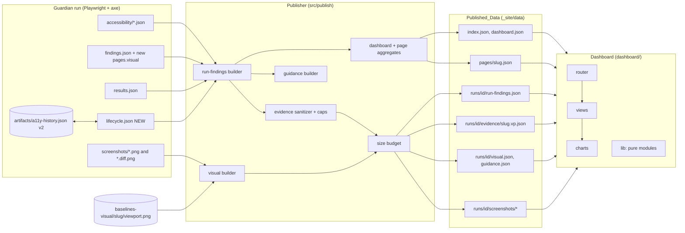
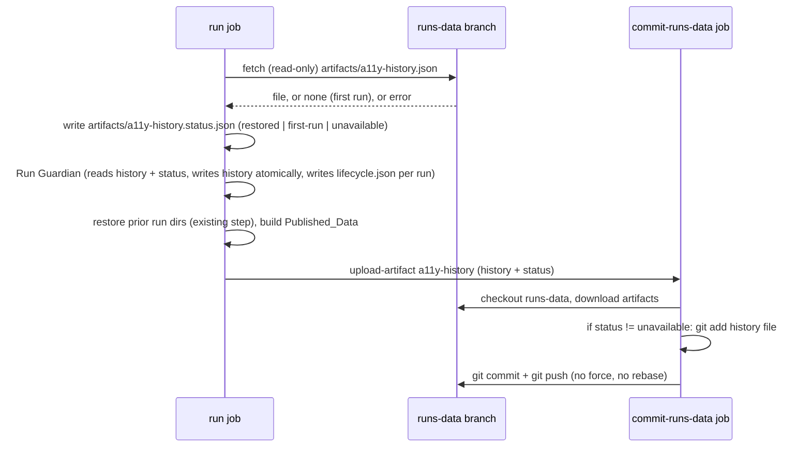

# Design Document

## Overview

This design turns the Dashboard from a list of opaque check strings into an explainable, navigable, and honest view of each run. It covers three layers, plus a fourth, local human-decision layer (Resolve / Ignore, Section I) whose effects flow through the same Publisher and Dashboard:

1. **Capture (Guardian run time).** Persist the data the Dashboard needs but the run does not keep today: the visual-difference measure, a per-run lifecycle snapshot, and an accessibility history that survives between CI runs.
2. **Publish (Publisher).** Turn raw run artifacts into a richer, sanitized, size-capped, backward-compatible Published_Data tree: one Finding per rule violation with real Impact, sanitized element evidence, baseline images, deterministic Automated_Guidance, and per-run and per-page detail files.
3. **Present (Dashboard).** A plain-JS, no-build, hash-routed app with an Overview, Run_View, Filtered_Findings_View, Page_Detail_View, Finding_Detail_View, Visual_Comparison, and an image lightbox, built to a WCAG 2.2 AA goal. Pure logic lives in small ES modules that vitest can import under Node.

### What the code review found (and how the design responds)

| Observation (from real code and data) | Design consequence |
|---|---|
| `src/core/orchestrator.ts` writes the full axe result per page and viewport to `accessibility/<slug>.<viewport>.json` (url, viewport, `violations[]` with id, impact, tags, description, help, helpUrl, `nodes[]` with html, target, failureSummary, any/all/none). Nothing publishes it. | Publisher reads these files and emits compact per-run findings plus per-page evidence files. |
| `findings.json` holds one outcome per check per viewport, e.g. `desktop:a11y-critical-serious: link-name, nested-interactive`. Moderate and minor violations never appear. The substring `critical` in the check name is why every item looks critical. | Findings are rebuilt from the raw axe data: one Finding per (page, viewport, rule). The legacy outcome is kept in `findings.json` untouched but is no longer the source of counts. |
| `src/agents/visual-compare.ts` computes `diffPixels`, `totalPixels`, `diffRatio`, and a `note`, but `orchestrator.ts` keeps `VisualResult` only in memory (`PageReport.visual`). `findings.json` and `results.json` do not contain it. **This resolves the open question from R4.3/R4.4: the difference measure is NOT recorded anywhere today.** | Two-part fix. (a) The orchestrator persists `visual` into `findings.json` (additive). (b) For existing runs, the Publisher derives the measure from the existing `*.diff.png` (see "Visual difference measure"), labelled `derived-from-diff-image`. |
| Baselines live in `baselines-visual/<slug>/<viewport>.png` (tracked in git on main). Only the current and `.diff.png` images are published. No approval date or source run is stored for a visual baseline (the `baselines/<slug>/baseline.vN.md` files are text specs, not images). | Publisher copies the baseline for pages with a difference. Provenance (`approvedAt`, `sourceRunId`) is published as `null` and the Dashboard shows "not recorded" (R4.7 says "when available"). |
| `src/agents/a11y-history-store.ts` swallows parse errors and returns `{}`. `updateHistory` increments `occurrenceCount` on every call (not idempotent) and its state machine (`reopened`, `dismissed-reappeared`) does not match R13. `analytics.ts` and `dashboard-data.ts` read the whole history as one global map, so `findingsBySeverity` counts history entries, not the run. | New pure lifecycle module and a v2 history file that stays readable by `analytics.ts` and `dashboard-data.ts` (superset of `TrackedFinding`). |
| `guardian.yml` runs the Guardian, and only afterwards restores run directories from `runs-data`. `artifacts/` is git-ignored on main, so `artifacts/a11y-history.json` is lost after every CI run. `commit-runs-data` only stages `artifacts/runs/<id>/`. | Add a history restore step **before** "Run Guardian", upload the history as a workflow artifact, and let `commit-runs-data` add it (additive, never forced). |
| `src/publish/sanitizer.ts` `sanitizeJson` composes `redact` and `stripPaths`. `redact` blanks any key matching `/(auth\|card\|session\|ssn\|...)/i` and any 32+ character `[A-Za-z0-9_]` run. | Published key names must avoid these substrings (for example never `className`, `author`, `discard`). A test enforces it. Hashes published in JSON are truncated below 32 characters. |
| `src/agents/ai-agents.ts` produces a fixed template and a made-up `confidence`; the Dashboard labels it "Large-language-model commentary". | Replace the published guidance with deterministic, specific `guidance.json` (no confidence) and relabel as "Automated guidance". The legacy functions stay exported (existing tests import them) but their output is no longer displayed. |

## Architecture

### Data flow



### CI sequence for A11y_History (run job and commit-runs-data job)



### Key design decisions

1. **Unified Finding list per run (`run-findings.json`).** One Finding per (page, viewport, rule). Three kinds: `a11y-rule` (from raw axe), `check` (failed non-accessibility deterministic checks such as `desktop:h1`), and `visual` (one per viewport with a screenshot difference). The legacy `a11y-critical-serious` outcome is replaced by its rule Findings, so nothing is double counted. This is what makes R2.9, R10.11, R11.10, R12.9, and R14.7 true by construction: every chart and KPI is computed from this one list.
2. **Compact list plus lazy evidence.** `run-findings.json` has no element snippets (about 400 bytes per Finding). Element evidence is split into `evidence/<slug>.<viewport>.json` and loaded only when a Finding or page is opened. `dashboard.json` never contains elements (R16.5).
3. **Retroactive but honest.** Because the raw axe files exist for earlier runs on `runs-data`, the Publisher rebuilds rule-level Findings and real severities for those runs. Only lifecycle (never recorded) is `not-recorded` for them. Runs with no raw axe file fall back to a legacy mode (`detailLevel: "legacy"`): one Finding per outcome, severity `not-recorded`, no inference from text (R2.8, R17.9).
4. **Lifecycle is computed once, at run time, and stored with the run.** `lifecycle.json` is written next to the run artifacts. The Publisher only joins it. This keeps R13.13 (determinism) simple and avoids replaying history at publish time.
5. **Lifecycle tracks all Finding kinds**, not only accessibility, using the key `pageUrl|viewport|ruleId` where `ruleId` is the axe id, `check:<name>`, or `visual-diff`. Without this, every non-accessibility Finding would show as "State not recorded", which would be misleading.
6. **Dashboard pure logic is separated from DOM code** (`dashboard/lib/*.js`), so vitest (Node environment, no jsdom) can test routing, filtering, grouping, counts, summaries, and captions.
7. **No `innerHTML` anywhere.** All dynamic text goes through `textContent`, enforced by a source-scan test (R3.11).
8. **Resolved is a separate series.** R12.9/R14.7 require lifecycle series to sum to the run's total Findings, but a `resolved` Finding is by definition not in the run. The chart therefore draws five present-state series (`new`, `recurring`, `existing-unresolved`, `regression`, `not-recorded`) that sum to the total of Active_Findings, plus `resolved` as a visually separate, labelled series ("resolved in this run, not part of the total"). See Open Questions.
9. **Dispositions are an overlay, not a mutation (Section I).** Detection, the A11y_History, and the raw artifacts never change because of a human decision. A pure function `applyDispositions` takes the detected Findings of a run plus the frozen set of Dispositions that apply to that run and splits them into Active_Findings, Ignored_Findings, and Regressions. Every total, chart, and list is computed from the Active set only, so "ignored findings are never counted" holds by construction, and "earlier runs never change" holds because the applied set is frozen into the run directory when the run is finalised.

## Components and Interfaces

### A. Guardian run-time changes (small, additive)

| File | Change |
|---|---|
| `src/core/orchestrator.ts` | (1) Persist `visual` per page into `findings.json` (sanitized subset of `VisualResult`: no file paths). (2) Write `trigger` marker file from `AWG_RUN_TRIGGER`. (3) After `findings.json`, `results.json`, and `accessibility/*.json` are written, call `buildRunFindingSet(runDir)` then `applyRunToHistory` and write `lifecycle.json`. (4) Replace `mergeRunIntoHistory` usage with the v2 store. Record a `migration` audit entry through `tel.audit` when a v1 history is converted (R17.10). |
| `src/agents/visual-compare.ts` | Add `baselineHash` (first 16 hex of sha256 of the baseline PNG) to `VisualResult`. No behaviour change. |
| `src/agents/a11y-lifecycle.ts` (new) | Pure lifecycle functions (below). |
| `src/agents/a11y-history-store.ts` | `loadA11yHistory` returns `{ status, history }`; parse failure is `unavailable`, not `{}`. `saveA11yHistory` writes a temp file then renames (R13.11). Add `readHistoryFindings(path)` that returns a `Record<string, TrackedFinding>` view for both v1 and v2 files; `analytics.ts` and `dashboard-data.ts` switch to it. |
| `src/core/finding-model.ts` (new) | `findingKey`, `findingId`, `buildRunFindingSet`: shared by the orchestrator and the Publisher so both agree on identity. |

### B. Publisher modules (`src/publish/`)

```ts
// src/core/finding-model.ts
export type Severity = "critical" | "serious" | "moderate" | "minor" | "unrated" | "not-recorded";
export type FindingKind = "a11y-rule" | "check" | "visual";
export type Lifecycle = "new" | "recurring" | "existing-unresolved" | "regression" | "not-recorded";
// "regression" is assigned only by the disposition overlay (Section I); the history state machine never produces it.

export interface RunFindingCore {
  kind: FindingKind;
  pageUrl: string;
  slug: string;
  viewport: "desktop" | "mobile";
  ruleId: string;            // axe id | "check:<name>" | "visual-diff"
  severity: Severity;
}
export function findingKey(f: Pick<RunFindingCore, "pageUrl" | "viewport" | "ruleId">): string; // `${pageUrl}|${viewport}|${ruleId}`
export function findingId(runId: string, key: string, kind: FindingKind): string;               // "rf_" | "cf_" | "vf_" + sha1(runId + "#" + key).slice(0, 12)

// src/publish/run-findings.ts
export interface RawRunInputs {
  runId: string;
  findings: unknown | null;            // findings.json
  results: unknown | null;             // results.json
  axe: { slug: string; viewport: string; raw: unknown | null; parseError?: string }[];
  visualFiles: { slug: string; viewport: string; hasDiff: boolean; diffPixels?: number }[];
  lifecycle: unknown | null;           // lifecycle.json
}
export function buildRunFindings(inputs: RawRunInputs, opts: { caps: PublishCaps }): BuiltRun; // pure, total, no I/O
export function loadRawRunInputs(runDir: string): RawRunInputs;                                 // thin I/O shell
```

```ts
// src/publish/evidence.ts  (pure)
export interface PublishCaps {
  maxNodesPerViolation: 10;      // R1.5
  maxHtmlChars: 500;             // R1.5
  maxTargetChars: 300;
  maxFailureSummaryChars: 600;
  maxJsonBytesPerRun: 8 * 1024 * 1024;
  maxRunBytes: 64 * 1024 * 1024;       // R1.11 / R5.8
  maxImageBytes: 8 * 1024 * 1024;
  maxGuidancePerRun: 100;
}
export function sanitizeEvidenceText(raw: unknown, maxChars: number):
  { value: string; truncated: boolean; withheld: false } | { value: "[withheld]"; truncated: false; withheld: true; reason: string };
export function buildViolationEvidence(v: AxeViolationLike, caps: PublishCaps): ViolationEvidence;
```

`sanitizeEvidenceText` order of operations (matters for safety):
1. Coerce to string; non-string becomes `""`.
2. `sanitizeJson(text)` (redact + strip paths, reused from `sanitizer.ts`). Sanitizing **before** truncating means a secret that straddles the cut point is still caught.
3. Remove control characters: `/[\u0000-\u0008\u000B\u000C\u000D\u000E-\u001F\u007F-\u009F\u2028\u2029]/g` (keeps `\n` and `\t`), collapse runs of spaces in HTML only.
4. Truncate to `maxChars` on a code point boundary; append `...` when cut and set `truncated: true`.
5. Re-scan the final string with the exported residual-path detector (`hasResidualPath` in `sanitizer.ts`, to be exported). If it still matches, or any step throws, return `{ value: "[withheld]", withheld: true, reason: "residual-path" | "sanitize-error" }` (R1.8).

Known trade-off: the POSIX rule `/(?:Users|home)/...` also matches site paths such as `href="/home/about"` and rewrites them to `[path removed]`. This over-redacts rather than leaks, which is the safe direction. It is documented in the Dashboard footnote for snippets.

```ts
// src/publish/visual.ts
export interface VisualItem { /* see Data Models */ }
export function buildVisualItems(args: {
  runDir: string; runId: string; findingsVisual: Record<string, Record<string, RecordedVisual>> | undefined;
  baselineRoot: string;           // env AWG_VISUAL_BASELINES, default "baselines-visual"
}): VisualBuildResult;
export function deriveDiffMeasure(diffPng: Buffer): { diffPixels: number; totalPixels: number; diffRatio: number };
```

```ts
// src/publish/guidance.ts  (pure)
export function buildGuidance(run: BuiltRun, visual: VisualItem[], caps: PublishCaps): { items: GuidanceItem[]; omitted: number };
export function isGenericGuidance(text: string): boolean;     // R7.5; also used by dashboard/lib/guidance.js (duplicated, cross-tested)
```

```ts
// src/publish/size-budget.ts  (pure)
export interface Candidate { path: string; bytes: number; role: "json" | "diff" | "baseline" | "current" | "evidence"; priority: number; }
export function selectWithinBudget(cands: Candidate[], caps: PublishCaps): { keep: Candidate[]; dropped: { path: string; role: string; reason: "run-cap" | "image-cap" | "image-retention" }[] };
// Image retention is applied before the budget: images of runs outside the latest N (AWG_IMAGE_RETENTION_RUNS, default 10) never become candidates.
export function runsWithImages(runsNewestFirst: { runId: string; finishedAt: string | null }[], n: number): Set<string>;   // the N most recent by finishedAt desc, then runId desc; pure
```

```ts
// src/publish/pages.ts (pure)
export function pageGroupOf(url: string): string;   // first path segment, lowercased, "(home)" when empty
export function buildPageHistory(slug: string, runs: BuiltRun[]): PageHistory;
export function buildDashboardAggregates(runs: BuiltRun[]): DashboardRunAggregate[];
```

`buildPublishedData` (in `src/publish/published-data.ts`) is extended, not rewritten: for each run it already calls `sanitizeRun` and `copyScreenshots`. New steps per run, in order: `loadRawRunInputs` -> `buildRunFindings` -> `buildVisualItems` -> `buildGuidance` -> `selectWithinBudget` -> write JSON (every object passes through `sanitizeJson` and a residual-path check; fail-closed to omission with a recorded reason) -> copy kept images. After all runs: `pages/<slug>.json`, `dashboard.json` (legacy fields corrected plus `runs[]` and `latest`), `index.json` (additive fields). `copyScreenshots` is replaced by the budget-aware copy so the cap applies to images too.

### C. Lifecycle module (`src/agents/a11y-lifecycle.ts`, pure)

```ts
export type LifecycleState = "new" | "recurring" | "existing-unresolved" | "resolved";

export interface HistoryEntry {
  // Superset of TrackedFinding so analytics.ts keeps working.
  fingerprint: string;       // equals the finding key
  ruleId: string; pageUrl: string; viewport: string;
  impact: string | null;     // axe impact or null for non-a11y kinds
  firstSeen: string; lastSeen: string;           // ISO timestamps
  occurrenceCount: number; runsSeen: string[];   // runsSeen holds run ids (deduplicated)
  state: LifecycleState;     // state as of lastProcessedRun
  lastSeenRun: string;
  resolvedRun?: string | null;
  humanDisposition?: "accepted" | "rejected" | "dismissed" | null;   // preserved if present
}
export interface HistoryV2 { schemaVersion: 2; runs: string[]; findings: Record<string, HistoryEntry>; }

export interface CurrentFinding { key: string; ruleId: string; pageUrl: string; viewport: string; impact: string | null; }
export interface RunObservation { runId: string; at: string; findings: CurrentFinding[]; scanned: { pageUrl: string; viewport: string }[]; }

export function nextState(prev: LifecycleState | undefined, present: boolean): LifecycleState | undefined;
export function applyRun(history: HistoryV2, obs: RunObservation): { history: HistoryV2; snapshot: LifecycleSnapshot };
export function migrateV1(v1: Record<string, TrackedFinding>): HistoryV2;
export function emptyHistory(): HistoryV2;
```

Transition table implemented by `nextState` (R13.4 to R13.7):

| Previous state | Present in run | Result |
|---|---|---|
| none | yes | `new` |
| `new`, `recurring`, `existing-unresolved` | yes | `recurring` |
| `resolved` | yes | `new` |
| `new`, `recurring`, `existing-unresolved` | no, and its page+viewport was scanned this run | `resolved` (reported in this run's `resolved` list) |
| `resolved` | no | stays `resolved`, not reported again |
| any | no, page+viewport **not** scanned this run | unchanged (a skipped page or failed navigation is not evidence of a fix) |

`existing-unresolved` is produced only by migration from the old history (old `existing-unresolved` entries stay as is); new runs never create it, so the chart series will normally be zero and is still drawn and labelled (R12.1).

`applyRun` is idempotent by construction: if `obs.runId` is already in `history.runs`, it returns the history unchanged and returns the snapshot previously derived (recomputed from `findings[*].state` and `runsSeen`; see test for P7). Entries and `runs` are only appended or updated; none are removed (R13.11).

`migrateV1` maps the old per-fingerprint map to per-key entries: `new`->`new`, `recurring`->`recurring`, `existing-unresolved`->`existing-unresolved`, `resolved`->`resolved`, `reopened`->`new`, `dismissed-reappeared`->`recurring`. Several old fingerprints for the same (url, viewport, rule) collapse into one entry (earliest `firstSeen`, latest `lastSeen`, union of `runsSeen`).

`LifecycleSnapshot` is what gets written to `artifacts/runs/<id>/lifecycle.json`:

```json
{
  "schemaVersion": 2,
  "runId": "run_abc",
  "historyStatus": "restored",
  "states": { "https://assurity.nz/|desktop|link-name": "recurring" },
  "resolved": [
    { "key": "https://assurity.nz/|mobile|color-contrast", "pageUrl": "https://assurity.nz/", "viewport": "mobile",
      "ruleId": "color-contrast", "severity": "serious" }
  ]
}
```

`historyStatus` values: `restored` (history file loaded and parsed), `first-run` (no history exists and none was expected), `unavailable` (restore failed or file did not parse), `not-recorded` (published for runs that have no `lifecycle.json`). When `historyStatus` is `unavailable` the orchestrator writes `states` empty, does **not** modify or create `a11y-history.json`, and the Publisher marks all Findings `not-recorded` (R13.8, R12.5). A warning event `a11y.history.unavailable` is emitted through `tel.event`.

Lifecycle and human decisions: the history state machine above records detection only and is unaffected by Dispositions. Ignoring never deletes or edits history; the `regression` label and the Ignored split are applied afterwards by the overlay in Section I.5, which also defines the state of an un-ignored Finding.

### D. CI workflow changes (`.github/workflows/guardian.yml`)

All changes are additive and keep the existing hardening (pinned actions, per-job permissions, no `${{ github.event.* }}` in `run:` scripts).

**run job, new step "Restore a11y history" placed immediately before "Run Guardian":**

```bash
set -u
mkdir -p artifacts
status="first-run"
if git fetch origin runs-data --depth=1 2>/dev/null; then
  if git cat-file -e FETCH_HEAD:artifacts/a11y-history.json 2>/dev/null; then
    if git show FETCH_HEAD:artifacts/a11y-history.json > artifacts/a11y-history.json; then
      status="restored"
    else
      rm -f artifacts/a11y-history.json; status="unavailable"
    fi
  fi
else
  git ls-remote --exit-code --heads origin runs-data >/dev/null 2>&1
  rc=$?
  if [ "$rc" -eq 2 ]; then status="first-run"; else status="unavailable"; fi
fi
printf '{"status":"%s"}\n' "$status" > artifacts/a11y-history.status.json
echo "a11y history status: $status"
```

Why before "Run Guardian": the Guardian merges the run into the history while it runs. The existing "Restore run history from runs-data" step stays **after** the run on purpose, because `applyRetention` inside the Guardian would delete restored run directories.

The Guardian step also gets `AWG_RUN_TRIGGER: ${{ github.event_name }}` (a GitHub-controlled enum value, not attacker-controlled payload data) so the Run_View can show the trigger.

**run job, new step "Upload a11y history"** after the existing raw-runs upload: `actions/upload-artifact` (same pinned SHA as the existing step) with `name: a11y-history`, `path` listing `artifacts/a11y-history.json` and `artifacts/a11y-history.status.json`, `if-no-files-found: warn`, `retention-days: 1`.

**commit-runs-data job:** after the existing "Download raw run artifacts", add "Download a11y history" (`actions/download-artifact`, same pinned SHA, `name: a11y-history`, `path: artifacts`, `continue-on-error: true`). In "Commit new run(s)", before the `git diff --cached --quiet` check, add:

```bash
if [ -f artifacts/a11y-history.json ] && ! grep -q '"status":"unavailable"' artifacts/a11y-history.status.json 2>/dev/null; then
  git add -- artifacts/a11y-history.json
fi
```

The status file is never committed. The commit and the `git push origin HEAD:runs-data` stay as they are: no `-f`, no rebase, no history rewrite. The `concurrency: guardian` group serialises workflow runs, so a non-fast-forward rejection is not expected; if it happens the job fails visibly and the next run restores the older history, which is safe because `applyRun` is keyed by run id. The early exit "No raw run artifacts to commit" must be restructured so a history-only change is still committed.

The history file lives on `runs-data` (a free GitHub feature), satisfying R13.14. Free-tier artifact use is unchanged in kind.

**run job, new step "Self-scan dashboard"** after "Add static dashboard to site": `node scripts/scan-dashboard.mjs ./_site` (see section H).

### E. Dashboard architecture (`dashboard/`)

```text
dashboard/
  index.html            shell: skip link, header, nav, <main id="view">, footer, live regions, <dialog id="lightbox">
  style.css             tokens, layout, components, focus, reduced-motion, 320px reflow
  app.js                bootstrap: data load, router wiring, render dispatch, focus/scroll handling
  data-source.js        existing resolver; adds loadPublished(relPath) (relative URLs only)
  rule-catalogue.js     Rule_Catalogue (static, human-authored)
  lib/                  PURE modules (no window/document at import time)
    route.js            parseRoute, formatRoute, normalizeRoute
    findings.js         normalizeRun, countBySeverity, countByLifecycle, filterFindings, sortFindings
    pages.js            groupOfUrl, buildPageRows, filterPages, sortPages, groupPages
    summary.js          plainEnglishSummary(finding, catalogue)
    guidance.js         isGenericGuidance, visibleGuidance(items, findingsById)
    captions.js         evidenceCaption, imageAlt
    legacy.js           normalizeLegacyRun (old runs without rule-level fields)
    severity.js         SEVERITY_ORDER, rank, label, symbol
  views/                DOM renderers (use textContent only)
    overview.js  run-view.js  filtered-findings.js  page-detail.js
    finding-detail.js  visual-comparison.js  lightbox.js  charts.js  common.js
  vendor/chart.umd.min.js   (unchanged, Chart.js 4.4.6)
```

No framework and no build step. Native ES modules are already in use (`app.js` imports `data-source.js`), and `cp -r dashboard/. ./_site/` already copies subfolders, so the CI copy step needs no change. Like today, opening from `file://` is not supported by browsers for modules; "static files with no server" (R17.8) means no Event_Server or live process, and the Pages site or any static file server works.

**Router (`lib/route.js`).** Hash routes, canonical forms:

| View | Hash |
|---|---|
| Overview | `#/` with optional `?run=<runId>&q=<text>&sev=<list>&state=<list>&has=<yes\|no>&sort=<url\|count\|severity>&dir=<asc\|desc>` |
| Run_View | `#/run/<runId>` with optional filter query |
| Filtered_Findings_View | `#/findings?run=<runId>&sev=<list>&state=<list>&group=<list>&rule=<list>&page=<slug>` |
| Page_Detail_View | `#/page/<slug>?run=<runId>` |
| Finding_Detail_View | `#/finding/<runId>/<findingId>` |
| Visual_Comparison | `#/visual/<runId>/<slug>/<viewport>` |

`parseRoute(hash)` returns a plain object; unknown parameters are ignored, invalid enum values are dropped, lists are de-duplicated and sorted, so `formatRoute(parseRoute(h))` is the canonical form of `h`. `parseRoute(formatRoute(r))` deep-equals `normalizeRoute(r)` (property P11). Path segments and values use `encodeURIComponent`.

Navigation uses `history.pushState` (not `location.hash =`) so the app controls scroll saving; a single `popstate` listener handles back, forward, and manual hash edits. Before each navigation the app calls `history.replaceState` to store `{ scrollY, focusKey }` for the current entry. `history.scrollRestoration` is set to `"manual"`; after rendering a popped entry the app restores `scrollY` and focuses the element whose `data-focus-key` equals `focusKey` (R9.8, R9.10, R9.11).

**State model (`app.js`).** One plain object:

```js
const state = {
  mode: "static",                 // from resolveDataSource()
  dashboard: null,                // dashboard.json (always loaded)
  index: null,                    // index.json
  runCache: new Map(),            // runId -> Promise<RunBundle>   (run-findings.json, lazily visual/guidance)
  evidenceCache: new Map(),       // `${runId}/${slug}.${vp}` -> Promise<Evidence>
  pageCache: new Map(),           // slug -> Promise<PageHistory>
  route: null,
  ui: { expandedGroups: new Set(), listScroll: 0, lastListHash: "#/" }
};
```

Promises are cached, so repeated navigation does not refetch and concurrent opens share one request. `RunBundle = { run, visual?, guidance? }`; `visual.json` and `guidance.json` are fetched only by views that need them.

**Lazy loading (R16).** On start the Dashboard fetches `index.json` and `dashboard.json` only. The Overview for the latest run renders from `dashboard.json.latest` (page rows with counts) without any per-run fetch. Choosing another run, opening a Run_View, a Finding, or a page triggers the matching fetch. A visible loading indicator in a `role="status"` region is shown while a fetch is pending (R16.7). Images use `loading="lazy"` and `decoding="async"` (R16.4).

**Overview (`views/overview.js`).** Run selector (a native `<select>` labelled "Run", options "date - Run_ID - N findings", newest first), KPI cards, three charts, then the page explorer.

- KPI cards (R14.3, R14.4): Health, Runs tracked, Total findings, Findings by severity (a compact group of severity buttons), Pages scanned. The old "Issues found (latest)" card duplicated "Total findings" and is removed; "Critical findings" folds into the severity group. Each card has a visible label and a `title`/`aria-describedby` definition. Cards that represent Findings are buttons that route to `#/findings?...` with the matching filter (R14.5).
- Notice (R10.7): when `selectedRunId` is not the latest, a banner states the run id and date with a "Back to latest run" button.
- Error banner (R14.6): if the latest run's data fails to load, the banner names the failed file and the Overview renders the most recent run that loaded, when one exists.

**Page explorer (`lib/pages.js`, `views/overview.js`).**

- `groupOfUrl(url)`: parse with `new URL`, take the first non-empty path segment, lowercase, `decodeURIComponent` inside try/catch; empty path gives `"(home)"`; unparseable input gives `"(other)"`. Query and fragment are ignored. Same algorithm as `pageGroupOf` in the Publisher (cross-checked by a test).
- `buildPageRows(pages)` precomputes a lowercase `searchKey` (url + title) per row once, so filtering is a linear scan over a flat array of at most a few thousand rows.
- Filters: Severity (any of the selected severities present on the page), Lifecycle state (any Finding in that state), Has findings (yes/no). Sort: URL, number of Findings, highest Severity, with direction. All composed in `filterPages(rows, {q, sev, state, has})` and `sortPages(rows, {sort, dir})`; both are pure and stable.
- Rendering (R8.10): group headers are `<button aria-expanded>` elements. Only the rows of expanded groups are created. Default: groups collapsed when there are 100 or more pages, expanded otherwise; while a search is active, groups with matches are expanded and only matching rows are created. A result count is announced through the live region. "No pages match" plus the active filters and a "Clear filters" button when empty (R8.8).
- Group header text: `name, N pages, 2 critical, 3 serious ...` plus an `aria-label` with the same sentence. Row accessible name: `url, N findings, highest severity X` (R8.11). Severity is shown as text plus a shape glyph, never colour alone.
- Search input updates the list on every `input` event, coalesced with `requestAnimationFrame` (no debounce delay), and updates the URL with `history.replaceState` so typing does not flood history; filter and sort changes use `pushState` (R8.9).

**Run_View, Filtered_Findings_View (`views/run-view.js`, `views/filtered-findings.js`).**

- Run_View shows Run_ID, date and time, trigger (`not recorded` when absent), origin, pages scanned, Finding count by Severity, change versus the previous run (`+3`, `-2`, `no change`, or "no earlier run"), and then the shared findings list with no filters (R10.3, R10.4).
- Filtered_Findings_View lists Findings with page URL, viewport, rule or check, Plain_English_Summary, and a link to the Finding_Detail_View; shows the active filters as removable chips and the count (`Showing 12 findings`); has controls to add or remove Severity, Lifecycle state, Page_Group, and rule id filters; and "No findings match these filters" with a clear button when empty (R11.3 to R11.5, R11.9). The list is a `<ul>` of `<li>` items (each item has one primary link), paged in blocks of 100 with a "Show more" button when the result exceeds 100.

**Page_Detail_View (`views/page-detail.js`).** Full-width layout (`.view` uses the full content width; no side panel). Sections in order (each an `h2`/`h3` in logical order): heading (page URL), summary (highest severity, count by severity), Findings grouped by viewport (each with Severity badge, Plain_English_Summary, link), Evidence (screenshots with Evidence_Captions, link to the Visual_Comparison when `visual.json` has an item for the page), History across runs (table: run, date, Finding count, and per-Finding lifecycle state; loaded from `pages/<slug>.json`). The old `#page-detail` aside and overlay are removed from `index.html`.

**Finding_Detail_View (`views/finding-detail.js`).** Order: heading (rule or check title), Severity badge (text), Plain_English_Summary, "What is affected" (whole page vs N elements), facts list (rule id, WCAG tags with link text such as "WCAG 2.4.4", help link opening with `rel="noopener noreferrer"`, page URL, viewport, Run_ID, run date, lifecycle state), "How to fix", "Affected elements" (each node: sanitized HTML in a `<pre><code>` set via `textContent`, CSS target, failure summary; "Showing 10 of 27 elements (17 not shown)" when `omittedNodeCount > 0`), screenshot with Evidence_Caption, "Same rule on other pages" (count of other pages with the same `ruleId` in this run and a link to `#/findings?run=..&rule=<ruleId>`), and Automated_Guidance for this Finding in its own visually distinct block. Visual Findings additionally show the baseline statement, suppression reason, difference measure, Severity text "Not rated - visual changes need human review", baseline and current provenance, and a link to the Visual_Comparison (R4).

- No element detail (`hasElementDetail: false`): shows "No element detail was recorded for this finding" and the legacy `detail` string (R3.10).
- Unknown rule: shows `description` and `help` from the data and a link; the Rule_Catalogue fallback adds no explanatory text of its own (R3.8).

**Visual_Comparison (`views/visual-comparison.js`).** Three `<figure>` elements (Approved baseline, Current run, Difference highlight) in a CSS grid: three columns when the content width allows, otherwise stacked (`grid-template-columns: repeat(auto-fit, minmax(min(100%, 22rem), 1fr))`). A toggle button group "Baseline / Current" (a `<button role="switch" aria-checked>`; Space or Enter toggles) swaps one image in place for flicker comparison (R5.5). When no baseline is published, the baseline figure is not rendered; a text paragraph says "The baseline image was not published for this run" and why (`reason` from `visual.json`) (R5.7). Each figure's `` is wrapped in a `<button>` that opens the lightbox; each figure has a `<figcaption>` from `captions.js`. Tall images scroll inside a bounded container (`max-height: 70vh; overflow: auto; tabindex="0"` with `role="region"` and an `aria-label`) (R5.10).

**Lightbox (`views/lightbox.js`).** A native `<dialog>` opened with `showModal()`: focus trapping, `Escape` to close, and inert background come from the platform. Contains the full-size image, its Evidence_Caption, and a Close button that receives initial focus. On `close`, focus returns to the opener button (stored in a variable). It is not a route, so Back does not reopen it.

**Charts (`views/charts.js`).** Chart.js options set per chart:

- `onClick: (evt, els, chart)` uses `chart.getElementsAtEventForMode(evt, "nearest", { intersect: true }, true)` and routes: trend point -> `#/run/<runId>`; severity slice -> `#/findings?run=..&sev=<severity>`; lifecycle bar segment -> `#/findings?run=..&state=<state>`. `onHover` sets `cursor: pointer` on the canvas.
- Each canvas has `role="img"` and an `aria-label` that states the same values as text ("Issues per run, 31 runs, latest 12 findings"), and a visible one-line summary paragraph.
- Each chart is followed by a `<details>` "Data table and actions" containing a real `<table>` (caption, `<th scope>`), where each row has a `<button>` or link that performs the same action as clicking the chart. This is the keyboard equivalent (R10.8, R11.7, R12.7) and the text alternative (R15.5).
- Not colour alone (R12.2, R15.4): severity slices and lifecycle series use distinct canvas pattern fills (stripes, dots, cross-hatch, solid) generated once with an offscreen canvas, and the table/legend lists label and count as text (R11.6, R12.8). The legend is an HTML list outside the canvas, not the Chart.js legend, so it is accessible and clickable.
- Reduced motion (R15.9): `Chart.defaults.animation = false` and `Chart.defaults.transitions.active.animation.duration = 0` when `matchMedia("(prefers-reduced-motion: reduce)").matches`; listener updates on change. CSS transitions are also disabled in that media query.
- Trend tooltip (R10.9): `tooltip.callbacks.title` returns the Run_ID, `label` returns date and Finding count. The trend uses `runs[]` from `dashboard.json`, one point per run; runs whose per-run data is missing (`hasRunData: false`) are drawn as hollow points and their table row says "Run data not published" with no link (R10.10).

**Plain-English summaries (`lib/summary.js`).** For `a11y-rule` Findings:

```text
{what}. {scopeSentence} {who}
```

- `what`, `who`, `fix`, and `scope` (`"page"` or `"elements"`) come from `RULE_CATALOGUE[ruleId]`.
- `scopeSentence`: `scope === "page"` -> `This affects the whole page.`; otherwise `This affects N element(s) on the page: the first is "<target>".` (target taken from evidence only if already loaded, else omitted).
- Fallback (R3.8) for an unknown `ruleId`: the summary is the published `description` followed by the published `help`, plus the scope sentence derived only from `nodeCount`. No invented text.
- `check` Findings: `The "<name>" check failed on <viewport>: <published detail>.` `visual` Findings: `The <viewport> screenshot differs from the approved baseline.` (+ measure when known).

**Evidence captions (`lib/captions.js`).** `evidenceCaption({ role, pageUrl, viewport, runId, runFinishedAt })` returns text such as `Current run - https://assurity.nz/ - desktop - run_abc - 27 Oct 2026 08:15 - full-page capture at the desktop viewport`. Missing run id or date renders the literal `Run not recorded` for that field (R6.6). Diff role adds `Highlighted areas are pixel differences from the approved baseline; red pixels are changes, yellow pixels are anti-aliasing differences that were ignored, and faded grey is unchanged content.` `imageAlt` returns the same facts in one sentence (R6.5, R5.9).

**Automated guidance (`lib/guidance.js`, section in Overview and Finding_Detail_View).** Items come from `guidance.json`. `visibleGuidance(items, findingsById)` drops any item whose `findingId` is not a Finding in the run (R7.8), any item for which `isGenericGuidance(text)` is true (R7.5), and ignores any `confidence` field if present (R7.9). The panel heading is "Automated guidance"; its subtitle is "Generated by fixed rules from the test results above. Not a test result and not produced by an AI model." Items render as a list: page, problem, Severity (text), reviewer decision (when any), and links to the Finding_Detail_View and related evidence (R7.3, R7.4, R7.10). The panel uses a dashed border and a distinct background and is never styled like a deterministic fact (R7.6). The old `assertAi()` fail-closed check is replaced by a check that every rendered guidance node carries `data-guidance="true"` and the "Automated guidance" label.

**Accessibility approach (R15).**

- Landmarks: skip link to `#view`; `<header>`, `<nav aria-label="Primary">` (Overview, Findings), `<main id="view" tabindex="-1">`, `<footer>`. One `h1` (product name); each view has one `h2`; subsections `h3`; no skipped levels.
- Live regions: `#sr-status` (`role="status"`, polite) announces view changes ("Finding detail: link-name on https://assurity.nz/, desktop"), result counts ("23 pages match"), and loading; `#sr-alert` (`role="alert"`) announces load errors. Announcements are set after the view is rendered.
- Focus: after a route change the view heading gets `tabindex="-1"` and `.focus()` (R9.10); when only filter/search parameters changed within the same view, focus stays where it is. The opener is remembered through `focusKey` (R9.10, R9.11).
- Controls: every input has a `<label>`; filters are in `<fieldset><legend>`; sort is a `<select>`; toggles use `aria-pressed`/`aria-expanded`; no `tabindex` greater than 0.
- Targets (R15.8): `min-height: 24px; min-width: 24px` for every interactive element, and rows are at least 40px tall.
- Focus indicator (R15.2): `:focus-visible { outline: 3px solid #93c5fd; outline-offset: 2px; }` (about 8.9:1 against `#141b27`); never `outline: none` without replacement.
- Contrast (R15.3): tokens revised where needed (for example muted text for `minor` is lightened from `#64748b`, which is about 3.6:1 on `--surface`, to `#94a3b8`). A unit test parses `style.css` custom properties and asserts the ratio of each declared foreground/background pair (4.5:1 text, 3:1 large text and UI components).
- Reflow and zoom (R15.10): single-column layout below 40rem; `overflow-wrap: anywhere` on URLs and code; tables inside `div[role="region"][tabindex="0"][aria-label]` with `overflow-x: auto`; font sizes in `rem`; no fixed heights on text containers.
- Honest claim (R15.12): the footer states "Accessibility is a goal for this Dashboard (WCAG 2.2 AA). Automated checks cannot confirm conformance; manual testing with assistive technologies is still required."

### F. Rule_Catalogue (`dashboard/rule-catalogue.js`)

Static, human-authored ES module, loaded eagerly (about 25 KB). One entry per axe rule id:

```js
export const RULE_CATALOGUE = {
  "link-name": {
    scope: "elements",
    what: "Some links have no text that a screen reader can announce",
    who: "People who use screen readers hear only the word 'link' with no destination, and voice-control users cannot say the link name.",
    fix: "Give each link visible text, or add an aria-label or an image with alt text that describes where the link goes.",
    wcag: ["2.4.4", "4.1.2"]
  },
  "color-contrast": {
    scope: "elements",
    what: "Some text does not have enough contrast with its background",
    who: "People with low vision or colour-vision differences, and anyone reading in bright light, may not be able to read it.",
    fix: "Darken the text or lighten the background until the contrast ratio is at least 4.5:1 (3:1 for large text).",
    wcag: ["1.4.3"]
  },
  "button-name": { scope: "elements", /* ... */ },
  "nested-interactive": { scope: "elements", /* ... */ },
  "document-title": { scope: "page", /* ... */ }
};
export const FALLBACK_NOTE = "No curated explanation exists for this rule. The description and help text below come from the accessibility test engine.";
```

Initial coverage (authored in the implementation task): the four rules present in published data (`link-name`, `nested-interactive`, `button-name`, `color-contrast`) and the common axe rules `image-alt`, `label`, `document-title`, `html-has-lang`, `html-lang-valid`, `heading-order`, `empty-heading`, `page-has-heading-one`, `region`, `landmark-one-main`, `landmark-unique`, `bypass`, `aria-allowed-attr`, `aria-required-children`, `aria-required-parent`, `aria-valid-attr-value`, `aria-roles`, `aria-hidden-focus`, `duplicate-id-aria`, `frame-title`, `list`, `listitem`, `meta-viewport`, `tabindex`, `target-size`, `scrollable-region-focusable`, `select-name`, `link-in-text-block`, `autocomplete-valid`. Ids not in the catalogue use the fallback (R3.8).

Authoring rules, enforced by `tests/unit/rule-catalogue.test.ts`: ASCII only; every field non-empty; `what`/`who`/`fix` do not start with a bare pronoun (`It`, `They`, `This`, `These`) and contain no unresolved `{placeholder}` (R3.14); `what` shares at least one significant word with the axe `help` text for that rule where a fixture of help strings is available; `scope` is `page` or `elements`.

### G. Automated guidance rules (`src/publish/guidance.ts`)

Deterministic templates keyed by Finding kind and severity. Examples (the exact wording is final in the implementation task):

| Kind | Template (title / text / reviewerDecision) |
|---|---|
| `a11y-rule` with severity critical or serious | `Fix "{help}" on {pageUrl}` / `On {pageUrl} ({viewport}), the rule "{ruleId}" failed on {nodeCount} element(s) and has {severity} impact. {fixHint}` / `Confirm the fix on the listed elements and re-run the check.` |
| `a11y-rule` moderate or minor | Same text; no guidance item is created when `maxGuidancePerRun` would be exceeded (critical and serious are kept first). |
| `check` | `The "{checkName}" check failed on {pageUrl} ({viewport}): {detail}.` / `Decide whether the page content is intended.` |
| `visual` | `The {viewport} screenshot of {pageUrl} differs from the approved baseline ({measure}).` / reviewer decision: `Decide whether this visual change is intended. If it is, approve a new baseline; if it is not, investigate the change.` Suppressed variant adds `A failing rule ({ids}) on this page also needs attention.` |

`fixHint` is the first sentence of the axe `help` text (published data), never invented. Each item carries `findingId`, `pageUrl`, `checkId`, `severity` (R7.7), a stable `guidanceId`, and `label: "Automated guidance"`, `generatedBy: "fixed-rules"`. There is no `confidence`. Items are sorted by severity rank then page URL then rule id, and capped at `maxGuidancePerRun` with the omitted count published.

`src/agents/ai-agents.ts` is not deleted: `tests/property/classification.test.ts` imports it, and the Virtual Office telemetry is out of scope. It is no longer a data source for anything the Dashboard displays.

### H. Dashboard self-scan (R15.11)

The Guardian scans only the Approved_Domain, so the Dashboard cannot be scanned as a "site page". Instead a separate script, `scripts/scan-dashboard.mjs`, serves the built `_site` from a tiny Node `http` server bound to `127.0.0.1` (no new dependency), opens the Overview, a Run_View, a Page_Detail_View, a Finding_Detail_View, and the Visual_Comparison with Playwright, runs `@axe-core/playwright` (already a dependency) with the same tags (`wcag2a`, `wcag2aa`, `wcag22aa`), and writes `_site/data/self-scan.json`:

```json
{
  "schemaVersion": 2,
  "scannedAt": "2026-10-27T08:20:00.000Z",
  "routes": [
    { "route": "#/", "violations": [ { "ruleId": "color-contrast", "impact": "serious", "nodeCount": 2 } ] }
  ],
  "totals": { "critical": 0, "serious": 1, "moderate": 0, "minor": 0 },
  "note": "Automated scan of the Dashboard. This is not a conformance claim."
}
```

It also appends a table to `$GITHUB_STEP_SUMMARY` and exits 0 (non-blocking; see Open Questions). The Dashboard footer reads `self-scan.json` and shows "Dashboard self-check: N critical or serious issues found by automated scan" as a Finding-style notice, separate from the site totals so R2.9 stays true. The script only talks to loopback; it does not go through the SiteGateway because it is not observing a site. This exemption is documented in the script header, and the Approved_Domain restriction for site scans is untouched (R17.11).

### I. Human Resolve / Ignore decisions (Requirements 18, 19, 20)

#### I.1 Flow and boundaries

```mermaid
flowchart LR
  subgraph LOCAL["Local machine (loopback only)"]
    GUI[Admin GUI 127.0.0.1:7787]
    CLI[CLI approve]
    GATE[Approval_Gate + audit log]
    LOG[(artifacts/dispositions.json)]
    SYNC[disposition-sync: pull + push]
    GUI --> GATE
    CLI --> GATE
    GATE --> LOG
    GUI --> SYNC
    SYNC <--> LOG
  end
  RD[(runs-data: artifacts/dispositions.json)]
  SYNC <-->|fetch / additive push, no force| RD
  subgraph CI["CI run job"]
    RS[Restore dispositions before Run Guardian]
    G[Guardian: freeze dispositions-applied.json per run]
    P[Publisher: applyDispositions overlay]
  end
  RD --> RS --> G --> P
  P --> PD[Published_Data: findings (active), ignored, decisions]
  PD --> DASH[Dashboard: read-only, shows Ignored list, regressions, annotations]
```

The public Dashboard and Pages site have no path back to the log: no form, no POST, no link to the Admin GUI, no GitHub-issue route. Decisions enter only through the local Admin GUI (or the CLI) and reach the cloud only through the Reviewer's own git push to `runs-data`.

#### I.2 Pure disposition module (`src/core/dispositions.ts`)

Shared by the Guardian, Publisher, Admin GUI, and CLI. No I/O, no clock, no randomness.

```ts
export type DispositionDecision = "ignore" | "resolve" | "unignore";
export type DispositionScope = "element" | "page-rule" | "site-rule" | "finding" | "undo";
// ignore -> element | page-rule | site-rule ; resolve -> finding ; unignore -> undo

export interface Matcher { pageUrl: string; viewport: "desktop" | "mobile" | ""; ruleId: string; cssTarget: string }

export interface DispositionEntry {
  id: string;                 // "dsp_" + first 16 hex of sha256(canonical JSON of all other fields)
  decision: DispositionDecision;
  scope: DispositionScope;
  matcher: Matcher;           // canonical per scope (see I.4); all-empty strings for "undo"
  reason: string;             // 1..500 chars after trim
  reviewer: string;           // 1..80 chars after trim
  at: string;                 // ISO-8601 UTC with milliseconds, set by the Admin GUI server, never by the client
  undoes: string | null;      // id of the ignore entry undone; null otherwise
  source: "admin-gui" | "cli";
}
export interface DispositionLog { schemaVersion: 1; entries: DispositionEntry[] }

export function normalizePageUrl(url: string): string;
export function canonicalMatcher(decision: DispositionDecision, scope: DispositionScope, raw: Partial<Matcher>): Matcher;
export function entryId(e: Omit<DispositionEntry, "id">): string;
export function validateNewEntry(input: unknown, existing: DispositionEntry[], now: Date):
  { ok: true; entry: DispositionEntry } | { ok: false; errors: { field: string; message: string }[] };
export function parseLog(text: string): { log: DispositionLog; rejected: { index: number; reason: string }[] };
export function serializeLog(log: DispositionLog): string;       // stable order (at, id); non-ASCII escaped as \uXXXX; trailing newline
export function mergeLogs(a: DispositionLog, b: DispositionLog): DispositionLog;   // union by id
export function effectiveEntries(log: DispositionLog, runFinishedAt: string): DispositionEntry[];  // Effective_From, see I.3
export function applyDispositions(detected: DetectedFinding[], effective: DispositionEntry[]): DispositionOutcome;
```

`validateNewEntry` rules: `decision`/`scope` pairing as above; `reason` and `reviewer` trimmed, non-empty, within limits (R18.4 to R18.6); control characters removed; for `unignore`, `undoes` must name an existing `ignore` entry that is not already undone and whose `at` is earlier than `now` (R18.11); matcher fields normalised by `canonicalMatcher`; an entry whose computed id already exists is reported as a duplicate (the API treats it as an idempotent success). `parseLog` recomputes every id and rejects any entry whose id does not match its content (R20.2), reports it in `rejected`, and never applies it.

#### I.3 Effective_From: which runs a decision applies to

A single deterministic rule (R19.1): **a Disposition applies to a run if and only if `Date.parse(entry.at) < Date.parse(run.finishedAt)` and the entry was in the Disposition_Log snapshot the Guardian read when it finalised that run.**

- The Guardian reads the log once, at run finalisation (after `lifecycle.json`), calls `effectiveEntries(log, finishedAt)`, and writes the result to `artifacts/runs/<id>/dispositions-applied.json` (I.6). From then on the run's applied set is fixed.
- The Publisher never re-evaluates the live log. It reads the frozen file of each run. Republishing an old run after new decisions were made therefore yields byte-identical counts (R19.2, R19.3).
- In CI the log is restored before the run starts, so a decision pushed while a CI run is in progress is not in that run's snapshot and takes effect from the next run. A run with no frozen file (a run from before this feature, or a restored raw run that predates it) has status `not-applicable` and applies nothing.
- `unignore` and `resolve` follow the same rule. An `unignore` stops an `ignore` from applying only in runs where the `unignore` itself applies; earlier runs keep the ignore (R19.12).

Consequence stated in the Admin GUI after each decision (R18.12): "This decision takes effect from the next run. Earlier runs keep their original counts." Because decisions never change the latest already-published run, the Dashboard will not change until the next run finishes. This is the intended "from the decision onward" behaviour; see Open Questions.

#### I.4 Matcher

`normalizePageUrl`: parse with `new URL`; lowercase scheme and host; drop the default port, the fragment, and a trailing slash on non-root paths; keep the query string; unparseable input is returned trimmed and unchanged. The same function is applied to the entry matcher and to the Finding's `pageUrl` before comparison.

| Scope | Canonical matcher stored | Matches a detected Finding or node when |
|---|---|---|
| `element` | `pageUrl`, `viewport`, `ruleId`, `cssTarget` all set | normalised page, viewport, and rule id are equal, and (for kinds with elements) the node's CSS target string is equal; for kinds without elements (`check`, `visual`, `legacy-outcome`) `cssTarget` is `""` and the whole Finding matches |
| `page-rule` | `pageUrl`, `ruleId`; `viewport = ""`, `cssTarget = ""` | normalised page and rule id are equal, any viewport |
| `site-rule` | `ruleId`; `pageUrl = ""`, `viewport = ""`, `cssTarget = ""` | rule id is equal on any page and viewport |
| `finding` (resolve) | `pageUrl`, `viewport`, `ruleId`; `cssTarget = ""` | normalised page, viewport, and rule id are equal |

CSS target string: the same string the evidence publishes (iframe and shadow-DOM arrays joined with ` >> `), taken from the raw axe nodes, all of them and not only the 10 that are published. Documented consequence (R19.17): if the page markup changes so an element gets a different CSS target, an `element` ignore no longer matches and the issue is flagged again. `page-rule` and `site-rule` do not depend on the CSS target and survive markup changes.

Element accounting (R19.15, R19.16): for an `a11y-rule` Finding with n raw nodes, let M be the nodes matched by active `element` ignores. If a `page-rule` or `site-rule` ignore matches the Finding, it is ignored as a whole. Otherwise, if n > 0 and |M| = n, the Finding is ignored (scope `element`). Otherwise the Finding stays active with `ignoredNodeCount = |M|`, its `nodeCount` is reduced to n - |M|, and the evidence file is built from the remaining nodes so the published 10-node cap applies to nodes that are still active.

Precedence (R19.19): an active (not undone, applicable) `ignore` always wins over a `resolve` for the same Finding. An `unignore` removes exactly the entry it names; other matching ignores still apply.

#### I.5 Overlay, lifecycle, and un-ignore semantics

```ts
export interface DetectedFinding extends RunFindingCore {
  id: string; lifecycle: Lifecycle;                 // lifecycle from lifecycle.json: detection only
  nodeTargets: string[];                            // all raw axe node targets; [] for kinds without elements
}
export interface DispositionOutcome {
  active: (DetectedFinding & { ignoredNodeCount: number; regression: RegressionInfo | null })[];
  ignored: (DetectedFinding & { disposition: AppliedDisposition })[];
  resolved: ResolvedItem[];          // lifecycle `resolved` items of the run minus those matched by an applicable ignore
  newlyEffective: { id: string; decision: DispositionDecision; scope: DispositionScope; findingsAffected: number }[]; // filled by the Publisher against the previous run
}
```

Rules, applied in this order for each detected Finding:

1. Ignore test (I.4). Ignored Findings go to `ignored[]` with a `disposition` object (decision id, scope, reason, reviewer, `at`). They get no lifecycle bucket and appear in no count.
2. Regression test. If the Finding is active and an applicable `resolve` matches its (page, viewport, rule), its lifecycle is set to `regression` and `regression = { decisionId, at, reviewer, reason }` of the latest applicable `resolve` (latest by `at`, ties broken by id). The Finding stays active and is counted (R19.9). A Finding that is detected in a run and has an applicable `resolve` stays `regression` in later runs until the Reviewer acts again (a new `resolve` updates the date and reviewer; an `ignore` suppresses it).
3. Otherwise the lifecycle is the detection lifecycle unchanged.

Resolved items of the run (R19.11): lifecycle `resolved` items whose key matches an applicable `ignore` are removed from `resolved` (an ignored issue that disappears is not reported as resolved). Items matching an applicable `resolve` carry `humanResolved = { decisionId, at, reviewer }` so the Dashboard can say "Marked resolved by <reviewer> on <date>".

History and un-ignore (R19.13, R19.14): the A11y_History keeps recording detection of Ignored Findings, so ignoring deletes nothing. When an `unignore` applies to a run, the Finding becomes active with the lifecycle that the history recorded for that run, which follows the normal transition table: `recurring` if it was present in the preceding run (even though it was ignored then), `new` if it was absent (or resolved) in the preceding run, and `not-recorded` if history was unavailable. No earlier run is recounted.

#### I.6 Publisher output

New per-run raw artifact (written by the Guardian, kept on `runs-data` with the run directory): `artifacts/runs/<id>/dispositions-applied.json`

```json
{
  "schemaVersion": 1,
  "runId": "run_abc",
  "finishedAt": "2026-10-27T08:20:11.000Z",
  "status": "applied",
  "logDigest": "9f2c61d04ab37e18",
  "entries": [
    { "id": "dsp_5c2a91e07b44d6f1", "decision": "ignore", "scope": "page-rule",
      "matcher": { "pageUrl": "https://assurity.nz/", "viewport": "", "ruleId": "color-contrast", "cssTarget": "" },
      "reason": "Brand colour approved by design; contrast exception accepted", "reviewer": "S. Nair",
      "at": "2026-10-26T21:04:09.113Z", "undoes": null, "source": "admin-gui" }
  ]
}
```

`status` is `applied` (log read; `entries` may be empty), `unavailable` (log could not be read or parsed; `entries` empty), or the file is absent (`not-applicable`). `logDigest` is the first 16 hex characters of the sha256 of the serialised log (for diagnostics only; below the redactor's 32-character threshold).

Published `run-findings.json` additions (see the example in Data Models): `findings[]` contains Active_Findings only (so no consumer can count an ignored Finding by accident); `ignored[]` contains Ignored_Findings with the same fields plus `disposition`; each active Finding carries `ignoredNodeCount` (0 unless partly ignored) and, for regressions, `regression`. `totals.all`, `bySeverity`, `byLifecycle`, `pages[].counts`, `dashboard.json runs[]`, `pages/<slug>.json`, and guidance are all computed from `findings[]` only. `totals.ignored` and `totals.detected` complete the invariant `all + ignored = detected`. `decisions` records `status` (`applied`, `unavailable`, `not-applicable`), `appliedCount`, `newThisRun`, and counts `ignoredNewThisRun`, `unignoredNewThisRun`, `resolvedNewThisRun`.

`newThisRun` is computed by the Publisher by comparing the run's applied entry ids with those of the previous published run (by `finishedAt`; a previous run with no frozen file counts as the empty set); `ignoredNewThisRun` is the number of Ignored_Findings of this run whose key was not an Ignored_Finding in the previous run. These feed the trend annotation "12 issues ignored from this run".

Reviewer names and reasons are untrusted free text: they pass through `sanitizeJson`, the control-character filter, and the residual-path check like evidence text (a value that cannot be confirmed clean is published as `"[withheld]"` with a recorded reason). They are public once published, and the Admin GUI says so next to the input fields (R20.12, R20.13).

#### I.7 Admin GUI, endpoints, Approval_Gate, CLI

`src/admin/admin-server.ts` (loopback `127.0.0.1:7787`, unchanged bind) gets these additions. Handlers stay thin and delegate to `src/admin/dispositions-api.ts` (testable without sockets).

| Endpoint | Behaviour |
|---|---|
| `GET /api/findings?run=<id\|latest>` | Reads the raw artifacts of a local run (`loadRawRunInputs` + `buildRunFindings`) and the current log. Returns each detected Finding with id, kind, page, viewport, rule, severity, title, node count, up to 50 sanitized node targets (for choosing an element), and a `status` of `active`, `ignored`, or `decision-pending` (a recorded decision that has not yet taken effect on a run). Also returns, for each possible scope, how many Findings it would match. Paths are run-relative; no absolute path leaves the server. |
| `GET /api/dispositions` | All log entries with derived flags: `undone`, `syncState` (`synced` or `not-yet-synced`), and the sync status. |
| `POST /api/dispositions` | Body `{ decision, scope, pageUrl, viewport, ruleId, cssTarget, reason, reviewer, undoes }`. Order: local-request guard, body size limit (8 KB), `validateNewEntry`, `ApprovalGate.disposeFinding` (human check and audit), append to the local log. The server sets `at` and the id. Responses: 201 with the entry and `effectiveFrom: "next-run"`; 200 for an exact duplicate (idempotent); 400 with per-field errors; 403 for guard or gate rejection; 409 when a log write conflicts; 500 on write failure (an audit line records the failure). |
| `POST /api/dispositions/sync` | Starts the push path (I.8). 202; 409 if a push is running. |
| `GET /api/dispositions/sync/status` | `idle`, `running`, or `done` with `pushed`, `pendingIds`, and `reason`. |
| `POST /api/sync` (existing, pull-only today) | Unchanged for run data. After `cloudSync` it also runs `pullDispositions`, which merges the remote `artifacts/dispositions.json` into the local log as a union. Still read-only toward the remote. |

Approval_Gate integration: `ApprovalGate.disposeFinding` is used as it exists (it rejects empty reviewers and agent identities with `SelfApprovalError`, and audits). Decision kinds map as `ignore -> "dismissed"`, `resolve -> "accepted"`, `unignore -> "rejected"` (rejecting the earlier dismissal), with `findingId = "disposition:" + entry.id`. One small additive change: `disposeFinding` accepts an optional `detail` object (scope, matcher, `undoes`) that is copied into the audit entry so the audit log carries what was decided; callers that do not pass `detail` behave as today. A gate rejection stops the flow before the log is touched (R18.10).

CLI: `src/index.ts approve` gains `--decision ignore|resolve|unignore`, `--scope element|page-rule|site-rule`, `--page`, `--viewport`, `--rule`, `--target`, `--undoes`, with the existing `--reviewer` and `--reason`. It builds the same input, calls the same `dispositions-api` function, and prints the entry id (R18.14). Existing `accepted|rejected|dismissed` usage for specification drafts is unchanged: the new decision names are distinct and are routed to the disposition path.

Admin GUI page (extends the existing control page): a "Findings" panel lists the local run's Findings grouped by page; each row has "Mark resolved" and "Ignore" buttons that open a form (native `<dialog>`) with: scope radio group (element / this rule on this page / this rule on every page; element lists the node targets), live "matches N findings" text, required Reason (max 500) and Reviewer (max 80, remembered in `localStorage` for convenience), the notice "Reason and reviewer name are published on the public Dashboard", and the consequence text "Takes effect from the next run". A "Decisions" panel lists every entry (including undone) with an "Un-ignore" button for active ignores and a sync column showing "Synced" or "Not yet synced" with a "Sync now" / "Retry" button. All dynamic text is set with `textContent`; the page is keyboard operable and labelled like the Dashboard.

Local-request guard (R20.10, R20.11). The existing admin server binds to loopback but, from the code reviewed (`handleRequest` in `src/admin/admin-server.ts`), performs no Host or Origin check on any route, so a web page open in the Reviewer's browser could post to `127.0.0.1:7787` (cross-site request) or reach it through DNS rebinding. A pure function `checkLocalRequest({ host, origin, contentType, secFetchSite }, port)` is added and applied to every new state-changing route:

- `Host` must equal `127.0.0.1:<port>` or `localhost:<port>` (defeats DNS rebinding).
- If `Origin` is present it must equal `http://127.0.0.1:<port>` or `http://localhost:<port>`; `Origin: null` is rejected. A missing `Origin` is allowed (non-browser local tools), but `Sec-Fetch-Site: cross-site` or `same-site` is rejected.
- `Content-Type` must be `application/json` (a cross-origin form post cannot send it without a preflight, and the server sends no `Access-Control-*` headers, so the preflight fails).
- Failure returns 403 with no detail and records nothing.

The guard is applied to the new POST routes. Applying it to the existing POST routes (`/api/schedule`, `/api/run`, `/api/open/*`, `/api/sync`) is a one-line change per route and is recommended (see Open Questions) but is beyond this feature's scope.

#### I.8 Persistence, push path, and CI

Local file: `artifacts/dispositions.json` (git-ignored on `main`, like the rest of `artifacts/`), written by `writeLogAtomic` (temp file then rename) inside a read-merge-write step so a concurrent CLI and GUI write cannot lose an entry. Local sync bookkeeping: `artifacts/dispositions.sync.json` with `syncedIds` and `lastSyncedAt`; "Not yet synced" is every local id not in `syncedIds`.

Push path (`src/admin/disposition-sync.ts`, alongside the existing pull-only `cloudSync`; the Reviewer's own git credentials and identity are used, and no git config is changed):

1. `git fetch origin runs-data`. Failure (offline, no auth) ends with "Not yet synced" and a reason; nothing local is lost.
2. Create a temporary detached worktree of the fetched tip in the OS temp directory (`git worktree add --detach <tmp> FETCH_HEAD`). The Reviewer's current branch, index, and working tree are never touched.
3. In the worktree read `artifacts/dispositions.json` if present, `mergeLogs(remote, local)`, and `serializeLog`. If the result equals the remote file, mark everything synced and stop.
4. Write the file, `git add -- artifacts/dispositions.json`, and commit with message `dispositions: add N entries` (the commit is additive on top of the remote tip).
5. `git push origin HEAD:refs/heads/runs-data` with no force flag. If the push is rejected as non-fast-forward (CI pushed run data meanwhile), discard the worktree and repeat from step 1; the commit is re-created on the new tip from the union, not rebased and not forced. At most 3 attempts.
6. Always remove the temporary worktree it created (`git worktree remove` on that temp path, then `git worktree prune`).
7. On success merge the remote result back into the local log, record `syncedIds`, report "Synced". On any failure keep the local log, report "Not yet synced" with the reason, and leave the Retry button.

CI (`guardian.yml`), additive and keeping the existing hardening:

- **run job, new step "Restore dispositions"** immediately before "Run Guardian", same pattern as "Restore a11y history": `git fetch origin runs-data --depth=1`, then `git show FETCH_HEAD:artifacts/dispositions.json > artifacts/dispositions.json` if the path exists, validate that it parses as JSON with `schemaVersion` 1 (`node -e` one-liner, no new dependency), and write `artifacts/dispositions.status.json` with `restored`, `first-run` (branch or file absent), or `unavailable` (fetch failed or file invalid; the invalid file is removed from the workspace, never from `runs-data`).
- The Guardian reads `artifacts/dispositions.json` and the status file at finalisation and writes `dispositions-applied.json` with status `applied` or `unavailable` (R20.9). The Publisher then applies the frozen set. With status `unavailable` the Dashboard shows the notice in R19.22.
- **commit-runs-data**: the job never writes, regenerates, or stages `artifacts/dispositions.json` (CI only reads the log; it creates no entries). Its `git add` lines stay explicit paths (`artifacts/runs/<id>/` and the a11y history), so a log pushed by the Reviewer is neither overwritten nor dropped. To avoid losing a CI commit when the Reviewer pushed in between, the push step becomes: push; if rejected, `git fetch origin runs-data`, `git merge --no-edit FETCH_HEAD`, push again, at most 3 attempts. This is a merge commit, never `--force`, never a rebase. The merge is clean because CI and the Reviewer change disjoint paths.
- Merge safety of the log file itself is by construction: only the Admin GUI push path writes it, always as the union with the remote file (commutative and idempotent), and it never deletes entries.

#### I.9 Dashboard changes

The Dashboard stays static and read-only. It only reads fields the Publisher wrote.

- **Overview**: KPI cards count Active_Findings. A new "Ignored" card shows `totals.ignored` for the selected run and links to `#/findings?run=<id>&scope=ignored`. The severity and lifecycle charts, page rows, Page_Group counts, and "same rule on other pages" counts use Active_Findings only. Page rows show "(+N ignored)" as text beside the count when N > 0; this text is not part of any count.
- **Route**: `scope=active|ignored` (default `active`) is added to the Filtered_Findings_View and to the canonical route form (R19.8). `#/findings?...&scope=ignored` is the Ignored list. Round-trip behaviour (P13) is extended to include `scope`.
- **Ignored list** (`views/filtered-findings.js`, scope `ignored`): items are grouped by decision. Each group shows the scope in words ("This element only", "This rule on this page, all viewports", "This rule on every page"), the reason, "Ignored by <reviewer> on <date>", the decision id, and the Findings it covers (rule, page, viewport, with link to the Finding_Detail_View, which still loads because evidence is kept). Site-wide groups show the number of pages matched in this run. Reason and reviewer are set with `textContent`.
- **Finding_Detail_View**: an ignored Finding shows the banner "Ignored by <reviewer> on <date>. Reason: <reason>. Scope: <scope>." A Regression shows the label "Reappeared after being marked resolved on <date> by <reviewer>" with its original reason, in a distinct block with the text prefix "Regression:" and a symbol, never colour alone (R19.23). A partly ignored Finding shows "N elements ignored".
- **Lifecycle chart**: a fifth present-state series `regression` with its own pattern, label, legend entry, and table row; the separate `resolved` series is unchanged. Resolved items carry the "Marked resolved by <reviewer> on <date>" note when `humanResolved` is set.
- **Trend chart** (`views/charts.js`): runs whose `decisions` show new effects use a larger triangle point style, and the tooltip, the run table, and a visible line under the chart show the effect text from the pure `decisionEffectText(decisions)`, for example "12 issues ignored from this run" (R10.12, R19.21). A drop in the Active count at such a run is therefore explained on screen. If `decisions.status` is `unavailable` the run row shows the notice from R19.22.
- **Honesty and privacy**: the footer states "Ignored issues are listed on the Ignored page. Reasons and reviewer names are published as entered."
- **Image retention** (`lib/captions.js`): `imageUnavailableText(reason, retentionRuns)` returns "Images not kept for this run (only the latest 10 runs keep images)" for `image-retention` and the existing wording for other reasons; every place that would render an image calls it when the path is `null`.
- **Legacy data**: runs without `ignored`, `decisions`, or `hasImages` are treated as 0 ignored, status `not-applicable`, and images as published if the path exists.

## Data Models

All new JSON files carry `"schemaVersion": 2`. Every file is written with `JSON.stringify(x, null, 2)`, and every published structure passes `sanitizeJson` and a residual-path check before writing. Key names avoid the redactor's sensitive substrings (see Overview); a test checks this.

### Raw artifact additions (inside `artifacts/runs/<id>/`)

`findings.json` gains `pages[].visual` (additive; existing fields untouched):

```json
{
  "page": "https://assurity.nz/", "slug": "assurity-nz", "outcomes": [ "..." ], "aiItems": [ "..." ],
  "visual": {
    "desktop": { "differs": true, "diffPixels": 18423, "totalPixels": 3780000, "diffRatio": 0.004874,
                 "dimensionsChanged": false, "baselineHash": "3fa91c0d2b7e44aa",
                 "note": "Visual difference detected (18423 px, 0.487%). Requires human review; run is NOT auto-failed on pixel percentage." },
    "mobile":  { "differs": false, "diffPixels": 0, "totalPixels": 1200000, "diffRatio": 0, "dimensionsChanged": false,
                 "baselineHash": "a1b2c3d4e5f60718", "note": "No visual difference." }
  }
}
```

`lifecycle.json`: see the Lifecycle module section. `trigger`: a one-line text file (`schedule`, `workflow_dispatch`, `manual`, or `local`), read like the existing `origin` marker.

`artifacts/a11y-history.json` (v2) and `artifacts/a11y-history.status.json`:

```json
{ "schemaVersion": 2,
  "runs": ["run_a", "run_b"],
  "findings": {
    "https://assurity.nz/|desktop|link-name": {
      "fingerprint": "https://assurity.nz/|desktop|link-name",
      "ruleId": "link-name", "pageUrl": "https://assurity.nz/", "viewport": "desktop", "impact": "serious",
      "firstSeen": "2026-10-23T05:58:42.934Z", "lastSeen": "2026-10-27T08:15:40.000Z",
      "occurrenceCount": 2, "runsSeen": ["run_a", "run_b"], "state": "recurring",
      "lastSeenRun": "run_b", "resolvedRun": null, "humanDisposition": null } } }
```
```json
{ "status": "restored" }
```

### Published_Data layout (additions marked NEW or EXT)

```text
data/
  index.json                      EXT  schemaVersion, runs[].detailLevel, runs[].hasRunData, runs[].trigger
  dashboard.json                  EXT  legacy fields kept and corrected; adds runs[] and latest
  self-scan.json                  NEW  CI only
  pages/<slug>.json               NEW  per-page history
  runs/<runId>/
    summary.json                  EXT  schemaVersion, historyStatus, trigger, omissions[], totals
    events.json findings.json results.json test-manifest.json a11y-history-summary.json   unchanged names and fields
    run-findings.json             NEW
    evidence/<slug>.<viewport>.json   NEW
    visual.json                   NEW
    guidance.json                 NEW
    screenshots/<slug>.<viewport>.png          current (existing)
    screenshots/<slug>.<viewport>.diff.png     difference (existing)
    screenshots/<slug>.<viewport>.baseline.png baseline (NEW, only when a difference exists)
```

### `run-findings.json`

```json
{
  "schemaVersion": 2,
  "runId": "run_mvqeuudp5138e73cef49",
  "finishedAt": "2026-10-27T08:20:11.000Z",
  "detailLevel": "rule",
  "historyStatus": "not-recorded",
  "totals": {
    "all": 31,
    "detected": 33,
    "ignored": 2,
    "bySeverity": { "critical": 3, "serious": 12, "moderate": 9, "minor": 2, "unrated": 5, "notRecorded": 0 },
    "byLifecycle": { "new": 0, "recurring": 0, "existingUnresolved": 0, "regression": 0, "notRecorded": 31 },
    "resolved": 0
  },
  "decisions": { "status": "applied", "appliedCount": 3, "newThisRun": [], "ignoredNewThisRun": 0 },
  "pages": [
    { "url": "https://assurity.nz/", "slug": "assurity-nz", "group": "(home)", "title": "Smarter Quality Assurance and Software Testing",
      "counts": { "total": 6, "critical": 0, "serious": 4, "moderate": 1, "minor": 0, "unrated": 1, "notRecorded": 0 },
      "highest": "serious" }
  ],
  "findings": [
    { "id": "rf_9c1e0a7b42d1", "kind": "a11y-rule", "pageUrl": "https://assurity.nz/", "slug": "assurity-nz", "viewport": "desktop",
      "ruleId": "link-name", "severity": "serious",
      "title": "Links must have discernible text", "description": "Ensure links have discernible text",
      "helpUrl": "https://dequeuniversity.com/rules/axe/4.13/link-name?application=playwright",
      "wcag": ["wcag244", "wcag412"], "nodeCount": 7, "shownNodeCount": 7, "omittedNodeCount": 0,
      "hasElementDetail": true, "evidence": "evidence/assurity-nz.desktop.json",
      "lifecycle": "not-recorded", "legacyFindingId": "fnd_mvqev4wbe16db8477779" },
    { "id": "vf_41b07d93a5c2", "kind": "visual", "pageUrl": "https://assurity.nz/", "slug": "assurity-nz", "viewport": "desktop",
      "ruleId": "visual-diff", "severity": "unrated", "title": "Screenshot differs from approved baseline",
      "suppressed": true, "suppressedBy": ["link-name", "nested-interactive"], "hasElementDetail": false,
      "visual": "visual.json#vis_41b07d93a5c2", "lifecycle": "not-recorded", "legacyFindingId": "fnd_mvqev4wb324d7aee9da8" },
    { "id": "cf_0d52e6a8f7b3", "kind": "check", "pageUrl": "https://assurity.nz/careers/", "slug": "assurity-nz-careers",
      "viewport": "mobile", "ruleId": "check:h1", "severity": "unrated", "title": "Check failed: h1",
      "detail": "missing", "hasElementDetail": false, "lifecycle": "not-recorded" }
  ],
  "resolved": [],
  "ignored": [
    { "id": "rf_2b7d40c19e55", "kind": "a11y-rule", "pageUrl": "https://assurity.nz/", "slug": "assurity-nz", "viewport": "desktop",
      "ruleId": "color-contrast", "severity": "serious", "title": "Elements must meet minimum color contrast ratio thresholds",
      "nodeCount": 4, "hasElementDetail": true, "evidence": "evidence/assurity-nz.desktop.json", "lifecycle": "recurring",
      "disposition": { "decisionId": "dsp_5c2a91e07b44d6f1", "decision": "ignore", "scope": "page-rule",
                       "reason": "Brand colour approved by design; contrast exception accepted",
                       "reviewer": "S. Nair", "at": "2026-10-26T21:04:09.113Z" } }
  ],
  "omissions": []
}
```

An active regression (inside `findings[]`) carries the extra fields:

```json
{ "id": "rf_71d0c3a8e946", "kind": "a11y-rule", "ruleId": "link-name", "severity": "serious", "viewport": "mobile",
  "lifecycle": "regression", "ignoredNodeCount": 0,
  "regression": { "decisionId": "dsp_a04f77b2c9d1e386", "at": "2026-10-20T09:12:44.501Z", "reviewer": "S. Nair",
                  "reason": "Fixed in release 4.2" } }
```

Field rules:
- `severity` for `a11y-rule` equals the axe `impact` verbatim. An axe violation whose `impact` is `null` or an unknown value is published as `unrated`, never guessed. Kinds `check` and `visual` use `unrated` (R2.6). At the `legacy` detail level every Finding has `not-recorded` (R2.8).
- `totals.all` is the number of Active_Findings (the entries of `findings[]`). `totals.ignored` is the number of Ignored_Findings (the entries of `ignored[]`, Section I). `totals.detected = totals.all + totals.ignored`. `totals.bySeverity` sums to `totals.all` (R2.9); `totals.byLifecycle` present-state values (now including `regression`) sum to `totals.all` (R12.9, R14.7); `resolved` is separate. For runs without decisions, `ignored` is 0 and `ignored[]` is empty, so the file is unchanged in meaning for earlier consumers. `decisions` is described in Section I.
- `detailLevel`: `rule` (built from raw axe) or `legacy` (no readable raw axe: one Finding per legacy outcome with `kind: "check"`, `ruleId: "legacy-outcome"`, `detail` = the old string, `severity: "not-recorded"`).
- `legacyFindingId` links a rule or visual Finding to the old `fnd_*` outcome it replaces (when it can be matched by viewport prefix and rule id membership of the old detail string; used only to join Automated_Guidance and never to derive severity).
- `title` is the axe `help`; `description` is the axe `description`; `wcag` keeps only success-criterion tags matching `/^wcag\d{3,4}$/` (for example `wcag244`); level tags such as `wcag2aa` are dropped. The Dashboard turns `wcag244` into "WCAG 2.4.4".
- `omissions` records anything dropped for size, for example `{ "path": "evidence/x.mobile.json", "role": "evidence", "reason": "run-cap" }`.
- `pages[].title` comes from the `<viewport>:title` check `detail` in `results.json` when that check passed; otherwise `null`.

Stable ids: `findingId(runId, key, kind)` hashes the run id and key, so republishing the same run yields the same ids and deep links stay valid (R9.12).

### `evidence/<slug>.<viewport>.json`

```json
{
  "schemaVersion": 2, "runId": "run_mvqeuudp5138e73cef49",
  "pageUrl": "https://assurity.nz/", "viewport": "desktop",
  "violations": [
    { "findingId": "rf_9c1e0a7b42d1", "ruleId": "link-name", "severity": "serious",
      "help": "Links must have discernible text",
      "nodeCount": 7, "omittedNodeCount": 0,
      "nodes": [
        { "html": "<a class=\"nav-link\" href=\"/about/\"></a>", "target": "header > nav > a:nth-child(2)",
          "failureSummary": "Fix any of the following:\n  Element does not have text that is visible to screen readers\n  aria-label attribute does not exist or is empty",
          "truncated": [], "withheld": [] }
      ] }
  ],
  "withheldCount": 0
}
```

Rules: at most 10 `nodes` per violation (document order, deterministic); `nodeCount` is the true total and `omittedNodeCount = nodeCount - nodes.length` (R1.6); a node's `target` is a string (iframe and shadow-DOM arrays joined with ` >> `); `truncated` lists field names that were cut, `withheld` lists field names replaced by `"[withheld]"` (R1.8). Only `html`, `target`, `failureSummary` are published from each axe node; `any/all/none` check details are not published.

### `visual.json`

```json
{
  "schemaVersion": 2, "runId": "run_mvqeuudp5138e73cef49",
  "items": [
    { "id": "vis_41b07d93a5c2", "findingId": "vf_41b07d93a5c2",
      "pageUrl": "https://assurity.nz/", "slug": "assurity-nz", "viewport": "desktop",
      "differs": true, "dimensionsChanged": false,
      "measure": { "diffPixels": 18423, "totalPixels": 3780000, "diffRatio": 0.004874, "source": "recorded" },
      "images": {
        "baseline": "screenshots/assurity-nz.desktop.baseline.png",
        "current": "screenshots/assurity-nz.desktop.png",
        "diff": "screenshots/assurity-nz.desktop.diff.png" },
      "baseline": { "published": true, "hash": "3fa91c0d2b7e44aa", "approvedAt": null, "sourceRunId": null, "reason": null },
      "suppressed": true, "suppressedBy": ["link-name", "nested-interactive"],
      "diffLegend": "red = changed pixels; yellow = anti-aliasing differences ignored; faded grey = unchanged" }
  ]
}
```

- `measure.source` is `recorded` (from `findings.json pages[].visual`), `derived-from-diff-image` (older runs), or `null` measure when neither is possible (for example `dimensionsChanged: true` on an older run, where no diff image was generated).
- `images.*` is `null` when the file does not exist or was dropped; `baseline.reason` then explains: `no-baseline-file`, `baseline-changed-since-run`, `image-cap`, `run-cap`, `image-retention`. The Dashboard shows the retention message for `image-retention` and the generic "not published" text for the others.
- `approvedAt` and `sourceRunId` are `null` because they are not recorded anywhere today; the Dashboard shows "not recorded". If a future baseline manifest is added, the Publisher can fill these without a schema change.
- Items exist only for page and viewport pairs with `differs: true`; baselines are published only for these (R5.2). For older runs, `differs` is inferred from the existence of `<slug>.<viewport>.diff.png`, which the visual comparer writes only when dimensions matched and `diffPixels > 0`.

### `guidance.json`

```json
{
  "schemaVersion": 2, "runId": "run_mvqeuudp5138e73cef49", "omitted": 0,
  "items": [
    { "guidanceId": "gd_7a3c19e4b0f2", "findingId": "rf_9c1e0a7b42d1", "pageUrl": "https://assurity.nz/",
      "checkId": "link-name", "severity": "serious", "label": "Automated guidance", "generatedBy": "fixed-rules",
      "title": "Links must have discernible text",
      "text": "On https://assurity.nz/ (desktop), the rule \"link-name\" failed on 7 element(s) and has serious impact. Links must have discernible text.",
      "reviewerDecision": "Confirm the fix on the listed elements and re-run the check." } ]
}
```

### `pages/<slug>.json` (per-page history, R9.5)

```json
{ "schemaVersion": 2, "slug": "assurity-nz", "pageUrl": "https://assurity.nz/",
  "runs": [
    { "runId": "run_a", "finishedAt": "2026-10-26T08:00:00.000Z", "total": 5, "hasRunData": true,
      "bySeverity": { "critical": 0, "serious": 4, "moderate": 1, "minor": 0, "unrated": 0, "notRecorded": 0 },
      "findings": [ { "id": "rf_x", "viewport": "desktop", "ruleId": "link-name", "severity": "serious", "lifecycle": "new" } ],
      "resolved": [ { "viewport": "mobile", "ruleId": "color-contrast", "severity": "serious" } ] } ] }
```

Chronological ascending; the view sorts newest first. One page file is about 0.5 KB per run.

### `dashboard.json` (extended, backward compatible)

Legacy fields remain with the same names, with corrected meaning: `findingsBySeverity` and `a11yNewVsRecurring` now describe the **latest run** (not the whole history), `findingsByPage` uses the new per-page totals, and `aiItems` is published as `[]` so earlier consumers do not render misleading text. New fields:

```json
{
  "schemaVersion": 2,
  "runs": [
    { "runId": "run_a", "finishedAt": "2026-10-26T08:00:00.000Z", "origin": "cloud", "trigger": "schedule",
      "pages": 10, "total": 31, "hasRunData": true, "detailLevel": "rule", "historyStatus": "restored",
      "bySeverity": { "critical": 3, "serious": 12, "moderate": 9, "minor": 2, "unrated": 5, "notRecorded": 0 },
      "ignored": 2, "detected": 33, "hasImages": true,
      "decisions": { "status": "applied", "ignoredNewThisRun": 2, "newThisRun": [ { "id": "dsp_5c2a91e07b44d6f1", "decision": "ignore", "scope": "page-rule", "findingsAffected": 2 } ] },
      "byLifecycle": { "new": 4, "recurring": 27, "existingUnresolved": 0, "regression": 0, "notRecorded": 0 }, "resolved": 2 } ],
  "latest": { "runId": "run_a", "pages": [ { "url": "...", "slug": "...", "group": "...", "title": null,
              "counts": { "total": 0, "critical": 0, "serious": 0, "moderate": 0, "minor": 0, "unrated": 0, "notRecorded": 0 },
              "highest": "none" } ] }
}
```

`index.json` additionally publishes `imageRetentionRuns` (10). Legacy `dashboard.json` fields (`findingsBySeverity`, `a11yNewVsRecurring`, `findingsByPage`, any health or total derived from them) are computed from Active_Findings. `runs[]` is about 450 bytes per run; `latest.pages` is about 250 bytes per page; neither contains elements (R16.5).

### Old data handling (R2.8, R17.9)

| Situation | Behaviour |
|---|---|
| Old `dashboard.json` (no `runs`, no `latest`) | `lib/legacy.js` builds a minimal Overview from `runHealthTrend`; KPI cards show the fields available; unavailable figures show "not recorded". No throw. |
| Run listed in `index.json` but `run-findings.json` missing (HTTP 404) | Run shown as "Run data not published"; no Run_View. |
| Run with `detailLevel: "legacy"` | Findings listed with severity label "Severity not recorded for this run" and the old detail string; no element detail, no lifecycle. |
| Run without `lifecycle.json` | `historyStatus: "not-recorded"`; every Finding `lifecycle: "not-recorded"`; chart shows "State not recorded" series. |
| Missing optional files (`visual.json`, `guidance.json`, `pages/<slug>.json`) | The related section shows a short "not available for this run" message. |

### Disposition_Log (`artifacts/dispositions.json`, mirrored on `runs-data`)

Versioned, append-only, ASCII-only (non-ASCII characters in reasons and names are written as `\uXXXX` escapes and read back unchanged, R20.14). Entries are stored sorted by (`at`, `id`) so the file is stable and merges produce identical bytes. Undo is a new entry.

```json
{
  "schemaVersion": 1,
  "entries": [
    { "id": "dsp_a04f77b2c9d1e386", "decision": "resolve", "scope": "finding",
      "matcher": { "pageUrl": "https://assurity.nz/", "viewport": "mobile", "ruleId": "link-name", "cssTarget": "" },
      "reason": "Fixed in release 4.2", "reviewer": "S. Nair",
      "at": "2026-10-20T09:12:44.501Z", "undoes": null, "source": "admin-gui" },
    { "id": "dsp_5c2a91e07b44d6f1", "decision": "ignore", "scope": "page-rule",
      "matcher": { "pageUrl": "https://assurity.nz/", "viewport": "", "ruleId": "color-contrast", "cssTarget": "" },
      "reason": "Brand colour approved by design; contrast exception accepted", "reviewer": "S. Nair",
      "at": "2026-10-26T21:04:09.113Z", "undoes": null, "source": "admin-gui" },
    { "id": "dsp_e19b3340d8a7c5f2", "decision": "ignore", "scope": "element",
      "matcher": { "pageUrl": "https://assurity.nz/careers", "viewport": "desktop", "ruleId": "image-alt", "cssTarget": "main > div.hero > img" },
      "reason": "Decorative image, alt text intentionally empty", "reviewer": "S. Nair",
      "at": "2026-10-26T21:06:30.002Z", "undoes": null, "source": "admin-gui" },
    { "id": "dsp_0f6a52d7b1c48e93", "decision": "unignore", "scope": "undo",
      "matcher": { "pageUrl": "", "viewport": "", "ruleId": "", "cssTarget": "" },
      "reason": "Design review reversed this exception", "reviewer": "S. Nair",
      "at": "2026-10-28T07:55:12.870Z", "undoes": "dsp_5c2a91e07b44d6f1", "source": "admin-gui" }
  ]
}
```

Sync bookkeeping (local only, never published): `artifacts/dispositions.sync.json` is `{ "schemaVersion": 1, "syncedIds": ["dsp_..."], "lastSyncedAt": "2026-10-28T07:56:01.000Z" }`. CI status file (never committed): `artifacts/dispositions.status.json` is `{ "status": "restored" }`.

Worked timeline (same entries): run A finished 2026-10-26T08:00Z applies only the `resolve`; run B finished 2026-10-27T08:20Z applies the `resolve`, the `page-rule` ignore, and the `element` ignore; run C finished 2026-10-29T08:20Z applies all four, so the `color-contrast` ignore is undone and that Finding is active again from run C, labelled `recurring` because history shows it present in run B. Runs A and B are unchanged by the `unignore`. In run B the trend annotation reads "N issues ignored from this run".

### Caps and size policy

`maxRunBytes` (64 MiB) applies to everything published for a run. `selectWithinBudget` keeps files in priority order until the cap is reached: JSON files first (never dropped; if JSON alone exceeds `maxJsonBytesPerRun`, evidence files are dropped from minor upward, recorded in `omissions`), then for pages with differences `diff`, `baseline`, `current`; then `current` screenshots of pages with Findings; then remaining `current` screenshots. Any image larger than `maxImageBytes` is dropped with reason `image-cap`. Every drop is recorded in `run-findings.json.omissions`, in `summary.json.omissions`, and, for images, in `visual.json` (`reason`) (R1.11, R5.8). A site-level guard keeps total Pages size under control (see Open Questions): screenshots, diff images, and baseline images are published only for the 10 most recent runs (`AWG_IMAGE_RETENTION_RUNS`, default 10; "most recent" is by `finishedAt` descending, ties broken by run id descending, over runs that have published data). For every older run the images are not copied, each omission is recorded with reason `image-retention` in `run-findings.json.omissions`, `summary.json.omissions`, and (for visual items) `visual.json`, and the Findings, evidence JSON, `visual.json` (with `images.* = null`), and guidance JSON stay. `index.json` publishes `imageRetentionRuns: 10` and each run entry publishes `hasImages: true|false`. The Dashboard shows "Images not kept for this run (only the latest 10 runs keep images)" (number taken from `imageRetentionRuns`) wherever an image would be shown, instead of a broken image or a silent gap. The retention rule runs before size budgeting, so a run outside the window never competes for the run cap.

### Visual difference measure (resolution of the R4.3/R4.4 open question)

- New runs: recorded by the orchestrator in `findings.json pages[].visual[viewport]` (source `recorded`).
- Existing runs: `deriveDiffMeasure(diffPng)` decodes the published `*.diff.png` with `pngjs` (already a dependency) and counts pixels exactly equal to pixelmatch's default `diffColor` (255, 0, 0, alpha 255). `totalPixels = width x height`, `diffRatio = diffPixels / totalPixels`. Source is labelled `derived-from-diff-image`. A property test checks that this count equals the value returned by `pixelmatch` for random image pairs (P24); if the equality does not hold in practice, the fallback is to publish the measure as `null` and rely on the unit test to keep that decision explicit.
- Baseline validation: for new runs the Publisher compares the current baseline file hash with the recorded `baselineHash`; for older runs it recomputes `pixelmatch(baselineNow, currentRunShot)` and requires the same count as the derived measure. On mismatch the baseline is not published (`baseline-changed-since-run`), so an old comparison is never shown against a different baseline (R17.5).
- Cost: decoding PNGs for older runs happens only inside the image-retention window (latest 10 runs) and only for pages with a diff image.

## Correctness Properties

*A property is a characteristic or behavior that should hold true across all valid executions of a system-essentially, a formal statement about what the system should do. Properties serve as the bridge between human-readable specifications and machine-verifiable correctness guarantees.*


### Property 1: Published element evidence is clean

*For any* axe-like node whose `html`, `target`, and `failureSummary` contain arbitrary text (including emails, bearer tokens, 32+ character opaque tokens, 13 to 19 digit numbers, Windows drive paths, UNC paths, POSIX home paths, and control characters), every published evidence field SHALL match none of the Sanitizer's secret patterns, contain no absolute or internal path, and contain no control character other than newline and tab; and any field the Sanitizer could not confirm clean SHALL be published as `"[withheld]"` and listed in the node's `withheld` array.

**Validates: Requirements 1.4, 1.8, 1.10, 17.6**

### Property 2: Evidence caps and counts are exact

*For any* axe violation with n nodes (0 to 60) and arbitrarily long `html`, the published violation SHALL carry `nodeCount = n`, at most 10 nodes, `omittedNodeCount = n - publishedNodes`, and every published `html` of at most 500 characters (plus the `...` marker when truncated, recorded in `truncated`); and the rule id, impact, description, help, help URL, WCAG tags, page URL, viewport, and Run_ID SHALL be carried through unchanged.

**Validates: Requirements 1.1, 1.2, 1.3, 1.5, 1.6**

### Property 3: One Finding per rule violation with its real Impact

*For any* set of axe results for a run, `buildRunFindings` SHALL emit exactly one `a11y-rule` Finding for each distinct (page URL, viewport, rule id), each with `severity` equal to the violation's `impact` (or `unrated` when the impact is `null` or not one of the four values), and every `check` or `visual` Finding SHALL have a severity of `unrated`.

**Validates: Requirements 2.1, 2.3, 2.6**

### Property 4: Counts are conserved

*For any* run, `totals.all` SHALL equal the number of Active_Findings listed in `findings[]`, the sum of `totals.bySeverity` over all six values (`critical`, `serious`, `moderate`, `minor`, `unrated`, `notRecorded`) SHALL equal `totals.all`, and the sum of the present-state lifecycle counts (`new`, `recurring`, `existingUnresolved`, `regression`, `notRecorded`) SHALL equal `totals.all`; `resolved` SHALL be reported separately and SHALL NOT be part of these sums, and `totals.ignored` SHALL be reported separately (see Property 31).

**Validates: Requirements 2.4, 2.9, 12.6, 12.9, 14.7**

### Property 5: Every view of a run's counts agrees

*For any* run and any severity or lifecycle state, the KPI card value, the chart segment value, the data-table value, the number of Findings returned by `filterFindings` for that severity or state, and (for the trend chart) the `runs[].total` value SHALL all be equal, and SHALL equal the number of Findings listed for that run in the Run_View.

**Validates: Requirements 2.5, 10.11, 11.2, 11.10, 12.3, 14.2, 14.7**

### Property 6: Legacy runs are never given inferred values

*For any* legacy-shaped run data (missing `schemaVersion`, missing rule-level fields, missing lifecycle, outcome `detail` strings containing arbitrary words including `critical`, `serious`, `moderate`, `minor`), `normalizeLegacyRun` SHALL NOT throw, SHALL assign every Finding the severity `not-recorded` and the lifecycle `not-recorded`, and SHALL keep the original `detail` text unchanged.

**Validates: Requirements 2.2, 2.8, 12.4, 12.5, 17.9**

### Property 7: Lifecycle transitions follow the table

*For any* previous state (none, `new`, `recurring`, `existing-unresolved`, `resolved`), any presence flag, and any scanned flag, `nextState` SHALL return `new` when absent from history or when previously `resolved` and present; `recurring` when present and previously `new`, `recurring`, or `existing-unresolved`; `resolved` when absent, scanned, and previously unresolved; and the unchanged previous state when absent and not scanned. For any finding triple, `findingKey` SHALL be equal for equal (page URL, viewport, rule id) triples and different for different triples.

**Validates: Requirements 12.10, 13.3, 13.4, 13.5, 13.6, 13.7**

### Property 8: History application is idempotent

*For any* history and any run observation, applying the observation a second time with the same run id SHALL produce a history deeply equal to applying it once, and the lifecycle snapshot for that run SHALL be unchanged.

**Validates: Requirements 13.12**

### Property 9: History only grows

*For any* sequence of run observations, after each application every previously recorded run id SHALL still be present in `runs` in the same order, every previously recorded finding key SHALL still be present with its `firstSeen` unchanged, and a simulated write failure SHALL leave the previous history file bytes unchanged.

**Validates: Requirements 13.11**

### Property 10: Lifecycle is deterministic

*For any* history and run observation, computing `applyRun` twice on deep-cloned inputs SHALL return deeply equal histories and snapshots, and the result SHALL NOT depend on the current time other than through the timestamp passed in the observation.

**Validates: Requirements 13.13**

### Property 11: Unavailable history never fabricates state

*For any* run observation processed with history status `unavailable`, the snapshot SHALL mark every Finding `not-recorded`, SHALL list no resolved items, and SHALL leave the stored history untouched; and *for any* Finding without a recorded state the Dashboard counts SHALL place it in the "State not recorded" group, never in `new`.

**Validates: Requirements 12.5, 13.8**

### Property 12: Resolved items are complete and scoped

*For any* history and run observation, the lifecycle snapshot's `resolved` list (before the disposition overlay removes items matched by an applicable ignore, Property 31) SHALL contain exactly the unresolved history entries that are absent from the observation and whose page and viewport were scanned in that run, and each item SHALL include page URL, viewport, rule id, and severity; every published Finding SHALL carry a lifecycle value.

**Validates: Requirements 13.6, 13.9, 13.10**

### Property 13: Deep links round-trip

*For any* route (overview, run, filtered findings, page, finding, visual) with any combination of run id, search text (including spaces, `&`, `#`, `%`, and non-ASCII characters), severity, state, group, rule, page, `has`, `scope` (`active` or `ignored`), sort, and direction values, `parseRoute(formatRoute(r))` SHALL deeply equal `normalizeRoute(r)`, and `formatRoute(parseRoute(h))` SHALL be stable (formatting a parsed canonical hash returns the same hash).

**Validates: Requirements 3.13, 8.9, 9.7, 9.12, 11.8**

### Property 14: Search and filters only narrow the page list

*For any* list of pages, any search text, and any filters, every page returned by `filterPages` SHALL satisfy the search text and every active filter; the result for a given search text SHALL be a subset of the result for the empty search text under the same filters; adding a filter SHALL never increase the result; and the reported match count SHALL equal the number of rows returned. The same narrowing holds for `filterFindings`.

**Validates: Requirements 8.5, 8.6, 8.12, 11.5**

### Property 15: Page groups partition the pages

*For any* list of page URLs, `groupPages` SHALL place every page in exactly one group, the group page counts SHALL sum to the number of pages, each group's per-severity counts SHALL equal the sum of its pages' counts, the group name SHALL be the lowercased first path segment (or `(home)` when empty), and the TypeScript `pageGroupOf` and JavaScript `groupOfUrl` implementations SHALL return the same value for the same URL.

**Validates: Requirements 8.1, 8.2**

### Property 16: Row severity and sort order are correct

*For any* page with Findings of several severities, `highest` SHALL equal the maximum by the order critical, serious, moderate, minor, unrated; and *for any* page list and sort key (URL, Finding count, highest severity) and direction, `sortPages` SHALL return a permutation of the input in non-decreasing (or non-increasing) key order, stable for equal keys.

**Validates: Requirements 8.7, 8.13**

### Property 17: Published size never exceeds the cap and every drop is recorded

*For any* list of candidate files with arbitrary roles and sizes, `selectWithinBudget` SHALL return a kept set whose total bytes is at most `maxRunBytes`, SHALL keep JSON files ahead of images and `diff`, `baseline`, and `current` images of pages with differences ahead of other screenshots, SHALL drop any image larger than `maxImageBytes`, and SHALL produce one `dropped` record with a reason for every candidate that is not kept.

**Validates: Requirements 1.11, 5.8**

### Property 18: Baselines are published exactly for differing pairs

*For any* set of (page, viewport) pairs with arbitrary `differs` flags, the baseline image paths in `visual.json` SHALL correspond exactly to the pairs with `differs: true` whose baseline file exists and is not dropped; no baseline path SHALL exist for a pair without a difference; and a missing baseline SHALL yield `images.baseline = null` with a non-null reason.

**Validates: Requirements 5.1, 5.2, 5.7**

### Property 19: Derived difference measure equals the comparer's count

*For any* pair of equally sized random RGBA images, `deriveDiffMeasure` applied to the PNG that `pixelmatch` writes (with the project's options) SHALL return `diffPixels` equal to the count returned by `pixelmatch`, `totalPixels = width x height`, and `diffRatio = diffPixels / totalPixels`.

**Validates: Requirements 4.3, 4.4**

### Property 20: Captions and alt text always carry their facts

*For any* evidence context (any role of baseline, current, diff; any page URL and viewport; run id and run date each present or absent), `evidenceCaption` SHALL contain the page URL, viewport, and role name; SHALL contain the run id and date or the literal `Run not recorded` for each missing field and never an assumed value; SHALL contain the pixel-difference legend for the `diff` role and the phrase "full-page capture" for the `current` role; and `imageAlt` SHALL contain the page URL, viewport, and role.

**Validates: Requirements 4.7, 5.6, 5.9, 6.2, 6.3, 6.4, 6.5, 6.6**

### Property 21: Plain-English summaries are complete and never invented

*For any* Finding and any catalogue entry, `plainEnglishSummary` SHALL return non-empty text that states the scope (whole page or the number of elements) and contains no unresolved placeholder; *for any* rule id absent from the catalogue, the summary SHALL consist only of the published description, the published help text, and the scope sentence; and *for any* count of omitted elements greater than zero the "showing X of Y" text SHALL contain both the total and the omitted number.

**Validates: Requirements 3.2, 3.6, 3.8**

### Property 22: Automated guidance is specific, linked, and honest

*For any* run, every guidance item produced by `buildGuidance` SHALL carry `findingId`, `pageUrl`, `checkId`, and `severity` with a `findingId` that exists in the run's Findings, SHALL name the page, the rule or check, and the severity in `text`, SHALL include a non-empty `reviewerDecision` for visual and check items, SHALL have no `confidence` property, and SHALL NOT be generic; and *for any* list of items, `visibleGuidance` SHALL drop items whose `findingId` is unknown, items for which `isGenericGuidance` is true, and any `confidence` field.

**Validates: Requirements 7.3, 7.4, 7.5, 7.7, 7.8, 7.9**

### Property 23: Suppressed visual Findings name the failing rules

*For any* page whose visual difference is suppressed because deterministic checks failed, `suppressedBy` SHALL equal the set of rule or check ids of that page's non-visual Findings, and the visual Finding SHALL have severity `unrated`.

**Validates: Requirements 4.2, 4.5**

### Property 24: Same-rule-on-other-pages count is exact

*For any* run and Finding, the "same rule on other pages" count SHALL equal the number of distinct pages other than the Finding's page that have at least one Finding with the same rule id in that run.

**Validates: Requirements 3.12**

### Property 25: Page history agrees with run data

*For any* set of runs, each entry of `pages/<slug>.json` SHALL have `total` and `bySeverity` equal to the counts of that page's Findings in the corresponding run's `run-findings.json`, and `findings[*].lifecycle` equal to the published lifecycle of those Findings.

**Validates: Requirements 9.5**

### Property 26: The aggregate file does not depend on element detail

*For any* two runs that differ only in the number and content of Affected_Elements, the published `dashboard.json` and `run-findings.json` SHALL be byte-identical except for `nodeCount`, `shownNodeCount`, and `omittedNodeCount`, and `dashboard.json` SHALL contain no `html`, `target`, or `failureSummary` key at any depth.

**Validates: Requirements 16.5**

### Property 27: Published data is genuine, valid, and stable JSON

*For any* published JSON structure built from generated raw inputs, `JSON.stringify(JSON.parse(s))` SHALL equal `s`, every published Finding key SHALL be derivable from the raw input (no fabricated page, viewport, rule, run, or image), and every key name in the published schemas SHALL be unchanged by `sanitizeJson` (no key matches the redactor's sensitive-key pattern).

**Validates: Requirements 17.5, 17.14**

### Property 28: Page filtering stays within the latency budget

*For any* generated list of 500 pages with arbitrary search text and filters, `filterPages` followed by `sortPages` SHALL complete in under 200 milliseconds on the test machine (measured with a generous multiple of the budget in CI to avoid flakiness, and the exact 200 ms asserted in the local run).

**Validates: Requirements 16.3, 8.10**

### Property 29: Matcher scope correctness

*For any* detected Finding (page URL, viewport, rule id, node targets) and any entry, a `page-rule` ignore SHALL match the Finding if and only if the normalised page URL and rule id are equal (any viewport); a `site-rule` ignore SHALL match if and only if the rule id is equal (any page and viewport); an `element` ignore SHALL match a node if and only if normalised page URL, viewport, rule id, and CSS target string are all equal; a `resolve` SHALL match if and only if normalised page URL, viewport, and rule id are equal; and URL variants that differ only by letter case of scheme and host, fragment, default port, or trailing slash SHALL match identically.

**Validates: Requirements 20.3, 19.17, 19.18**

### Property 30: Element-scope ignores account for nodes exactly

*For any* Finding with n raw nodes (including more than 10) and any set of `element` ignores, with no `page-rule` or `site-rule` ignore matching, the Finding SHALL be ignored if and only if n > 0 and every node target is matched; otherwise it SHALL remain active with `ignoredNodeCount` equal to the number of matched nodes and a published `nodeCount` equal to n minus that number; and changing the CSS target of a node so that it differs from the entry's `cssTarget` SHALL make that node unmatched.

**Validates: Requirements 19.15, 19.16, 19.17**

### Property 31: Ignored Findings are excluded from every active count and nothing is lost

*For any* set of detected Findings, any log, and any run finish time, `applyDispositions` SHALL return disjoint `active` and `ignored` sets whose union equals the detected set, so `totals.all + totals.ignored = totals.detected`; every published count (`totals`, `bySeverity`, `byLifecycle`, `pages[].counts`, `dashboard.json runs[]`, page-group sums, guidance items, "same rule on other pages") SHALL be computed from `active` only; no ignored Finding SHALL appear in any lifecycle bucket or in the `resolved` list; and for a log with no applicable entries the active set SHALL equal the detected set.

**Validates: Requirements 2.9, 14.7, 19.4, 19.5, 19.6, 19.11, 12.9, 11.10, 10.11**

### Property 32: Decisions never change runs that finished before them

*For any* log, any run, and any entry whose timestamp is at or after the run's `finishedAt`, the run's frozen applied set and its published `run-findings.json` and `pages/<slug>.json` entry SHALL be byte-identical with and without that entry in the log; and republishing the run after the log changes SHALL produce byte-identical output because the frozen set is used.

**Validates: Requirements 19.1, 19.2, 19.3, 18.12**

### Property 33: Resolved then reappears is a regression

*For any* Finding key and any `resolve` entry that applies to a run, if the Finding is detected in that run (and no applicable ignore matches) it SHALL be published active with lifecycle `regression` and a label containing the decision date and the reviewer name of the latest applicable `resolve`; if it is not detected it SHALL appear in `resolved` with `humanResolved`; and an applicable ignore SHALL take precedence over a resolve.

**Validates: Requirements 19.9, 19.10, 19.11, 19.19, 19.23**

### Property 34: Un-ignore restores from its own time onward

*For any* sequence of runs and any `ignore` followed by an `unignore` of it, runs that finished before the `unignore` timestamp SHALL count the Finding as ignored exactly as before, runs that finished after it SHALL count the Finding as active, and its lifecycle in the first such run SHALL be `recurring` when the history shows it present in the preceding run and `new` otherwise; and the A11y_History SHALL be identical whether or not the ignore existed.

**Validates: Requirements 19.12, 19.13, 19.14, 18.11**

### Property 35: Log merge is a lossless, commutative, idempotent union

*For any* logs a, b, and c of valid entries, `mergeLogs(a, b)` SHALL equal `mergeLogs(b, a)`, `mergeLogs(a, mergeLogs(b, c))` SHALL equal `mergeLogs(mergeLogs(a, b), c)`, `mergeLogs(a, a)` SHALL equal `a`, the merged ids SHALL equal the union of the input ids with no entry dropped or altered, and `serializeLog` SHALL produce identical bytes for equal merged logs; and parsing then serialising then parsing a serialised log SHALL return an equal log with every non-ASCII character of reasons and names preserved and the file containing only ASCII characters.

**Validates: Requirements 20.1, 20.4, 20.8, 20.14, 20.16**

### Property 36: Application of dispositions is deterministic and order independent

*For any* detected Findings, any log, and any permutation of the log's entries, `applyDispositions(detected, effectiveEntries(log, finishedAt))` SHALL return deeply equal outcomes, and the same inputs applied twice SHALL return the same outcome.

**Validates: Requirements 19.24, 19.1**

### Property 37: Decision input validation and entry integrity

*For any* decision input, `validateNewEntry` SHALL reject it with an error naming the field when the reason or reviewer is empty or whitespace only, when the reason exceeds 500 characters or the reviewer exceeds 80, when an `ignore` has no scope or a scope outside the three allowed values, or when an `unignore` names a missing, non-ignore, or already undone entry; SHALL accept every well-formed input and produce an id equal to `entryId` of its content; and `parseLog` SHALL reject any entry whose stored id differs from the recomputed id and SHALL never apply it.

**Validates: Requirements 18.3, 18.4, 18.5, 18.6, 18.11, 20.2**

### Property 38: Published decision text is clean

*For any* reviewer name and reason containing secrets, tokens, absolute paths, control characters, markup, or non-ASCII text, every value published in `run-findings.json` (`disposition`, `regression`, `decisions`) SHALL pass the Sanitizer checks of Property 1 (or be `"[withheld]"`), and the Dashboard text helpers SHALL return the values as plain strings that are never interpreted as markup.

**Validates: Requirements 20.12, 17.6**

### Property 39: Decision effect counts are exact

*For any* two consecutive published runs with frozen applied sets, `decisions.newThisRun` SHALL list exactly the entry ids in the later run's set that are not in the earlier run's set, `ignoredNewThisRun` SHALL equal the number of Ignored_Findings of the later run whose key was not an Ignored_Finding in the earlier run, and `decisionEffectText` SHALL contain that number and the word "ignored" whenever it is greater than zero and SHALL be empty when all counts are zero.

**Validates: Requirements 19.20, 19.21, 10.12**

### Property 40: Images are published only for the latest N runs and every omission is recorded

*For any* list of runs with arbitrary `finishedAt` values (including ties and missing values) and any N from 1 to 30, `runsWithImages` SHALL return exactly the N most recent runs (all runs when fewer than N exist); no image path SHALL be published for any other run; the Findings, evidence, and visual JSON of every run SHALL still be published; every omitted image SHALL appear in `omissions` with reason `image-retention`; and `imageUnavailableText` SHALL return the message "Images not kept for this run (only the latest N runs keep images)" for that reason.

**Validates: Requirements 16.8, 16.9, 16.10, 16.11, 16.12**

### Property 41: Only same-origin loopback requests may change decisions

*For any* combination of Host, Origin, Content-Type, and Sec-Fetch-Site header values and any port, `checkLocalRequest` SHALL accept the request if and only if the Host is `127.0.0.1:<port>` or `localhost:<port>`, the Origin is absent or equals `http://127.0.0.1:<port>` or `http://localhost:<port>`, the Sec-Fetch-Site is not `cross-site` or `same-site`, and the Content-Type is `application/json`; and a rejected request SHALL leave the log, audit log, and sync state unchanged.

**Validates: Requirements 20.10, 20.11**

## Error Handling

| Failure | Where | Behaviour |
|---|---|---|
| Raw axe file missing or invalid JSON | Publisher | That page and viewport gets no rule-level Findings; the legacy outcome for it is published as a `legacy-outcome` Finding with `hasElementDetail: false`; `omissions` records `raw-axe-unreadable`; other pages continue (R1.9). |
| Sanitizer throws or residual path remains on an evidence field | Publisher | Field value `"[withheld]"`, node `withheld` list set, `withheldCount` incremented, reason recorded in `summary.json.omissions` (R1.8). A whole evidence file that cannot be confirmed clean is not written and its Finding shows `hasElementDetail: false`. |
| JSON output fails the final `sanitizeJson` + residual scan | Publisher | The file is withheld exactly like existing `sanitizeRun` behaviour (fail-closed) and added to `summary.withheld`. |
| Run exceeds `maxRunBytes` or `maxJsonBytesPerRun` | Publisher | Drop by priority (evidence from minor severity upward, then low-priority screenshots); record every drop (R1.11, R5.8). |
| Baseline file missing, unreadable, or changed since an older run | Publisher | `images.baseline = null`, `baseline.reason` set; Visual_Comparison explains and shows only current and diff (R5.7). |
| PNG decode fails while deriving the measure | Publisher | `measure = null`; the Dashboard shows "difference measure not recorded". |
| `a11y-history.json` unparseable or restore step failed | Guardian | Run continues; `historyStatus: "unavailable"`; warning event `a11y.history.unavailable`; history file untouched; all Findings `not-recorded`; `commit-runs-data` does not touch the history file (R13.8). |
| History write fails mid-write | Guardian | Write goes to `a11y-history.json.tmp` then rename; a failure leaves the previous file intact and is logged as a warning event; the run does not fail (R13.11). |
| `git push` of history rejected | CI | Job fails visibly; the next run restores the older history; idempotent `applyRun` makes this safe. No force push, no rebase. |
| `index.json` or `dashboard.json` fails to load | Dashboard | Error banner names the file and HTTP status in `#sr-alert`; if an earlier successful load is cached, it stays on screen; otherwise the existing empty state with an explanation (R14.6). |
| Per-run, evidence, page-history, visual, or guidance file fails to load | Dashboard | Section-level error text naming the file ("Could not load runs/run_x/run-findings.json (HTTP 404)") with a Retry button; the rest of the Dashboard stays usable (R16.6). |
| Run in `index.json` has no per-run data | Dashboard | Row shows "Run data not published"; no Run_View is opened (R10.10). |
| Deep link to unknown run, page, or Finding | Dashboard | View renders "That item is not in the published data" with a link to the Overview; focus moves to that heading (R9.9). |
| Malformed hash or unknown parameters | Dashboard | `parseRoute` drops unknown parameters and invalid values; unknown view falls back to the Overview. |
| Chart.js fails to load | Dashboard | Charts are replaced by their data tables (which are the text alternatives); KPIs and lists keep working. |
| Image fails to load | Dashboard | The `<figure>` shows its caption and the text "Image could not be loaded" instead of disappearing silently (the old code removed the node). |
| Unexpected exception in a view | Dashboard | Caught at the render dispatcher: `#sr-alert` announcement, a visible error panel with the route and a link to the Overview; the router keeps working. |
| Live mode (Event_Server) | Dashboard | See Open Questions: only the legacy overview is available; a notice says detail views need the published site. |
| Decision input invalid (blank or over-long reason or reviewer, bad scope, bad `undoes`) | Admin GUI / CLI | 400 with per-field messages; form stays open with focus on the first error; nothing is audited or logged (R18.5, R18.6). |
| Host, Origin, Content-Type, or Sec-Fetch-Site check fails | Admin GUI | 403, no detail, no log or audit change (R20.11). |
| Approval_Gate rejects (agent identity, empty reviewer) | Admin GUI | 403 with the gate's message; the log is untouched (R18.10). |
| Exact duplicate submission (same content, same id) | Admin GUI | 200, idempotent, no second entry. Two different submissions in the same millisecond differ in content and get different ids. |
| Local log unreadable or fails `parseLog` | Admin GUI / Guardian | The Admin GUI shows "Disposition log could not be read", offers no write controls, and never overwrites the file; the Guardian writes status `unavailable` into `dispositions-applied.json` and continues. Entries with a wrong id are listed as rejected and are never applied. |
| `unignore` names an unknown entry (for example only on the remote so far) | Publisher | The `unignore` has no effect and is listed as an orphan in the Admin GUI; it is not deleted. |
| Element target not found among a Finding's nodes | Admin GUI / Publisher | The form shows "matches 0 findings"; submission is allowed with a warning; the entry simply matches nothing until a node with that target appears. |
| Dispositions restore failed in CI | Cloud_Runner | Run continues; `dispositions.status.json` is `unavailable`; the frozen file has status `unavailable`; the Dashboard shows the R19.22 notice; `commit-runs-data` does not touch the log (R20.9). |
| Push of the log fails (offline, auth, non-fast-forward after 3 attempts, no git identity) | Admin GUI | Decisions stay local; entries show "Not yet synced" with the reason; Retry button; no force, no rebase, no change to the Reviewer's branch or working tree; the temporary worktree is always removed (R20.5, R20.6). |
| `git push` of run data rejected in `commit-runs-data` | CI | Fetch, merge commit (no rebase, no force), push again, at most 3 attempts; if still failing the job fails visibly. |
| Run is outside the Image_Retention_Window | Publisher / Dashboard | Images not copied; omission recorded with reason `image-retention`; the Dashboard shows "Images not kept for this run (only the latest 10 runs keep images)" instead of an image. |

Fail-closed rule carried over from the existing design: when in doubt about safety (secrets or paths), the Publisher omits or withholds and records why; when in doubt about meaning (severity, lifecycle, baseline provenance), the Publisher and Dashboard say "not recorded" rather than guess.

## Testing Strategy

### Framework and conventions

Match the repository: vitest (`npm test` runs `tests/unit/**/*.test.ts` and `tests/property/**/*.test.ts` from the repo root, Node environment, no jsdom) and `fast-check` (already a devDependency). Property tests live in `tests/property/`, unit and smoke tests in `tests/unit/`. Existing files use `import { describe, it, expect } from "vitest"`, `import fc from "fast-check"`, and a describe title of the form `Feature: <spec> - <topic>`; new tests follow that, and every property test carries the tag comment `// Feature: dashboard-usability-overhaul, Property N: <title>` and runs at least 100 iterations (`fc.assert(..., { numRuns: 100 })` or more). Tests import dashboard modules directly (for example `../../dashboard/lib/route.js`) because `tsconfig.json` excludes `tests/` and vitest handles plain ES modules. The pure dashboard modules therefore must not touch `window` or `document` at import time. No new dependency is introduced (R17.12): no jsdom, no YAML parser; DOM-free logic is tested directly and workflow checks are text assertions.

### Where property-based testing applies and where it does not

PBT applies to the pure layers: sanitization and caps, finding building, severity and lifecycle, history, size budgeting, routing, filtering, grouping, sorting, captions, summaries, and guidance. It does not apply to: DOM rendering and CSS (covered by source-scan smoke tests and the browser self-scan), GitHub Actions wiring (text assertions on `guardian.yml`), Chart.js click handling (the handlers are thin and delegate to the pure route builder, which is property-tested), and browser behaviours such as focus, live regions, zoom, and reduced motion (manual testing plus self-scan; these cannot be proven by automated checks alone, and the Dashboard says so).

### Test files

| File | Type | Covers |
|---|---|---|
| `tests/property/evidence-sanitize.test.ts` | property | P1, P2, key hygiene part of P27 |
| `tests/property/run-findings.test.ts` | property | P3, P4, P5 (publisher side), P23, P24, P25, P26, P27 |
| `tests/property/a11y-lifecycle.test.ts` | property | P7, P8, P9, P10, P11, P12 |
| `tests/property/size-budget.test.ts` | property | P17 |
| `tests/property/visual-publish.test.ts` | property | P18, P19 (uses `pngjs` and `pixelmatch`, small images up to 16x16 for speed) |
| `tests/property/dashboard-route.test.ts` | property | P13 |
| `tests/property/dashboard-pages.test.ts` | property | P14, P15, P16, P28 |
| `tests/property/dashboard-counts.test.ts` | property | P4 and P5 (dashboard side), P6 |
| `tests/property/dashboard-text.test.ts` | property | P20, P21, P22 (including `isGenericGuidance` cross-check against the TypeScript implementation) |
| `tests/unit/rule-catalogue.test.ts` | unit | ASCII, non-empty fields, no leading pronoun, no placeholders, scope enum (R3.14) |
| `tests/unit/dashboard-source-scan.test.ts` | smoke | No `innerHTML`, `outerHTML`, `insertAdjacentHTML`, or `document.write` in `dashboard/**/*.js` (R3.11); no `<form`, `fetch(` with POST/PUT/DELETE (R17.7); no banned phrases "Large-language-model", "AI-assisted analysis" (R7.1); no WCAG conformance claim wording (R15.12); `loading="lazy"`/`loading = "lazy"` present for images (R16.4); every image created through the captioned helper (R6.1); all `dashboard/` and new `src/` files ASCII-only (R17.4) |
| `tests/unit/dashboard-contrast.test.ts` | unit | Parses `dashboard/style.css` custom properties and asserts WCAG contrast ratios for the declared text, focus, and UI-component colour pairs (R15.2, R15.3) |
| `tests/unit/publisher-fixture.test.ts` | integration (filesystem) | Builds Published_Data from a small hand-made fixture run under `tests/fixtures/run-sample/` (accessibility, findings with and without `visual`, results, screenshots and a baseline, a corrupt axe file); asserts legacy files keep their names and fields (R1.7), corrupt input degrades per R1.9, no absolute paths or secrets anywhere in the output tree (R17.6), and the output is byte-stable on a second run (R9.12) |
| `tests/unit/guardian-workflow.test.ts` | smoke | Text assertions on `.github/workflows/guardian.yml`: "Restore a11y history" appears before "Run Guardian"; the commit job adds `artifacts/a11y-history.json`; no `--force`, `push -f`, or `--force-with-lease`; no new `permissions:` beyond existing; pinned action SHAs still 40 hex characters (R13.1, R13.2, R13.14) |
| `tests/unit/a11y-history-store.test.ts` | unit | v1 to v2 migration (state mapping, collapsing of duplicate keys, migration audit entry), unparseable file yields `unavailable` and leaves the file unchanged, atomic write failure keeps the previous file (R13.8, R13.11, R17.10) |
| `tests/unit/data-source-static.test.ts` | unit | `loadPublished` only issues relative URLs and never touches `127.0.0.1` in static mode (R17.8); errors name the failing file (R16.6) |
| `tests/unit/dashboard-viewmodels.test.ts` | unit | Example-level checks listed as EXAMPLE in the prework: "Not rated" label, unrated visual message, missing baseline message, no-element-detail message, KPI card list has no duplicates, trigger "not recorded", run change text, fallback to the most recent loaded run (R14.6) |
| `tests/unit/self-scan-shape.test.ts` | unit | Pure part of `scripts/scan-dashboard.mjs` (result aggregation to `self-scan.json`) |
| `tests/property/dispositions-matcher.test.ts` | property | P29, P30, P31 (generators below) |
| `tests/property/dispositions-timeline.test.ts` | property | P32, P33, P34, P36, P39 (generated run sequences with generated logs) |
| `tests/property/dispositions-log.test.ts` | property | P35, P37, P38 (reuses the evidence-text generators of P1) |
| `tests/property/image-retention.test.ts` | property | P40 (including the Dashboard text helper) |
| `tests/property/admin-local-guard.test.ts` | property | P41 (pure `checkLocalRequest`) |
| `tests/unit/admin-dispositions-api.test.ts` | unit (temp dir, fake gate) | 201 flow writes one audit entry and one log entry; gate rejection leaves the log empty (R18.9, R18.10); duplicate is idempotent; blocked requests return 403; GUI HTML contains the publication notice and "takes effect from the next run" text (R18.12, R20.13) |
| `tests/unit/disposition-sync.test.ts` | integration (local bare git repos in a temp dir) | Push is additive and creates a new commit on the `runs-data` tip; a competing commit forces refetch, union, and a second push without any `--force` argument (spy on the git runner); offline remote yields "Not yet synced" and keeps the local log; the Reviewer's checked-out branch, index, and working tree are unchanged; the temporary worktree is removed |
| `tests/unit/dashboard-viewmodels.test.ts` (extended) | unit | Ignored list grouping and wording, regression label text "Reappeared after being marked resolved on <date> by <reviewer>", trend effect text, decisions-unavailable notice, retention message, legacy run without `ignored` or `decisions` |
| `tests/unit/dashboard-source-scan.test.ts` (extended) | smoke | `dashboard/**` contains no reference to `/api/dispositions`, `127.0.0.1:7787`, `method: "POST"` (or `PUT`/`DELETE`), `<form`, or `issues/new` (R17.7, R18.2) |
| `tests/unit/guardian-workflow.test.ts` (extended) | smoke | "Restore dispositions" appears before "Run Guardian"; no `git add` line names `dispositions`; push retry uses `git merge` and never `--force`, `-f`, `--force-with-lease`, or `rebase` (R20.7, R20.8) |

Existing tests that must stay green: `tests/unit/analytics.test.ts` (reads the real history through the compat reader), `tests/property/classification.test.ts` (imports `ai-agents.ts`, which is kept), `tests/unit/safety.test.ts`, `tests/unit/schema-validation.test.ts`. Note that `analytics.test.ts` reads `artifacts/a11y-history.json` from the working tree, so a migrated v2 file must satisfy its expectations (`lifecycle total > 0`, severity map non-empty); the compat reader guarantees this for both formats.

### Generators (fast-check)

- `arbAxeNode`: `html` from `fc.string()` mixed with injected secret and path fragments via `fc.oneof` (email, `Bearer abc.def`, 40-character token, `C:\Users\x\file.png`, `\\host\share\x`, `/home/user/x`, control characters `\u0000-\u001f`, non-ASCII), `target` as string or nested string array, `failureSummary` multi-line.
- `arbViolation`: id from a small pool (to force duplicates across pages), impact from `critical|serious|moderate|minor|null|"weird"`, 0 to 60 nodes, tags from a pool.
- `arbRunInputs`: 0 to 8 pages (URLs from a pool with 0 to 3 path segments, so groups and duplicates occur), two viewports, 0 to 6 violations per page and viewport, check results with random pass/fail, visual flags.
- `arbHistory` and `arbObservation`: built by applying generated observations to `emptyHistory()`, so histories are always reachable states.
- `arbRoute`: all views; text values from `fc.string()` with unicode; list values subset-arrays of the enums.
- `arbPageRows`: 0 to 500 rows with random counts and titles for the filter and sort properties.
- `arbDetected`: Findings drawn from small pools of page URLs (with case, fragment, port, and trailing-slash variants), viewports, rule ids, and CSS targets (0 to 15 per Finding) so matches and near-misses both occur.
- `arbEntry` and `arbLog`: valid entries built through `validateNewEntry` (all three decisions and scopes, timestamps from a small window around the generated run finish times so entries fall before, at, and after `finishedAt`), plus corrupted variants (wrong id, blank reason) for the validation properties.
- `arbRunSequence`: 2 to 6 runs with increasing `finishedAt`, each a subset of the same Finding pool, with a lifecycle computed by `applyRun`.
- `arbRetentionRuns`: 0 to 40 runs with tied, missing, and shuffled `finishedAt` values and N from 1 to 30.
- `arbHeaders`: Host, Origin, Content-Type, and Sec-Fetch-Site values drawn from valid, near-miss (`127.0.0.1:7788`, `localhost.evil.test`, `null`), and empty pools.

### Verification of CI-only and browser-only behaviour (stated plainly)

These cannot be proven by vitest and are verified differently: the workflow ordering and additive push are checked by text assertions only (a real push to `runs-data` is verified by the first scheduled run after merge, and the design asks that run to be inspected); keyboard operation, focus management, live-region announcements, 200 percent zoom, 320 px reflow, and reduced motion are checked by `scripts/scan-dashboard.mjs` for the machine-checkable part (axe rules such as `scrollable-region-focusable`, `target-size`, `color-contrast`, `landmark-*`, `heading-order`) plus a short manual checklist for the rest. The Dashboard text never claims conformance (R15.12).

## Design Decisions and Open Questions

### Decisions worth confirming

1. **Rule-level Findings replace the legacy `a11y-critical-serious` outcome in counts.** Totals will change (for example the assurity.nz home page previously showed 3 outcomes; it will show one Finding per failing rule per viewport, plus moderate and minor violations that were never shown, plus per-viewport visual Findings). This is the intended correction for R2, but it makes older published figures not comparable with new ones. Old runs are rebuilt from raw axe data, so the trend will be consistent across runs; only external screenshots of the old Dashboard will disagree.
2. **Lifecycle covers all Finding kinds** (not just accessibility) so non-accessibility Findings are not all "State not recorded". R13 literally speaks about accessibility history; extending it is a small, additive choice.
3. **Legacy history semantic mapping** (`reopened` to `new`, `dismissed-reappeared` to `recurring`) follows R13.7 and R13.5 rather than the old state machine. `existing-unresolved` is never produced by new runs; the series stays in the chart (zero) as R12.1 requires.
4. **Baseline provenance is `null`.** No approval date or source run exists for visual baselines. A tiny `baselines-visual/manifest.json` written at approval time would fix this later without schema change.
5. **Self-scan is non-blocking** and reported in the Actions step summary and `self-scan.json`. Making it fail the build is a one-line change if preferred.

### Open questions / risks for the user

1. **R12.9 versus R12.1 (resolved series).** A resolved Finding is not in the run's total, so "sum of all four series equals total" cannot hold literally. The design plots `resolved` as a separate, labelled series outside the sum. Please confirm, or say if resolved should be hidden from the chart and shown only as a count.
2. **Pages site size (decided: last 10 runs keep images).** The sample run holds about 28 MB of screenshots; 31 runs is already near 0.9 GB, and the baseline images add several MB per run with differences. GitHub Pages sites are limited to about 1 GB. The design adds `AWG_IMAGE_RETENTION_RUNS` with default 10, the user's choice (about 0.3 GB for 10 runs at the sample size, leaving headroom for baselines): images of older runs are not published (Findings and evidence JSON stay; the Dashboard says "Images not kept for this run (only the latest 10 runs keep images)") and every drop is recorded with reason `image-retention`. This goes beyond the written requirements (it is allowed by R1.11 and R5.8). Please confirm the default, or choose a different strategy such as de-duplicating baselines by hash (not done because R5.1 places baselines under `/data/runs/<Run_ID>/`).
3. **Live mode.** `dashboard/data-source.js` has a loopback Event_Server mode (`127.0.0.1:7788`) that builds the legacy shape. The new views depend on the published per-run files, which the Event_Server does not serve (not inspected in depth). The design keeps live mode working for the legacy overview with a notice and treats the new detail views as published-site features. Please confirm that is acceptable.
4. **Run_View "trigger".** The trigger is not stored in any run record today. The design adds an `AWG_RUN_TRIGGER` marker (from the workflow's `github.event_name`); earlier runs show "Trigger: not recorded".
5. **First run after rollout.** There is no earlier CI history, so the first new run reports everything as `new` (honest: new since tracking began), and earlier runs show "State not recorded". A one-off bootstrap that replays old raw runs into a history was considered and left out to avoid fabricating continuity; it can be added as a separate script.
6. **Over-redaction in snippets.** The existing path and token patterns will blank some legitimate content (site paths beginning `/home/` or `/Users/`, 32+ character class names or asset hashes). This is the safe direction and is footnoted in the Dashboard; changing the Sanitizer patterns is out of scope.
7. **Verifying pixelmatch colour assumption.** Deriving the difference measure from older `*.diff.png` files relies on pixelmatch drawing changed pixels as exact (255, 0, 0). Property 19 tests this; if it fails for the installed pixelmatch version the design falls back to `measure: null` for older runs.
8. **Performance of republishing old runs.** The Publisher re-derives measures and re-validates baselines for older runs on every build, inside the image-retention window only. Expected cost is a few seconds per run with differences; if it is slower in CI, a small cache file on `runs-data` can be added later.

9. **Decisions are not visible until the next run (consequence of "from the decision onward").** Because earlier runs are never recounted, marking an issue ignored does not change the latest published run; the counts and charts change when the next run finishes (the Admin GUI says so). If the Reviewer would rather see the latest run updated immediately, the alternative is "apply to the latest run when republished", which contradicts the stated rule for runs that finished before the decision, so it is not done.
10. **CI runs in progress.** A decision pushed while a CI run is in progress is not in that run's log snapshot and applies from the following run, even though its timestamp is earlier than the in-progress run's finish time. This keeps each run's applied set frozen and republishing stable, at the cost of one extra run of delay in that narrow case.
11. **`regression` stays until the Reviewer acts again.** A Finding with an applicable `resolve` that is still detected stays labelled `regression` in every later run, until the Reviewer ignores it or detection stops. Re-marking it resolved while it is still detected does not clear the label. Tell me if the label should instead fade to `recurring` after the first regression run.
12. **No "undo" for Mark resolved.** The requested decisions are ignore, resolve, and unignore (which undoes an ignore). A mistaken resolve is superseded by a later resolve or by an ignore; a dedicated unresolve entry can be added without a schema change if wanted.
13. **Element-scope ignore picks one element at a time.** The Admin GUI lists up to 50 node targets per Finding. To silence every element of a Finding use "this rule on this page". Element ignores depend on the exact CSS target string and stop matching if the markup changes (documented, R19.17).
14. **Published reviewer names and reasons.** They become public on the Pages site. The Admin GUI warns before submission; the Sanitizer blocks secrets and paths, but free text cannot be proven harmless to read, so reviewers should not enter private information.
15. **Admin server has no Host or Origin checks today.** From the code reviewed, no existing route checks them. The new guard is applied to the new POST routes only. Applying it to `/api/schedule`, `/api/run`, `/api/open/*`, and `/api/sync` is recommended and small; it is not done here because it changes existing behaviour. Please confirm whether to include it.
16. **Small additive change to the Approval_Gate.** `disposeFinding` gains an optional `detail` object so the audit entry records scope and matcher. Existing callers are unaffected. The decision kinds are reused (`ignore` as dismissed, `resolve` as accepted, `unignore` as rejected); a dedicated set of kinds is cleaner but changes the gate's public type.
17. **CI push now merges on rejection.** `commit-runs-data` retries a rejected push with a fetch and a merge commit (no rebase, no force) so a Reviewer push to `runs-data` does not cost a CI run. Previously the job simply failed.

### Phase status

This document completes the Design phase for `dashboard-usability-overhaul`, revised to include the 10-run image retention (R16.8 to R16.12) and the human Resolve / Ignore decisions (Requirements 18 to 20, Section I, Properties 29 to 41). `tasks.md` has not been created. Please review the design; once approved, the next phase is implementation planning.
