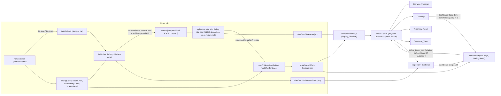

# Design Document

## Overview

This design replaces the React and Vite Virtual Office with a plain static, no-build ES-module app served at `/office/` that replays a genuine published run as an orbitable three.js Diorama, with a synchronized Transcript, Telemetry_Panel, Swimlane_View, and Inspector. It covers four layers:

1. **Record (Guardian).** `runGuardian` emits one additive `step.completed` event per real unit of work (page, viewport, step) with honest start and end times, a Result_Summary, and the Finding_Key parts of any finding the step produced. The three Setup_Placeholder_Agents are removed and the role value "ai" is never emitted.
2. **Publish (Publisher).** The Publisher sanitizes the enriched events, adds finding ids, caps the file at 256 KB with a defined truncation order, computes the Producing_Entry of every published finding, and writes the result as additive fields in `run-findings.json` (no new file, no new Dashboard request).
3. **Replay (Office).** A pure `office/lib/timeline.js` module turns Run_Events into a deterministic Replay_Timeline. Every view (Diorama, Transcript, Telemetry, Swimlane, Inspector) is a pure function of the timeline and the playback position.
4. **Trace (Dashboard).** Read-only links from the Dashboard to Office_Deep_Links, and a mandatory Office link in the main navigation.

Everything is deterministic, free, zero-AI-token, ASCII-only, and uses no `innerHTML`. three.js (MIT, r169) is vendored like Chart.js, with an import map and no bundler.

### What the code review found (and how the design responds)

| Observation (from real files) | Design consequence |
|---|---|
| `src/core/orchestrator.ts` emits `tel.agentStatus("Discovery crawler" / "Inventory_Agent" / "Specification_Agent", ...)` as instant working/completed pairs at the start of `runGuardian`, with `Specification_Agent` role `"ai"`. | Delete those six calls. Keep `discovery.validated` (a real scope check, ignored by the office). |
| `Quality_Analysis_Agent` and `Triage_Agent` are emitted with role `"ai"` although `src/agents/ai-agents.ts` is fixed template text. Triage is currently nested inside the Quality_Analysis_Agent working/completed pair. | Emit role `"template"` for both, split the nested pair into two sequential steps (`notes`, then `triage`), flag `template: true` on the step events. Order of `aiItems` is unchanged. |
| `TelemetryEmitter.agentStatus` writes only `{agentName, agentRole, status}`; the whole Observation_Runner viewport loop (pacing wait, navigate, screenshot, `compareScreenshot`, axe) is one working/completed pair. | Wrap each sub-step in a recorder that measures real time with `performance.now()` and emits `step.completed`. The pacing `setTimeout(requestSpacingMs)` stays outside every step and shows as an honest unattributed gap. |
| `src/core/finding-model.ts`: `findingKey = pageUrl|viewport|ruleId`, with ruleId = axe id, `check:<name>` (http, title, h1, nav), or `visual-diff`. `findingId` = prefix + sha1(runId#key) first 12 hex. | Step events record `pageUrl`, `viewport`, and a list of `ruleId`s; the key is formed with the same rule. The Publisher adds ids using the same `findingId`. |
| `sanitizeRun` writes `events.json` pretty-printed (`JSON.stringify(x, null, 2)`) from `events.jsonl`, with no size cap. `redact` replaces any value whose key matches `password|secret|token|auth|session|email|card|...` and any 32+ char `[A-Za-z0-9_]` run. | Rewrite `events.json` compact and ASCII-escaped, cap at 256 KB, and choose field names that avoid the redactor key regex (a test enforces this). |
| `run-findings.json` already holds `findings[]` and `ignored[]` (each with `id`, `kind`, `pageUrl`, `slug`, `viewport`, `ruleId`, `severity`) and `totals {all, detected, ignored, bySeverity}`, where `all` = active, `detected` = active + ignored. `dashboard/lib/findings.js` `normalizeFinding` copies unknown finding fields, but `normalizeRun` whitelists top-level fields. | Add `producedAt` per finding, `replayT` per page row, and a top-level `replay` object. `normalizeRun` gets a one-line pass-through for `replay`. Totals reconcile against `totals.detected` and `totals.ignored`. |
| Screenshots are published at `data/runs/<id>/screenshots/<slug>.<viewport>.png` only when the run is inside the Image_Retention_Window (`index.json` `runs[].hasImages`, `imageRetentionRuns`), and the size budget can drop individual images. | Evidence loads that exact path and shows an honest message when `hasImages` is false or an image fails to load. |
| `dashboard/data-source.js` `loadPublished` already validates relative paths and tags errors with the failing file. `virtual-office/src/office/dataSource.ts` `dataUrl` resolves `../data/` from the app base. | Office `lib/data.js` mirrors both: a validated `dataUrl` resolved from `import.meta.url`, and errors that name the file. |
| `scripts/verify.mjs` check 15 reads `virtual-office/src/office/dataSource.ts`; check 14 asserts every character-implying event has an `agentName`. `package.json` has `build:office:replay`. `.github/workflows/guardian.yml` has the `npm --prefix virtual-office ci` + `build-office-replay.mjs` step with `AWG_OFFICE_REQUIRED`. `src/admin/open-routes.ts` opens `http://localhost:5173`. `DEPENDENCIES.md` lists the React stack. | These are the retirement work items in the CI section. |
| The retired app depends on three `^0.169.0`; `virtual-office/node_modules/three/build/three.module.min.js` is 687,458 bytes and `examples/jsm/controls/OrbitControls.js` is 32,134 bytes (measured in this workspace). | Pin r169 (0.169.0): single-file build, about 703 KB for both files, leaving about 780 KB of the 1.5 MB budget for office code. |

## Architecture

### Data flow



### Key design decisions

1. **One new event kind, `step.completed`, emitted when the step ends.** A start/finish pair would double the event count, allow orphan starts after a crash, and complicate the cap. A single event carrying `startedAt`, `endedAt`, and `durationMs` is atomic and half the size. Live streaming of in-progress steps is out of scope (the requirements exclude live mode), so a start event has no consumer. Existing kinds (`run.started`, `agent.*`, `page.skipped`, `run.finished`, `run.record`, ...) are unchanged; `agent.*` events are still emitted so legacy readers and `scripts/verify.mjs` check 14 keep working.
2. **Honest time capture.** `startedAt` is `Date.now()` taken immediately before the work; `durationMs` is the difference of two `performance.now()` readings taken around the work (monotonic, immune to clock adjustment); `endedAt = startedAt + durationMs`. The event envelope `ts` is the emission time, which equals the end within about a millisecond. Waiting that is not work (the request-spacing delay, browser launch, report writing) is not inside any step.
3. **The timeline is a pure ES module, shared in shape with the Dashboard approach.** `office/lib/*.js` has no DOM access at import time, so vitest imports it under Node exactly like `dashboard/lib/route.js` (see `tests/property/dashboard-route.test.ts`).
4. **Station mapping lives in two places, tied by a test.** `src/telemetry/step-model.ts` (used by the Guardian and Publisher) and `office/lib/stations.js` (used by the office). A unit test imports both and asserts equality, so the Publisher's `producedAt.station` always equals the office's station for the same entry.
5. **Everything the office shows derives from the timeline and the position.** `stateAt(timeline, t)` returns a plain snapshot (figures, screens, flags). Scrubbing, jumping, and playing all call the same function, so there is no animation state that can diverge from data.
6. **No Dashboard network growth.** Traceability data rides inside `run-findings.json`, which the Dashboard already loads for run, page, and finding views (requirement 12.7).
7. **Fail-closed, additive, and boring on the CI side.** The office is copied with `cp -r office/. ./_site/office/` like the Dashboard; a size-gate script fails with the offending path.

### Open design questions, resolved

**(a) Where the finding-to-producing-entry mapping is computed.** Recommendation: the Publisher computes it (requirement 12.5 says the Publisher decides, matching Finding_Keys only), and writes it as additive fields inside `run-findings.json`, not a separate `trace.json`.

- Dashboard needs `t` and `station` to build "See how this was found" without loading `events.json` (requirement 12.7 forbids new network requests). `run-findings.json` is already loaded by every view that needs a link.
- The Phase-2 dispositions overlay exists only in `run-findings.json` (`findings[]` = active, `ignored[]` = ignored, both with `id`). The Publisher computes `producedAt` for both lists from the detected set, so ignored findings still link to their moment.
- The office does not recompute it for Dashboard links; it reads the same fields and uses its own `producingEntry(timeline, key)` only for the Inspector and a consistency check. A property (Property 12) asserts both agree.
- Fields (all additive): `findings[].producedAt` and `ignored[].producedAt` = `{ entryId, t, station } | null`; `pages[].replayT` = relative ms of the first entry for that page, or null; top-level `replay` = `{ enriched, durationMs }`. Dashboard `normalizeRun` passes `replay` through; per-finding and per-page fields already survive `Object.assign` and `asArray`.

**(b) Finding_Key and ruleId format for visual and check findings.** From `finding-model.ts`: key = `pageUrl|viewport|ruleId`, with `viewport` in `desktop|mobile`, and ruleId one of: the axe rule id (for example `color-contrast`), `check:<name>` where name is the part after `desktop:` or `mobile:` in the check name (`http`, `title`, `h1`, `nav`), or the literal `visual-diff`. The step events record the page URL and viewport once on the event and the ruleIds in a `findings` array, so the key is formed with the same function the Publisher uses (`findingKey`, mirrored by `officeFindingKey` in `office/lib/links.js`). Per step:

- `load`: `check:http`, `check:title`, `check:h1`, `check:nav` for each failed check.
- `accessibility-scan`: every axe violation id (all impacts, grouped by id, as `buildRunFindings` does). The aggregate `check:a11y-critical-serious` is never recorded because `buildRunFindings` drops it when raw axe is readable; recording it would create a key with no published finding.
- `visual-compare`: `visual-diff` when `differs` is true.
- All other steps: none.

**(c) Which published file holds the totals the office reconciles against.** `data/runs/<id>/run-findings.json` `totals`: `detected` (active plus ignored, before the overlay), `ignored`, `all` (active, what the Dashboard shows), and `bySeverity` (active). The office compares its event-derived total to `detected` first. If they are equal and `ignored > 0`, it states "N findings were ignored by a reviewer decision and are not counted on the Dashboard" (requirement 14.3). If not equal, it classifies each recorded key as active, ignored, or absent using `findings[]`, `ignored[]`, and the `detailLevel` and `omissions` fields, states the difference, and states the reason only when one of those fields proves it; otherwise it says the reason could not be determined (requirement 14.4). It never hides a difference.

## Components and Interfaces

### A. Guardian changes (small, additive)

| File | Change |
|---|---|
| `src/telemetry/step-model.ts` (new) | `STEP_NAMES`, `STEP_STATION`, `STEP_AGENT`, `STEP_IS_TEMPLATE`, `STATION_IDS`, `isStepName`. Single Guardian-side source of the Station_Mapping. |
| `src/telemetry/step-recorder.ts` (new) | `recordStep` (impure shell around a pure core). See below. |
| `src/telemetry/telemetry-emitter.ts` | Add `step(data)` that calls `this.event("step.completed", { data })`, so every step passes `redact` before the exporter. Existing methods unchanged. |
| `src/core/orchestrator.ts` | Remove the three Setup_Placeholder_Agent pairs. Add `replaySchema: 1` to the `run.started` data. Wrap the work in `recordStep`. Change roles of Quality_Analysis_Agent and Triage_Agent from `"ai"` to `"template"`. Split nested triage out of notes. Add `slug` to the `page.skipped` data. Make `freezeDispositions` return `{status, entries}` (previously void). |
| `src/core/run-lifecycle.ts` | Unchanged; its result supplies the `history` Result_Summary. |
| `src/telemetry/types.ts` | Add `StepEventData` type and the string `"template"` as a documented `agentRole` value. |

Step names and where they wrap real code (line references are to the current `runGuardian`):

| Step_Name | Scope | Agent (figure) | Wraps | Station |
|---|---|---|---|---|
| `test-plan` | page | Test_Generator | `generateTestFromBaseline(slug, url)` | Test plan desk |
| `load` | page + viewport | Observation_Runner | `browser.newContext`, `newPage`, `gateway.guardUrl`, `page.goto`, and the reads of title, h1, and nav that feed the http, title, h1, nav checks | Browser bay |
| `screenshot` | page + viewport | Observation_Runner | `takeScreenshot` and `store.addEvidence` | Browser bay |
| `visual-compare` | page + viewport | Observation_Runner | `compareScreenshot(...)` | Visual check |
| `accessibility-scan` | page + viewport | Observation_Runner | `new AxeBuilder(...).analyze()` and the `accessibility/<slug>.<vp>.json` write | Accessibility check |
| `compare` | page | Comparator | `compare({...})` | Review desk |
| `notes` | page | Quality_Analysis_Agent (template) | the loop over `result.outcomes` calling `qualityAnalysis` and `visualExplanation` | Review desk |
| `triage` | page, only when outcomes exist | Triage_Agent (template) | `triageRecommendation(result.outcomes)` | Review desk |
| `history` | run | Lifecycle_Tracker | `computeLifecycleForRun(...)` and the `a11y-history-summary.json` write | Records room |
| `decisions` | run | Decision_Recorder | `freezeDispositions(...)` | Records room |

`test-plan` is a tenth Step_Name that requirement 1.7 and the glossary do not list, although the Station_Mapping text says the "Test plan desk" holds the Test_Generator test plan per page. See Decisions needing user confirmation, item 3. `Lifecycle_Tracker` and `Decision_Recorder` are names for the two real run-level functions (they are components, not agents) and need confirmation, item 10.

The page loop's `await new Promise((r) => setTimeout(r, cfg.limits.requestSpacingMs))` remains outside every step. Telemetry reports the gap as "time not attributed to a Station".

`recordStep` (core is pure and unit-testable):

```ts
// pure
export function stepTimes(startWallMs: number, durationMs: number): { startedAt: string; endedAt: string; durationMs: number };
// endedAt = new Date(startWallMs + max(0, round(durationMs))).toISOString(); startedAt = new Date(startWallMs).toISOString()

// shell
export async function recordStep<T>(
  tel: { step(d: StepEventData): void },
  meta: { step: StepName; agent: string; pageUrl?: string; slug?: string; viewport?: "desktop" | "mobile" },
  work: () => Promise<T> | T,
  summarise: (out: T) => { result: StepResult; findings?: string[] },
): Promise<T>;
```

`recordStep` takes `Date.now()` and `performance.now()` before `work`, awaits it, takes `performance.now()` after, and emits one `step.completed` with a per-run increasing `seq` (counter held in a closure created by `createStepSeq()` per `runGuardian` call). If `work` throws, it emits the step with `result: { failed: true }` and rethrows, so control flow is unchanged and no error text (which could carry paths) is published. Summaries never include page content, only counts, booleans, and rule ids.

Result_Summary shapes (all objects of numbers, booleans, and short enums):

| Step | `result` | `findings` (ruleIds) |
|---|---|---|
| `test-plan` | `{ generated: 1 }` | none |
| `load` | `{ httpStatus: 200, reached: true, checksFailed: ["title"] }` (`httpStatus` is 0 and `reached` false when there is no response) | `check:<name>` for each failed check |
| `screenshot` | `{ saved: true }` | none |
| `visual-compare` | `{ differs: false, dimensionsChanged: false, baseline: true }` | `visual-diff` when `differs` |
| `accessibility-scan` | `{ violations: { critical: 0, serious: 1, moderate: 2, minor: 0, unrated: 0 }, rules: 3 }` | every violation id |
| `compare` | `{ outcomes: 2, failedChecks: 1 }` | none |
| `notes` | `{ items: 3 }` (template) | none |
| `triage` | `{ items: 1 }` (template) | none |
| `history` | `{ status: "restored", tracked: 12 }` | none |
| `decisions` | `{ status: "applied", entries: 3 }` | none |

Any step: `result.failed: true` when the work threw.

### B. Publisher changes (`src/publish/`)

| File | Change |
|---|---|
| `src/publish/replay-trace.ts` (new, pure) | `buildReplayPublication(events, built, runId, opts)` returns `{ eventsText, replay, producedAtById, replayTBySlug }`. Contains `addFindingIds`, `computeProducedAt`, `capEvents`, `toAsciiJson`. |
| `src/publish/published-data.ts` | In pass 2, after `sanitizeRun(...)` and before `publishRunDetail`, call `finalizeReplay(outRunDir, runId, built)`. It reads the sanitized `events.json`, runs `buildReplayPublication`, rewrites `events.json` (compact, ASCII-escaped), and mutates `built.runFindings` with `replay`, `producedAt`, `replayT`. Doing this before `publishRunDetail` keeps `legacyBytes` accurate for the per-run size budget. |
| `src/publish/sanitizer.ts` | No change to `sanitizeRun`. `events.json` is re-validated after rewrite with `sanitizeJson` and `hasResidualPath`; on failure the file is deleted and recorded as withheld (`withheld` list, reason in `omissions`), and the office shows "events not published for this run". |

Processing order for one run:

1. `sanitizeRun` has already written a sanitized, residual-checked `events.json` array.
2. **Classify.** Enriched iff any `step.completed` with `data.seq` is present and `run.started.data.replaySchema === 1`.
3. **Add finding ids** (enriched only). For each step event with `findings`, build `findingIds: { <ruleId>: <id> }` by looking up `findingKey({pageUrl, viewport, ruleId})` in a map built from `built.runFindings.findings` and `.ignored` (id is already `findingId(runId, key, kind)`). A ruleId with no published finding gets no id (never a guess).
4. **Compute `producedAt`.** For each published finding (active and ignored), the first step event by (startedAt, seq) whose recorded keys include the finding key gives `{ entryId: "step-<seq>", t: startedAt - runStartedTs clamped to >= 0, station: STEP_STATION[step] }`. Exact key match only; no proximity (requirement 12.5).
5. **Page start.** `replayT[slug]` = smallest relative start of any step event for that page.
6. **Cap.** Serialize compactly with ASCII escaping (`JSON.stringify` then replace each `[\u0080-\uffff]` with `\uXXXX`; this stays valid JSON and round-trips). If the byte length exceeds 262,144, apply the truncation tiers below in order, re-measuring after each, until it fits.
7. **Meta event.** For enriched or truncated runs, append one final element `{ ts, correlationId, runId, kind: "replay.meta", data: { schemaVersion: 1, enriched, stepCount, truncated: null | { level, droppedKinds, droppedEvents, overCap } } }`. The top-level value stays an array so existing readers keep working.

Truncation tiers (lowest priority first). Tiers 1 to 3 remove whole events or derivable fields; tiers 4 and 5 shrink `result`; nothing in the "always kept" list is ever removed:

| Tier | Dropped |
|---|---|
| 1 | Events whose kind the office does not replay: `audit`, `a11y.history`, `a11y.history.unavailable`, `run.record`, `discovery.validated`, `publish.*`, `dashboard.*`. |
| 2 | Legacy `agent.*` and `human.review.completed` events, only when the run is enriched (superseded by step events). |
| 3 | The `agent` and `template` fields on step events (derivable from `STEP_AGENT` and `STEP_IS_TEMPLATE`, mirrored in `office/lib/stations.js`). |
| 4 | `result` of `compare`, `notes`, `triage`, `history`, `decisions`, `test-plan`, `screenshot`. |
| 5 | `result.checksFailed`, `result.baseline`, `result.dimensionsChanged` (counts and `differs` stay). |

Always kept: every step event, its `seq`, `startedAt`, `endedAt`, `durationMs`, `step`, `pageUrl`, `slug`, `viewport`, `findings`, `findingIds`, `result` of `load`, `visual-compare`, `accessibility-scan` (the totals depend on them), `run.started`, `run.finished`, `page.skipped`, and the meta event. If the file is still larger than the cap after tier 5, the Publisher writes it anyway with `truncated.overCap: true` and the CI size gate fails with the path (requirement 17.7). A fixed `Legacy_Run` never exceeds the cap in practice (the 31 KB sample in `artifacts/published` is pretty-printed; compact it is smaller), and only tier 1 applies to it.

Size estimate (compact, per step event about 480 to 560 bytes including the repeated envelope; each finding id adds about 35 bytes):

| Scenario | Events | Estimated bytes |
|---|---|---|
| 10 pages, 2 viewports (the real CI shape): 1 test-plan + 8 viewport steps + compare + notes + triage = 12 per page, plus 2 run-level, plus agent events kept, plus markers | about 135 | about 70 to 80 KB |
| 30 pages | about 400 | about 200 to 230 KB (near the cap) |
| Tier 1 to 3 applied at 30 pages | about 370 | about 150 KB |

### C. Replay timeline module (`office/lib/timeline.js`, pure)

```js
// Types (JSDoc)
// Entry = {
//   id: string,            // "run-started" | "run-finished" | "step-<seq>" | "skip-<n>" | "a<origIndex>" (coarse)
//   index: number,         // position in the sorted list
//   srcIndex: number,      // index in the supplied events array (traceability to the source event)
//   kind: "marker" | "step" | "skip" | "agent",
//   step: StepName | null, // null for markers, skips, coarse agent entries
//   station: StationId,    // exactly one
//   agent: string | null,
//   template: boolean,
//   pageUrl: string | null, slug: string | null, viewport: "desktop" | "mobile" | null,
//   startMs: number, endMs: number,    // relative to run.started, >= 0
//   result: object | null,
//   findingKeys: string[],             // pageUrl|viewport|ruleId
//   findingIds: Record<string,string>, // ruleId -> id, when published
//   label: string,                     // plain text used by Transcript, Swimlane aria, Inspector
// }
// Timeline = { mode: "enriched"|"coarse"|"empty", schema: number|null, runId, startedAtMs, durationMs,
//              pagesTotal: number|null, entries: Entry[], pages: PageRow[],
//              notices: { notRecorded: string[], skipped: string[], truncated: object|null, empty: string|null, unsupported: string|null } }

export function buildTimeline(events: unknown): Timeline;
export function clampT(tl, t): number;
export function countAt(tl, t): number;             // entries with startMs <= t (a prefix, via binary search)
export function entriesAt(tl, t): Entry[];          // tl.entries.slice(0, countAt)
export function activeAt(tl, t): Entry[];           // startMs <= t < endMs, or startMs === t === endMs
export function nextStart(tl, t): number | null;    // smallest startMs > t
export function prevStart(tl, t): number;           // largest startMs < t, else 0
export function firstEntryForPage(tl, pageUrl): Entry | null;
export function producingEntry(tl, key): Entry | null;   // first entry (by startMs, index) whose findingKeys include key
export function stateAt(tl, t): Snapshot;           // figures, station screens, run flags (see below)
export function officeFindingKey(pageUrl, viewport, ruleId): string;
```

Rules:

- **Sorting and time.** Relative time = event time minus the `run.started` timestamp, clamped to 0 (requirement 2.8). Sort by `startMs`, then `srcIndex`. Entry ids come from the event (`seq`), not from sorted position, so truncation never renames an entry.
- **Enriched mode.** Entries come from `step.completed` (using `startedAt` and `endedAt`), `run.started`, `run.finished`, and `page.skipped`. `agent.*` events are ignored in this mode (superseded). `replay.meta` fills `notices.truncated`.
- **Coarse mode (Legacy_Run).** `agent.working` and `agent.completed` are paired per `agentName` first-in first-out to form bars; an unmatched working event becomes a zero-length open entry. Station from agent name: Test_Generator to Test plan desk; Observation_Runner to Browser bay; Comparator, Quality_Analysis_Agent, Triage_Agent to Review desk. `step`, `pageUrl`, `viewport`, `result`, `findingKeys` stay null or empty and `notices.notRecorded` lists page, viewport, step, timing within the agent, result, and producing step. Nothing is inferred (requirement 2.15).
- **Setup_Placeholder_Agents** (`Discovery crawler`, `Inventory_Agent`, `Specification_Agent`) are excluded in every mode regardless of role. `discovery.validated`, `run.record`, `a11y.history*`, `audit`, `publish.*`, `dashboard.*`, `human.review.completed`, and `replay.meta` are known non-replay kinds and are skipped silently. An agent name outside the known set, an unknown kind, or a step with a missing required field adds a line to `notices.skipped` and is skipped (requirement 2.9). Required fields for a step: known `step`, integer `seq`, parseable `startedAt` and `endedAt`, and `pageUrl` for page-scoped steps.
- **Unsupported schema.** If `run.started.data.replaySchema` is a number greater than 1, the timeline falls back to coarse mode and sets `notices.unsupported`.
- **Empty.** No events or no `run.started`: `mode: "empty"`, no entries, `notices.empty` explains.
- **Duration.** `max(run.finished time, max endMs)` relative; if `run.finished` is absent, `max endMs`.
- **`stateAt(tl, t)`** is pure. It returns `{ started, finished, health, figures: [{ agent, template, station, working }], screens: { [stationId]: { entryId, lines, evidenceRef } }, counts }`. A figure exists only if its agent has at least one entry with `startMs <= t`; it is at the station of its latest such entry and `working` iff that entry is in `activeAt`. A screen shows its latest reached entry; the step name, page, viewport, and Result_Summary come only from that entry.

### D. Telemetry module (`office/lib/telemetry.js`, pure)

```js
export function telemetryAt(tl, t): {
  pagesCompleted: number | null, pagesTotal: number | null, pagesSkipped: number,
  findings: { critical, serious, moderate, minor, unrated, total },   // so far, from step results
  visualDifferences: number,
  stepDurations: { step: string, count: number, totalMs: number }[],
  stationDurations: { station: string, totalMs: number }[],
  runDurationMs: number, recordedStepMs: number, unattributedMs: number,
};
export function stationShares(tl): { station: string, ms: number, percent: number }[]; // whole run
export function eventTotals(tl): { total, bySeverity, keys: string[] };                  // end-of-run, for reconciliation
export function reconcile(totals, runFindings): { status: "match"|"explained"|"differs"|"unavailable", ... , reasons: string[] };
```

- A page counts as completed once every entry for that page has `endMs <= t` and its `notes` step exists. `pagesTotal` is `run.started.data.pages` when present, else null (shown as "not recorded").
- Findings so far: sum of `accessibility-scan.result.violations` (by impact) plus one `unrated` per failed check in `load.result.checksFailed` plus one `unrated` per `visual-compare` with `differs`, over entries with `endMs <= t`. This matches how `buildRunFindings` assigns severities (checks and visual are `unrated`).
- Station shares: the denominator is recorded step time (sum of entry durations, which never overlap because the orchestrator is sequential). Percentages use largest-remainder rounding at one decimal so the displayed values sum to exactly 100.0. The panel also shows run duration, recorded step time, and unattributed time, so the pacing waits are visible rather than hidden (Decision 7).
- Running totals are sums over a growing prefix of non-negative values, so they are monotonic by construction (requirement 9.8).
- Legacy runs: only run duration and per-station durations from agent bars are shown; every other value reads "not recorded".

### E. Office app (`office/`)

Folder decision: a new `office/` folder at the repository root, and `virtual-office/` is deleted. Reasons: it mirrors `dashboard/`, so the CI step is the symmetrical `cp -r office/. ./_site/office/`; the old folder carries `node_modules`, three tsconfigs, a lockfile, and stray `_ci.log` files that have no place in a no-build app; and git history shows the retirement as one clear deletion. (Decision 1.)

```text
office/
  index.html                  landmarks, skip link, import map (inline), module script
  tokens.css                  mirror of the :root block of dashboard/style.css
  office.css                  layout and components
  app.js                      bootstrap, router, wiring
  ASSET-LICENCES.md           Asset_Licence_Record
  vendor/
    three.module.min.js       three r169 (0.169.0), MIT
    OrbitControls.js          three/examples/jsm/controls, r169, MIT
    three-LICENSE.txt         MIT licence text
  lib/
    honesty.js                the only file allowed to contain the words AI, model, LLM, autonomous (negated statements)
    stations.js               STATIONS, STEP_STATION, STEP_AGENT, descriptions, labels
    timeline.js  telemetry.js  route.js  clock.js  store.js
    data.js                   dataUrl, loadIndex, loadEvents, loadRunFindings, imageUrl
    links.js                  Dashboard Deep_Link builders from Finding_Key and ids
    evidence.js               evidenceAt(timeline, t, run, index): pure view-model
    format.js                 time and duration text
    dom.js                    el(), text(), no innerHTML
  views/
    controls.js  transcript.js  telemetry-panel.js  swimlane.js  inspector.js
    stations-list.js  notices.js  run-picker.js  help.js
  diorama/
    diorama.js                lazy entry: createDiorama(host, handlers)
    scene.js  figures.js  screens.js  camera.js  loop.js  capability.js
```

Size budget (bytes, estimated; the real values go in the Asset_Licence_Record and are enforced by the size gate):

| Part | Estimate |
|---|---|
| `three.module.min.js` | 687,458 (measured, r169) |
| `OrbitControls.js` | 32,134 (measured, r169) |
| `three-LICENSE.txt`, `ASSET-LICENCES.md` | about 3,000 |
| Authored JS (lib, views, diorama, app) | 120,000 to 180,000 |
| CSS and HTML | 25,000 to 35,000 |
| Total | about 0.87 to 0.94 MB, limit 1,572,864 (1.5 MB) |

**index.html.** `lang="en"`, title "Assurity Web Guardian - Virtual Office", skip link to `#main`, header (banner) with brand, a link back to the Dashboard (`../`), and the honesty statement; `nav` (aria-label "Primary") with Dashboard and Virtual Office links; `main`; `footer` with the WCAG statement. An inline `<script type="importmap">{"imports":{"three":"./vendor/three.module.min.js"}}</script>` precedes the module script, because `OrbitControls.js` imports the bare specifier `three`. GitHub Pages sets no CSP, so the inline import map is permitted. Import maps are supported by Chrome and Edge 89+, Firefox 108+, and Safari 16.4+; an older browser fails the dynamic Diorama import and lands in Fallback_Mode, with everything else working (the rest of the app uses no import-map-dependent specifier).

**Routing (`lib/route.js`).** `#/` loads the newest run; `#/run/<runId>?t=<ms>&station=<id>`.

```js
export function parseOfficeRoute(hash): { runId: string|null, t: number, station: StationId|null }
export function formatOfficeRoute({ runId, t, station }): string   // "#/run/<enc>?t=<int>[&station=<id>]"
export function clampT(t, durationMs): number
```

Invalid `t` (non-numeric, negative, NaN) parses as 0; `t` is an integer capped at 2^31 - 1 at parse time and clamped to `[0, duration]` once the run loads (requirement 3.7). An unknown `station` is dropped (requirement 3.10). The Dashboard builds links with the same format (Section F), and a property ties the two.

**Playback clock (`lib/clock.js`, pure reducer plus a thin rAF driver in `app.js`).**

```js
export const SPEEDS = [1, 2, 5, 10];
export function createClockState(durationMs): { t: 0, playing: false, speed: 1, durationMs }
export function advance(state, realDeltaMs): State   // t += min(realDeltaMs, 100) * speed; at t >= duration: t = duration, playing = false
export function seek(state, t) / play(state) / pause(state) / setSpeed(state, s)
```

`advance` caps one frame at 100 ms of real time so a returning hidden tab does not jump; this is documented as a deliberate time-dilation guard. At the end the clock pauses and never loops (requirement 4.7). Next and previous event use `nextStart` and `prevStart`.

**State store (`lib/store.js`).** A 30-line observable: `get()`, `set(patch)`, `subscribe(fn)` returning an unsubscribe. State: `{ index, runId, run (events, runFindings, summary), timeline, clock, station, announce, mode: "3d"|"fallback", reducedMotion, errors }`. Views subscribe and re-render only when the slice they read changes (for example the Transcript re-renders when `countAt` changes, not every frame; the scrubber updates every frame because it is one input element).

**URL sync.** `history.replaceState` runs on pause, on seek (scrub release, jump, next, previous, Transcript click, Swimlane click), on run change, and on station select, debounced to 250 ms. It does not run every frame while playing. Opening a link restores run, position, and station (requirement 3.4 to 3.9).

**Views.**

- *Controls.* A `role="toolbar"` with labelled buttons (Play/Pause, Previous event, Next event, Reset view), a Speed `<select>` or radio group (1x, 2x, 5x, 10x), a range input scrubber with `aria-valuetext` such as "00:12.3 of 01:35.0, step accessibility-scan", a jump-to-page `<select>` (disabled with an explanatory note for Legacy_Run), a run picker listing each Run_Index entry with date, time, and health, and an "Announce steps" checkbox (off by default). All are native elements, so Enter and Space work and focus rings come from `office.css`.
- *Transcript.* An ordered list (`<ol>`) of entries; each `<li>` has relative time, agent, Station, page, viewport, Step_Name, and Result_Summary text, plus a Dashboard link where one exists. Entries after the position get a "not yet reached" class and `data-reached="false"` (also a visually-hidden text suffix "not yet reached"). The current entry gets `aria-current="step"`. Activating an entry (a `<button>` inside the `<li>`) seeks to its start. Under Reduced_Motion, `scrollIntoView({ block: "nearest", behavior: "auto" })` is used; otherwise also `auto` (never smooth), so no auto-scroll animation exists at all.
- *Telemetry panel.* A `<dl>` and a `<table>` of Station durations and shares, all text (requirement 9.9).
- *Swimlane.* Inline SVG with one lane per Station; each bar is an SVG `<a>`-like focusable `<g role="button" tabindex="0">` with `aria-label` "<step>, <page>, <viewport>, starts at <time>" and a `<title>`; bars are in the tab order sorted by time. Marker line moves with position. Positions are `x = startMs / duration * width`, minimum bar width 2 px. Works in Fallback_Mode.
- *Inspector.* For the selected Station or figure: name, plain-language description, whether its steps are Automated_Template_Steps, a table of entries up to the position (Step_Name, page, viewport, duration, Result_Summary, link), and Evidence_Items. Missing details print "not recorded".
- *Evidence (`lib/evidence.js` view-model, shown by Inspector and the Station screens).* Gated on the step having finished at the position: after `screenshot` ends and `index.runs[].hasImages` is true, an `` for `screenshots/<slug>.<viewport>.png` with a caption naming page, viewport, run, and role "current screenshot", linked to the Dashboard Visual_Comparison (`../#/visual/<runId>/<slug>/<viewport>`). If `hasImages` is false, the text says images are not published for this run (Image_Retention_Window of N runs, from `index.imageRetentionRuns`) and no image element is created. If the image errors, the text names the file that failed. After `accessibility-scan`, the rule ids and counts for that page and viewport come from `run-findings.json` `findings[]` and `ignored[]` filtered by `slug` and `viewport` and `kind === "a11y-rule"`; if a recorded key has no published finding, the panel says "rule ids not available for this page and viewport". After `visual-compare`, the yes/no result and a Visual_Comparison link.
- *Notices.* Not_Recorded_Notice for Legacy_Run, truncation notice from `replay.meta`, skipped-event notes, load errors naming the file, unsupported schema, and the consistency message (Section D `reconcile`).

**Accessibility.** Landmarks: banner, navigation, main, contentinfo. The Diorama is a `role="group"` with an accessible name, `tabindex="0"`, `aria-describedby` pointing to visible help text; the `<canvas>` and label overlays are `aria-hidden="true"` because the Station list, Transcript, and Inspector carry the same facts as text. A single polite live region `<div role="status" aria-live="polite">` exists but is only written to when "Announce steps" is on, throttled to one message per 1.5 s. `prefers-reduced-motion: reduce` is read once and on change via `matchMedia`, and drives instant camera and figure moves. No keyboard trap: Tab always leaves the Diorama; Escape moves focus to the Station list.

Keyboard shortcuts (proposal, Decision 6): character-key shortcuts are active only while focus is inside the Diorama group, so they never fire globally and do not conflict with screen-reader quick keys (WCAG 2.1.4). Toolbar controls use native button and select keys only.

| Key (focus in Diorama) | Action |
|---|---|
| Arrow keys | Orbit left, right, up, down |
| Plus / Minus | Zoom in / out |
| Shift + Arrow keys | Pan |
| 1 to 6 | Focus Station 1 to 6 (list order) |
| 0 | Reset view |
| Space | Play or pause |
| Comma / Period | Previous / next event |
| Escape | Return focus to the Station list |

The shortcut table is printed on the page inside a `<details>` element.

**Theme.** `office/tokens.css` copies the `:root` custom properties of `dashboard/style.css` (`--bg`, `--surface`, `--text`, `--muted`, `--link`, `--focus`, `--accent`, severity colors, `--font`, `--mono`, `--radius`). A unit test parses both `:root` blocks and asserts equal values, so the copy cannot drift silently. Mirroring was chosen over `@import url("../style.css")` so the office has no hidden dependency on another folder and its bytes count toward its own budget (Decision 4b). Layout: CSS grid; below 900 px width everything stacks in this order: controls, Diorama, Stations list, Transcript, Telemetry, Swimlane, Inspector. At 320 px no horizontal page scroll (tables and the Swimlane scroll inside their own `overflow-x: auto` containers). Contrast follows the Dashboard tokens, which already satisfy 4.5:1 on `--bg` and `--surface`; the dashboard has `tests/unit/dashboard-contrast.test.ts` as precedent, and a sibling test checks the office pairs.

**Data loading (`lib/data.js`).**

```js
const DATA_BASE = new URL("../../data/", import.meta.url);      // /office/lib/ -> /data/ (also works at /local-dashboard/office/)
export function dataUrl(rel, base = DATA_BASE): string;          // rejects "", "..", ".", empty segments, backslashes, absolute or scheme paths
export async function loadPublished(rel): Promise<any>;          // errors name the file and HTTP status, like dashboard/data-source.js
export function imageUrl(runId, slug, viewport): string;         // runs/<id>/screenshots/<slug>.<viewport>.png
```

Only these requests are made: `index.json`, `runs/<id>/events.json`, `runs/<id>/run-findings.json`, and screenshot images. No third-party origins, no `127.0.0.1`, no `EventSource`. `fetch` uses `cache: "no-store"` like the Dashboard.

**Boot order (requirement 16.4).** (1) Render shell, controls, Stations list, empty Transcript. (2) Load `index.json`, choose run, load `events.json` and `run-findings.json` in parallel, build the timeline, render Transcript, Telemetry, Swimlane, Inspector. (3) `import("./diorama/diorama.js")` lazily; on success mount; on any failure enter Fallback_Mode. The 700 KB of three.js therefore never blocks the text views.

**Fallback_Mode.** Triggered by: no `webgl2`/`webgl` context, `new WebGLRenderer` throwing, the dynamic import failing, or a `webglcontextlost` event that does not restore within 3 seconds. The Diorama region is replaced by a `role="status"` message "The 3D view is unavailable in this browser. The Transcript, Telemetry, Swimlane, and Inspector below show the same information." The Stations list, controls, and all other views are unchanged (requirements 8.6 and 10.8).

### F. Diorama (`office/diorama/`)

**Vendoring.** `three@0.169.0` is obtained once from the npm registry tarball (or copied from `virtual-office/node_modules/three` before that folder is deleted) and these three files are committed: `build/three.module.min.js` (687,458 bytes), `examples/jsm/controls/OrbitControls.js` (32,134 bytes), and `LICENSE`. r169 is chosen because it is the version the retired app already pins (`DEPENDENCIES.md`), it is a single-file build (newer releases split into `three.core.min.js` plus `three.module.min.js`), and it contains `CapsuleGeometry`, `CanvasTexture`, and everything needed. Only `OrbitControls` is imported from `examples/jsm`; no loaders, no CSS2DRenderer, no post-processing (requirement 16.3). The Asset_Licence_Record states the SHA-256 of each file and a test recomputes sizes and hashes. Before commit, the implementation task checks the vendored file for non-ASCII bytes and for `https://` strings; vendored files are excluded from the ASCII and third-party-URL source scans (as `dashboard/vendor/` is in `dashboard-source-scan.test.ts`) and from `innerHTML` scans, with the exclusion being the single directory `office/vendor/`.

**Scene layout.** Six Station bays on a ring of radius 7 units around the origin, in process order every 60 degrees: Test plan desk, Browser bay, Visual check, Accessibility check, Review desk, Records room. Each bay: a coloured floor pad (colour from tokens, never the only cue), a desk or console made of `BoxGeometry`, and a screen (a `PlaneGeometry` 2.4 by 1.2 on a stand, tilted 15 degrees) facing the ring centre. Floor: a `CircleGeometry` disc of radius 11 and a `GridHelper`. Lights: one `HemisphereLight` and one `DirectionalLight`. No shadow maps by default; soft circular blob shadows under figures are `CircleGeometry` with a transparent material. Background is the `--bg` token colour.

**Labels (Decision 4).** Station names and figure names are real HTML elements in an absolutely positioned overlay `div` (`aria-hidden="true"`, `pointer-events: none`), positioned each rendered frame by projecting the 3D anchor with `Vector3.project(camera)`. This gives crisp text at any zoom, uses the page font, respects user zoom and contrast, needs no add-on (not CSS2DRenderer), and does not touch `innerHTML` (elements are created with `createElement` and `textContent`). In-scene Station screens are `CanvasTexture`s drawn with the 2D canvas `fillText` (512 by 256, large short lines), because a screen that shows nothing would not read as a screen. The same strings appear as HTML in the Inspector for the focused Station, so no information exists only in a texture.

**Station screens (`screens.js`).** Each screen redraws only when its content signature changes (entry id or evidence state). Lines: Station name; page slug truncated with "..." to 26 characters; "<viewport> | <step>"; the Result_Summary line (for example "serious 1, moderate 2", "HTTP 200", "visual difference: no", "not recorded"). The Browser bay screen also draws the current screenshot thumbnail downscaled with `drawImage` into the 2D canvas (so no large GPU texture is created). Automated_Template_Steps show "automated template step" on the Review desk screen. Records room screens show only the Step_Name (requirement 5.13). Before the first entry a screen shows its Station name only.

**Agent_Figure (Decision 5).** A board-game pawn: `CylinderGeometry` base, `SphereGeometry` head, one coloured `TorusGeometry` band, about 120 triangles each, deliberately abstract and non-human so it does not suggest an AI. Distinct colour per component plus an HTML name label. Template figures (Quality_Analysis_Agent, Triage_Agent) carry a small flat sheet-of-paper mesh above the head and the label suffix "(template)". A figure is created when its first entry is reached (it exists because an event backs it) and removed when the position moves back before that.

**Movement.** `stateAt` gives the target station; the figure follows a quadratic Bezier from its current spot to the target Station anchor, bowing toward the ring centre to avoid cutting through desks, at a constant 14 units per second capped to 0.6 s per move (decorative; the screens and Transcript are exact). Scrubbing, jumping, and Reduced_Motion snap to the target. "Working" is a slow vertical bob of 0.08 units.

**Camera (`camera.js`).** `PerspectiveCamera` fov 45. `OrbitControls` with `enableDamping = false` (no continuous frames), `minDistance 6`, `maxDistance 30`, `minPolarAngle 0.3`, `maxPolarAngle 1.35` rad, `screenSpacePanning = false`, and a clamp of `controls.target` to a circle of radius 8 after every `change` event. Fly-to uses a 600 ms eased interpolation of position and target toward a framing pose precomputed per Station (about 5 units from the pad, 2.2 up); Reduced_Motion and scrubbing set it instantly. Default overview pose: distance 20, polar 1.0 rad. Keyboard orbit, zoom, and pan are our own handler on the Diorama group (the table above), calling the same bounded camera setters, so the clamps apply to keys as well as pointer. `OrbitControls` provides mouse and touch (one finger orbit, two-finger pinch zoom and pan, right button pan). Click and tap on a Station pad (a `Raycaster` against pad and desk meshes) selects the Station.

**Render on demand (`loop.js`).**

```js
let scheduled = false;
export function requestRender() { if (!scheduled && visible && !document.hidden) { scheduled = true; requestAnimationFrame(frame); } }
function frame(now) { scheduled = false; update(now); renderer.render(scene, camera); frames++; host.dataset.frameCount = String(frames);
  if (animating()) requestRender(); }
```

A render is requested by: OrbitControls `change`, a snapshot signature change (an entry boundary reached, a screen redraw, a selection change), resize, and any tween in flight (`animating()`). While playing, scrubber ticks do not trigger renders; only entry boundaries do. While paused and idle, no frames are drawn (requirement 16.6; `data-frame-count` is how the Playwright test proves it). `visibilitychange` and an `IntersectionObserver` on the host clear `visible`; becoming visible again calls `requestRender()` (requirement 16.5).

**Low-end degradation (`capability.js`).** `quality = { pixelRatio, shadows }`. Starts with `pixelRatio = min(devicePixelRatio, 2)`, shadows false. Switch to `pixelRatio = 1` when `devicePixelRatio > 2`, `hardwareConcurrency < 4`, or the median of the first 20 frame deltas exceeds 50 ms. Shadows are off in every case in this design (blob shadows are plain meshes), which satisfies "disable shadows" trivially; the `shadows` flag is kept so a later change can turn on shadow maps for capable devices only.

**WebGL detection and disposal.** Detection creates a throwaway canvas and requests `webgl2` then `webgl`; failures fall to Fallback_Mode before three.js is even imported. `dispose()` disposes every geometry, material, and texture created, calls `controls.dispose()`, `renderer.dispose()`, `renderer.forceContextLoss()`, removes all listeners and the overlay, and runs on `pagehide`. Run changes reuse the scene and only reset figures and screens.

**Honest labels.** Station labels are the six names. Figure labels are component names such as `Test_Generator`. Template steps read "automated template step". The header statement reads: "Assurity Web Guardian uses zero AI tokens. This replay shows automated steps from a real run. Template steps use fixed text, not AI." These strings live only in `office/lib/honesty.js`; a source scan allows the words AI, model, LLM, and autonomous only there (and only in negated statements), and nowhere in labels, tooltips, or descriptions.

### G. Dashboard changes (`dashboard/`)

| File | Change |
|---|---|
| `dashboard/index.html` | Add `<a class="btn btn--ghost" href="./office/">Virtual Office</a>` to `#primary-nav` (requirement 12.8). It has no `data-nav`, and `app.js` intercepts only `href` values beginning `#/`, so the browser navigates normally. |
| `dashboard/lib/office-link.js` (new, pure) | `officeRunLink(runId)`, `officeFindingLink(runId, finding, run)`, `officePageLink(runId, pageRow, run)`. Output form `./office/#/run/<enc runId>?t=<ms>[&station=<id>]`. |
| `dashboard/lib/findings.js` | `normalizeRun` adds `replay: { enriched: r.replay?.enriched === true, durationMs: nonNegInt-or-null }`. |
| `dashboard/views/finding-detail.js` | After the "Back to this run" link, a paragraph with an `<a>` "See how this was found". With `producedAt`: `t` and `station` from it. Without (Legacy_Run or no matching key): `t=0` and a muted line "The exact moment was not recorded for this run." (requirement 12.6). Applies to findings in `ignored[]` too. |
| `dashboard/views/run-view.js` | Next to the run heading, an `<a>` "Replay this run" with `t=0`. |
| `dashboard/views/page-detail.js` | In the header toolbar, an `<a>` "See how this page was checked", shown only when the run's `replay.enriched` is true and the page row has a numeric `replayT`. |

All additions are plain anchors built with `createElement` and `textContent`. No new `fetch`, no `<form>`, no POST. `tests/unit/dashboard-source-scan.test.ts` already scans `dashboard/` (excluding `vendor/`) and keeps guarding this; a new test asserts the new files contain no `fetch(`.

### H. CI, packaging, and retirement

`.github/workflows/guardian.yml` (run job), keeping the existing hardening (pinned actions, no `${{ github.event.* }}` in `run:`):

1. Remove the step "Build Virtual Office (replay mode) into site", including `npm --prefix virtual-office ci`, `node scripts/build-office-replay.mjs ./_site`, `VITE_AWG_MODE`, and `AWG_OFFICE_REQUIRED`.
2. After "Add static dashboard to site", add:

```yaml
      - name: Add Virtual Office to site
        # Plain static files: no npm ci, no build. Served at /office/ next to the Dashboard.
        run: |
          mkdir -p ./_site/office
          cp -r office/. ./_site/office/
      - name: Check site size limits
        # Fails with the oversize path: office files plus vendored three.js over 1.5 MB,
        # or any published events.json over 256 KB.
        run: node scripts/check-site-sizes.mjs ./_site
      - name: Self-scan Virtual Office
        continue-on-error: true
        run: node scripts/scan-office.mjs ./_site
```

3. `scripts/check-site-sizes.mjs` (new): exports a pure `evaluateSizes({ officeFiles: [{path, bytes}], eventFiles: [{path, bytes}] })` returning `{ ok, problems: [{path, bytes, limit}] }`, and a CLI that walks `<site>/office` (limit 1,572,864 bytes total, and names the largest file in the message) and `<site>/data/runs/*/events.json` (limit 262,144 bytes each), prints every oversize path, and exits 1.
4. `scripts/scan-office.mjs` (new, modelled on `scripts/scan-dashboard.mjs`): serves `<site>` from a Node `http` server bound to `127.0.0.1`, opens `/office/` in Playwright Chromium for the latest run and a deep link, runs `@axe-core/playwright` with the same tags, asserts the Transcript is non-empty, then repeats with WebGL disabled and asserts Fallback_Mode text and a usable Transcript. Exports pure shaping like the dashboard script. Non-blocking at first (`continue-on-error`), flipped to blocking once stable (Decision 13).
5. Retire: `git rm -r virtual-office/`, `git rm scripts/build-office-replay.mjs`, remove `build:office:replay` from `package.json`, remove the `virtual-office/dist/` and `virtual-office-src/` lines from `.gitignore`, update `DEPENDENCIES.md` (remove the React/Vite table, add three r169 under the Asset_Licence_Record pointer), update the stale comment blocks in `src/core/orchestrator.ts` that mention `build:office:replay`.
6. `scripts/verify.mjs`: check 15's office part now reads `office/lib/data.js`, asserts it contains `../../data/` and no `EventSource` and no `http` literal. Check 14 stays and gains a sibling "step-events-well-formed" check: every `step.completed` has a known `step`, an integer `seq`, and `pageUrl` unless the step is `history` or `decisions`.
7. Local parity: `src/publish/publisher.ts` copies `office/` into the staging bundle next to `dashboard/` (same `cpSync`), so `artifacts/published/office/` exists and the console's `/local-dashboard/office/` works. `src/admin/open-routes.ts` `openOffice` opens `http://127.0.0.1:<port>/local-dashboard/office/` when `artifacts/published/office/index.html` exists, else returns the same "run once first" message style as `openDashboard`; `OFFICE_URL` (`http://localhost:5173`) is removed and `tests/unit/open-routes.test.ts` is updated (Decision 12).

Asset_Licence_Record: `office/ASSET-LICENCES.md`, ASCII, a table with one row per vendored or non-procedural asset:

| Name | Version | Licence | Source | File | Size (bytes) | SHA-256 |
|---|---|---|---|---|---|---|
| three.js | 0.169.0 | MIT | https://www.npmjs.com/package/three/v/0.169.0 | `vendor/three.module.min.js` | 687458 | (computed at commit) |
| three.js OrbitControls | 0.169.0 | MIT | same package, `examples/jsm/controls/OrbitControls.js` | `vendor/OrbitControls.js` | 32134 | (computed at commit) |

There are no other assets: Stations, figures, floor, and props are procedural geometry. `tests/unit/office-licences.test.ts` parses the table, recomputes size and SHA-256 for each listed file, asserts every licence string is on a short allowlist (`MIT`, `CC0-1.0`), and asserts every file under `office/vendor/` is listed.

## Data Models

### Enriched event (published `events.json` element)

```json
{
  "ts": "2026-10-23T06:10:47.195Z",
  "correlationId": "cor_mvkkmt5ff98ec22a3c56",
  "runId": "run_mvkkmt5f8c3848e90815",
  "kind": "step.completed",
  "data": {
    "seq": 7,
    "step": "accessibility-scan",
    "agent": "Observation_Runner",
    "pageUrl": "https://assurity.nz/careers/",
    "slug": "assurity-nz-careers",
    "viewport": "desktop",
    "startedAt": "2026-10-23T06:10:45.355Z",
    "endedAt": "2026-10-23T06:10:47.195Z",
    "durationMs": 1840,
    "template": false,
    "result": { "violations": { "critical": 0, "serious": 1, "moderate": 2, "minor": 0, "unrated": 0 }, "rules": 3 },
    "findings": ["color-contrast", "link-name", "region"],
    "findingIds": { "color-contrast": "rf_1a2b3c4d5e6f", "link-name": "rf_0f1e2d3c4b5a", "region": "rf_aabbccddeeff" }
  }
}
```

- `findingIds` is added by the Publisher only; the raw `events.jsonl` has `findings` but no ids (the id function is applied at publish time, and the Guardian already shares `findingId` through `finding-model.ts`, so a later change could emit them directly).
- Run-level steps omit `pageUrl`, `slug`, `viewport`. Page-level steps omit `viewport`.
- Existing events gain only: `run.started.data.replaySchema = 1`; `page.skipped.data.slug`. Existing `agent.*` events keep their shape; `agentRole` for Quality_Analysis_Agent and Triage_Agent becomes `"template"`, and `"ai"` is never emitted.
- Field names avoid the redactor key regex (`password|passwd|secret|token|api key|authorization|auth|credential|cookie|session|email|phone|ssn|dob|credit|card|cvv|iban|account number`): `seq`, `step`, `agent`, `pageUrl`, `slug`, `viewport`, `startedAt`, `endedAt`, `durationMs`, `template`, `result`, `violations`, `rules`, `findings`, `findingIds`, `httpStatus`, `checksFailed`, `differs`. A unit test runs every field name through the regex.
- Values: pages and rule ids contain `/ . : | -`, so the 32-plus `[A-Za-z0-9_]` opaque-token pattern does not match them; the Property 17 generator includes long URL path segments to check this and, if a URL segment is redacted, the entry keeps its `seq` and times and the page is shown as "[redacted]" rather than dropping the event.

### Meta event (last element, enriched or truncated runs only)

```json
{ "ts": "...", "correlationId": "...", "runId": "...", "kind": "replay.meta",
  "data": { "schemaVersion": 1, "enriched": true, "stepCount": 118,
            "truncated": null } }
```

`truncated` is `{ "level": 2, "droppedKinds": ["audit", "run.record"], "droppedEvents": 14, "overCap": false }` when tiers were applied.

### Additions to `run-findings.json` (all optional, additive, `schemaVersion` stays 2)

```json
{
  "replay": { "enriched": true, "durationMs": 95210 },
  "pages": [ { "url": "...", "slug": "...", "replayT": 3120 } ],
  "findings": [ { "id": "rf_1a2b3c4d5e6f", "producedAt": { "entryId": "step-7", "t": 45355, "station": "accessibility-check" } } ],
  "ignored":  [ { "id": "rf_...", "producedAt": { "entryId": "step-9", "t": 51200, "station": "accessibility-check" } } ]
}
```

`producedAt` is `null` when no recorded key matches (Legacy_Run, legacy detail level, or no matching step). Stable station ids: `test-plan-desk`, `browser-bay`, `visual-check`, `accessibility-check`, `review-desk`, `records-room`.

### Office_Deep_Link

`/office/#/run/<enc runId>?t=<int ms>[&station=<station id>]`. From the Dashboard (site root) the relative form is `./office/#/run/...`, so it works at the Pages project path and at `/local-dashboard/office/`.

### Published files the office reads

| File | Used for |
|---|---|
| `data/index.json` | run picker (runId, finishedAt, health, hasImages), `imageRetentionRuns` |
| `data/runs/<id>/events.json` | Replay_Timeline |
| `data/runs/<id>/run-findings.json` | rule ids at Stations, key-to-id map, `totals` for reconciliation, `producedAt` |
| `data/runs/<id>/screenshots/<slug>.<viewport>.png` | Evidence_Item thumbnails |

## Correctness Properties

*A property is a characteristic or behavior that should hold true across all valid executions of a system-essentially, a formal statement about what the system should do. Properties serve as the bridge between human-readable specifications and machine-verifiable correctness guarantees.*

Prework reflection: determinism and snapshot purity were merged (Property 1); monotonic position sets and monotonic telemetry stay separate because they test different modules; Guardian-side station mapping equality is an example test (Testing Strategy), while totality is Property 6. Properties marked "Example" are source-scan or fixture checks quantified over files or fixtures.

### Property 1: Timeline determinism and snapshot purity (PBT)

For any event list, `buildTimeline(events)` called twice yields deeply equal results, and for any timeline and position `t`, `stateAt(tl, t)` depends only on `(tl, t)`, so any sequence of seeks ending at `t` yields the same snapshot as a fresh `stateAt(tl, t)`.

**Validates: Requirements 2.5, 5.9, 18.3**

### Property 2: Ordering and relative time (PBT)

For any event list containing a `run.started` event, every entry has `startMs >= 0`, `startMs` equals the event time minus the `run.started` time clamped at 0, entries are sorted by `startMs` then `srcIndex`, and `endMs >= startMs`.

**Validates: Requirements 2.1, 2.2, 2.3, 2.8**

### Property 3: Monotonic position sets (PBT)

For any timeline and any `T1 <= T2`, `entriesAt(tl, T1)` is a prefix and therefore a subset of `entriesAt(tl, T2)`, and `countAt` is non-decreasing in `t`.

**Validates: Requirements 2.11**

### Property 4: No fabricated entries (PBT)

For any event list, every entry's `srcIndex` refers to an event in the input, no two entries share a `srcIndex` except the two halves of a paired coarse agent bar, `entries.length` is at most the event count, and every page, viewport, step, count, and duration shown by `stateAt`, `telemetryAt`, and the Transcript model appears in the source event of some entry.

**Validates: Requirements 2.6, 5.10, 9.5**

### Property 5: Placeholder exclusion (PBT)

For any event list, including lists that mix Legacy_Run agent events with enriched steps and any `agentRole` value, no entry has an agent named `Discovery crawler`, `Inventory_Agent`, or `Specification_Agent`, and no entry is produced from a `discovery.validated` event.

**Validates: Requirements 1.9, 2.7**

### Property 6: Station mapping totality (PBT)

For any entry produced from any valid event list, `entry.station` is exactly one of the six station ids; for every Step_Name in `STEP_NAMES` the mapping gives exactly one station; and each Station in the office has a non-empty visible name.

**Validates: Requirements 2.12, 5.1**

### Property 7: Legacy runs stay coarse (PBT)

For any event list with no `step.completed` events, `mode` is `coarse` or `empty`, every entry has `step`, `pageUrl`, `viewport`, and `result` null and `findingKeys` empty, and `notices.notRecorded` is non-empty when entries exist.

**Validates: Requirements 2.4, 2.15, 18.9**

### Property 8: Malformed input never throws and is reported (PBT)

For any array of arbitrary JSON values (including unknown kinds, missing fields, wrong types, and timestamps before `run.started`), `buildTimeline` returns without throwing, skipped events add exactly one line each to `notices.skipped`, and an input without `run.started` yields `mode: "empty"` with a non-empty `notices.empty`.

**Validates: Requirements 2.9, 2.10**

### Property 9: Producing-entry lookup (PBT)

For any timeline and any Finding_Key recorded on some entry, `producingEntry(tl, key)` returns the earliest entry (by `startMs`, then index) whose `findingKeys` include the key, and for any key recorded on no entry it returns null.

**Validates: Requirements 2.13, 2.14, 12.5**

### Property 10: Finding key format (PBT)

For any page URL, viewport, and ruleId, `officeFindingKey(pageUrl, viewport, ruleId)` equals `findingKey({pageUrl, viewport, ruleId})` from `src/core/finding-model.ts`, and for every key produced by `buildRunFindingSet` on a generated run directory, the matching step events of the Guardian-side summariser (`summariseStep`) record the same key set.

**Validates: Requirements 1.14**

### Property 11: Finding ids on producing events (PBT)

For any enriched event list and built run findings, every recorded ruleId whose key matches a published finding (active or ignored) gets `findingIds[ruleId] === finding.id`, and a ruleId with no matching published finding gets no id.

**Validates: Requirements 1.15**

### Property 12: Published producedAt equals office lookup (PBT)

For any enriched event list and built run findings, for every published finding (active and ignored) `producedAt` is null exactly when no step records its key, otherwise equals `{ entryId, t, station }` of the same entry the office's `producingEntry` returns, and `t` equals that entry's `startMs`.

**Validates: Requirements 12.4, 12.5, 12.6**

### Property 13: Step timestamps are consistent (PBT)

For any wall-clock start and any non-negative duration, `stepTimes` returns `startedAt <= endedAt`, `Date.parse(endedAt) - Date.parse(startedAt)` equals the rounded duration, and both are valid ISO strings.

**Validates: Requirements 1.1, 1.2**

### Property 14: Event cap and truncation keep identity (PBT)

For any generated enriched event list and any cap of at least the size of the minimal form, the published `events.json` is at most the cap, or carries `truncated.overCap: true`; every step event present in the input is present in the output with the same `seq`, `startedAt`, `endedAt`, `step`, page identity, `findings`, and `findingIds`; `truncated` is non-null whenever any tier was applied; and tiers are applied in order (a tier N drop never occurs while a tier below N still has droppable content).

**Validates: Requirements 1.12, 1.13**

### Property 15: Sanitizer cleanliness of enriched events (PBT)

For any enriched event list in which string fields (page URLs, rule ids, result strings) are generated to include absolute Windows paths, UNC paths, POSIX home paths, email addresses, bearer tokens, and long opaque tokens, the published `events.json` passes `hasResidualPath` as false, contains none of the injected secrets, and keeps every `seq` and timestamp.

**Validates: Requirements 1.11**

### Property 16: Published events are ASCII and round-trip (PBT)

For any event list containing arbitrary Unicode strings, the published `events.json` text contains only bytes 0x20 to 0x7E plus newline (if any), and `JSON.parse` of it deeply equals the pre-serialization value.

**Validates: Requirements 18.4**

### Property 17: Redactor-safe field names (Example)

For every key that the step recorder can emit in `data` or `result`, `SENSITIVE_KEY.test(key)` is false, and for generated page URLs with long path segments the redactor does not replace the page identity of a step event.

**Validates: Requirements 1.11, 1.14**

### Property 18: Telemetry running totals are monotonic (PBT)

For any timeline and any `T1 <= T2`, every running total in `telemetryAt(tl, T1)` (pages completed, each finding severity count, visual differences, pages skipped, and per-step and per-station accumulated duration) is less than or equal to the same total in `telemetryAt(tl, T2)`.

**Validates: Requirements 9.1, 9.4, 9.8**

### Property 19: Station shares sum to 100 (PBT)

For any timeline with recorded step time greater than 0, `stationShares(tl)` percentages are non-negative and their sum equals 100.0 (largest-remainder rounding), each share equals its Station's recorded time divided by total recorded time within one rounding step, and when recorded step time is 0 no shares are produced.

**Validates: Requirements 9.3, 9.7**

### Property 20: Totals reconciliation never hides a difference (PBT)

For any event-derived totals and any `run-findings.json` totals, `reconcile` returns `match` only when the event total equals `detected` and `ignored` is 0; returns `explained` with the ignored count when the totals are equal and `ignored > 0`; otherwise returns `differs` with the numeric difference and a reason that is either supported by `detailLevel`, `omissions`, or key-set evidence, or the text that the reason could not be determined; and returns `unavailable` when `run-findings` is missing.

**Validates: Requirements 14.1, 14.2, 14.3, 14.4, 14.6**

### Property 21: Office route round trip and clamping (PBT)

For any run id, non-negative integer `t`, and station id, `parseOfficeRoute(formatOfficeRoute(r))` equals the normalized `r`; for any arbitrary hash string, `parseOfficeRoute` never throws, returns an integer `t >= 0`, and drops an unknown station; and for any duration, `clampT(t, d)` is in `[0, d]` and equals `t` when already in range.

**Validates: Requirements 3.4, 3.5, 3.7, 3.9, 3.10**

### Property 22: Dashboard link round trip and legacy fallback (PBT)

For any run id, `producedAt`, or null, the Dashboard `officeFindingLink` output parses with the office `parseOfficeRoute` back to the same run id, with `t` and `station` taken from `producedAt` when present and `t = 0` with no station when null.

**Validates: Requirements 12.1, 12.2, 12.4, 12.6**

### Property 23: Playback clock (PBT)

For any clock state, speed in `SPEEDS`, and sequence of real deltas, `t` never decreases while playing, never exceeds `durationMs`, advances by `min(delta, 100) * speed` per step before clamping, and reaching `durationMs` sets `playing` to false with no wrap to 0.

**Validates: Requirements 4.2, 4.3, 4.7**

### Property 24: Evidence gating (PBT)

For any timeline, position, `hasImages` flag, and image-load result, `evidenceAt` returns a thumbnail view-model only when the page and viewport `screenshot` step has ended at or before `t` and `hasImages` is true, returns an "images not published" message and no image element when `hasImages` is false, returns a named "could not be loaded" message on load failure, and never returns a placeholder image.

**Validates: Requirements 11.1, 11.5, 11.6**

### Property 25: Same-origin data paths (PBT)

For any string, `dataUrl(rel)` either throws or returns a URL whose origin equals the page origin and whose path starts with the data base; every path containing `..`, `.`, an empty segment, a backslash, or a scheme throws.

**Validates: Requirements 11.7, 14.5, 16.1, 17.4**

### Property 26: Size evaluation (PBT)

For any list of office file sizes and events file sizes, `evaluateSizes` reports a problem naming the path of the largest office file when the total exceeds 1,572,864 bytes, reports each events file over 262,144 bytes by path, and reports no problem otherwise.

**Validates: Requirements 16.8, 17.6, 17.7**

### Property 27: Honest wording in office sources (Example, source scan)

For every file under `office/` except `office/vendor/` and `office/lib/honesty.js`, the string literals and HTML text contain none of the words AI, LLM, model, or autonomous as a standalone word; every `STATIONS` and figure label and description contains none of them; and `honesty.js` contains the statement that zero AI tokens are used and that template steps are automated, not AI.

**Validates: Requirements 5.7, 5.8, 15.6, 18.1**

### Property 28: No forbidden APIs and no third-party requests in office sources (Example, source scan)

For every `.js` and `.html` file under `office/` except `office/vendor/`, the code (comments stripped) contains none of `innerHTML`, `outerHTML`, `insertAdjacentHTML`, `document.write`, `eval(`, `new Function`, `EventSource`, `XMLHttpRequest`, `sendBeacon`, `localStorage`, or any `http://` or `https://` literal, and every file is ASCII-only.

**Validates: Requirements 16.1, 17.4, 17.5, 18.4, 18.5**

### Property 29: Dashboard additions are read-only links (Example, source scan)

For every changed or new file under `dashboard/` (`lib/office-link.js`, the three views, `index.html`), the code adds no `fetch(`, `<form`, `method: "POST"`, or `XMLHttpRequest`, and the office link in `index.html` is a relative `href`.

**Validates: Requirements 12.7, 12.8, 18.7**

### Property 30: Orchestrator honesty (Example, source scan)

For `src/core/orchestrator.ts`, the source contains no `agentStatus(` call whose first argument is one of the three Setup_Placeholder_Agent names, and no `agentStatus(` call with the role `"ai"`.

**Validates: Requirements 1.9, 1.10**

## Error Handling

| Condition | Behavior |
|---|---|
| Step `work` throws in the Guardian | `recordStep` emits `step.completed` with `result: { failed: true }` and rethrows; no error text is published. |
| `tel.step` or exporter fails | Same as other events: the exporter handles it; a failed optional export never stops the run (existing emitter behavior). |
| `events.jsonl` has a bad line | Existing `sanitizeRun` withholds `events.json` with a reason; the office shows "events not published for this run" and the Transcript lists nothing. |
| Enriched `events.json` fails the residual-path re-check after rewrite | File deleted, recorded in `omissions`/`withheld`; office shows the same message. Run and Dashboard are unaffected. |
| Events exceed 256 KB | Truncation tiers 1 to 5; `replay.meta.truncated` set; office shows "Some detail was left out to keep the file small". If still over the cap, `overCap: true` and the CI size gate fails naming the path. |
| Enriched run, no `run-findings.json` match for a key | `findingIds` omitted for that rule, `producedAt` null for any finding without a key; office shows "rule ids not available". |
| Legacy_Run | Coarse timeline plus Not_Recorded_Notice; jump-to-page disabled with text; Dashboard links open at `t=0` and say the moment was not recorded. |
| Unknown event kind or malformed step | Skipped, one line in `notices.skipped`, shown in a collapsed "Skipped events" list. |
| `run.started.data.replaySchema` greater than 1 | Coarse fallback and `notices.unsupported` ("This run uses a newer replay format"). |
| `index.json` fails to load | Error panel naming `index.json` and the HTTP status; shell, Dashboard link, and help stay usable; Retry button. |
| `events.json` or `run-findings.json` fails to load | Message naming the file; the other file's views still render (for example Transcript without rule ids). |
| Deep link names an unknown run | Message "That run was not found", newest run loads. |
| Deep link `t` out of range or invalid | Clamped to `[0, duration]` or 0. |
| Deep link `station` unknown | Ignored; default overview. |
| Image 404 or error | Text names the image file; no placeholder image. |
| Run outside the Image_Retention_Window | "Images are not published for this run (latest N runs only)". |
| WebGL missing, context creation fails, or import map unsupported | Fallback_Mode; all non-3D views work. |
| WebGL context lost | Wait 3 s for restore; otherwise Fallback_Mode with message; playback state is kept. |
| Event totals differ from Dashboard totals | `reconcile` message stating both totals, the difference, and a proven reason or "reason could not be determined". |
| Dashboard totals unavailable | "The consistency check could not be performed." |
| View code throws | Per-view try/catch shows an inline error in that panel and writes to the assertive status region; other views continue. |

## Testing Strategy

**Tooling.** vitest and fast-check (already used; `vitest.config.ts` includes `tests/unit/**/*.test.ts` and `tests/property/**/*.test.ts`, environment node). Pure office modules are plain JS imported with `// @ts-expect-error plain browser ES module without type declarations`, as `tests/property/dashboard-route.test.ts` does. Property tests run at least 100 iterations and carry the header `// Feature: virtual-office-replay, Property N: <title>`. One property test per property.

**Property-based (fast-check), under Node:**

| File | Properties |
|---|---|
| `tests/property/office-timeline.test.ts` | 1, 2, 3, 4, 5, 6, 7, 8, 9 |
| `tests/property/office-telemetry.test.ts` | 18, 19, 20 |
| `tests/property/office-route-clock.test.ts` | 21, 23, 25 |
| `tests/property/replay-publication.test.ts` | 11, 12, 14, 15, 16 |
| `tests/property/step-recorder.test.ts` | 10, 13 |
| `tests/property/dashboard-office-link.test.ts` | 22 |
| `tests/property/office-evidence.test.ts` | 24 |
| `tests/property/site-sizes.test.ts` | 26 |

Generators: a `arbEnrichedRun` that builds a consistent run (pages, viewports, steps with realistic durations, finding keys from the `check:*`, axe-id, and `visual-diff` formats); an `arbLegacyRun` shaped like the sample `events.json` under `artifacts/published`; an `arbJunkEvents` of arbitrary JSON; path and secret injectors reused from the existing sanitizer tests.

**Unit and example tests:**

| Test | Covers |
|---|---|
| `tests/unit/office-source-scan.test.ts` | Properties 27, 28 (strip comments as `dashboard-source-scan.test.ts` does; exclude `office/vendor/` only), landmarks, `lang`, title, import map, no inline event handlers |
| `tests/unit/dashboard-office-links.test.ts` | Property 29; the three views render the links with and without `producedAt` using a stub `ctx` and a minimal DOM stub if needed |
| `tests/unit/orchestrator-honesty.test.ts` | Property 30; `step-model.ts` equals `office/lib/stations.js` (station and step maps); Quality_Analysis_Agent and Triage_Agent emit `"template"` |
| `tests/unit/step-fields-redactor.test.ts` | Property 17 |
| `tests/unit/office-licences.test.ts` | Asset_Licence_Record size, hash, licence allowlist, every vendor file listed (requirements 16.2, 18.8) |
| `tests/unit/office-tokens.test.ts` | `office/tokens.css` `:root` equals `dashboard/style.css` `:root` (requirement 15.1); contrast pairs |
| `tests/unit/publisher-replay.test.ts` | End-to-end through `buildPublishedData` with a fixture raw run: `events.json` compact and ASCII, `replay.meta` present, `run-findings.json` has `replay`, `producedAt`, `replayT`; a Legacy_Run fixture has `replay.enriched` false and null `producedAt`; existing `publisher-fixture.test.ts` still passes |
| `tests/unit/verify-office.test.ts` | `scripts/verify.mjs` office checks read `office/lib/data.js` |
| `tests/unit/open-routes.test.ts` (updated) | `openOffice` URL and message |
| `tests/unit/workflow-office.test.ts` | Text scan of `guardian.yml`: has the `cp -r office/.` step and the size gate; has no `virtual-office`, `build-office-replay`, `npm --prefix`, or `AWG_OFFICE_REQUIRED` (requirements 17.1 to 17.3) |
| Fixture checks | `tests/fixtures/replay/` holds `enriched.events.json`, `legacy.events.json`, `truncated.events.json`, `index.json`, `run-findings.json`, used by unit tests and by the Playwright script |

**Browser smoke (`scripts/scan-office.mjs`, Playwright and axe, served from 127.0.0.1 as `scripts/scan-dashboard.mjs` does).** It loads `/office/` from the built `_site` (or from the fixture site when run locally), and checks: no page errors and no requests outside the loopback origin; the Transcript is non-empty before the canvas exists; deep link restores position and station; the canvas `data-frame-count` is unchanged over a one-second idle pause; Fallback_Mode with WebGL disabled shows the message and a usable Transcript, Telemetry, Swimlane, and Inspector; no horizontal scroll at 320 px width; axe with tags `wcag2a`, `wcag2aa`, `wcag22aa` for the 3D and Fallback states. Headless Chromium may need software GL flags to create a WebGL context in CI; this is not verified yet, so the script accepts either 3D or Fallback_Mode in the default pass and forces Fallback_Mode in the second pass. The step is non-blocking at first, matching the Dashboard self-scan.

**What cannot be verified automatically.**

- 3D visual quality: composition, readability of the screens at oblique angles, figure appearance, and camera feel need human review on desktop and phone.
- Frame rate and smoothness on real low-end devices; the automated frame check only proves that idle pauses render zero frames.
- Real assistive-technology behavior (screen readers, switch control) and WCAG 2.2 AA conformance; axe finds a subset only, and the page states this honestly.
- Behavior of old browsers without import map support beyond the Fallback_Mode path.
- That the old React office tolerates the new event kinds during the transition (it is retired in the same rollout; see Migration).

## Migration and Rollout

Ordering keeps the live site from ever being left without an office, and keeps each step independently releasable.

1. **Stage 1: Guardian and Publisher (no visible change).** Land `step-model.ts`, `step-recorder.ts`, the orchestrator changes, `replay-trace.ts`, the `published-data.ts` hook, the `normalizeRun` pass-through, and their tests. After deploy, `events.json` for every run is regenerated (the Build published data step re-publishes all restored runs on each CI run) in compact ASCII form; Legacy_Runs keep their exact events and gain no meta event unless tier 1 truncation applies. The old React office still reads the array; the implementation task for this stage verifies, by running the old reducer against an enriched fixture, that unknown kinds are ignored (not yet verified in this design). The first enriched run exists only after the next CI run following this deploy; every earlier run stays coarse forever (requirement 18.9).
2. **Stage 2: Office source (not wired).** Land `office/`, vendored three.js, `ASSET-LICENCES.md`, scripts, and tests. CI still builds the React app into `_site/office`; the new folder is unused by CI. Developers can preview locally through the console at `/local-dashboard/office/` once the publisher copy lands.
3. **Stage 3: CI swap and retirement (one change).** Replace the Vite step with the `cp -r office/.` step, add the size gate and office self-scan, delete `virtual-office/`, `scripts/build-office-replay.mjs`, the `build:office:replay` script, the `.gitignore` entries, update `DEPENDENCIES.md`, `verify.mjs`, `open-routes.ts` and its test. The deploy that carries this change publishes either the old or the new office, never none. If the size gate or smoke fails in CI, the run job fails before the Pages artifact is uploaded, so the previous site stays live.
4. **Stage 4: Dashboard links.** Add the main navigation link and the traceability links after Stage 3 has deployed and `/office/` loads, so no Dashboard link points at the retired app. Ship `run-findings.json` fields (already in Stage 1) first so links have data. Legacy runs show links at `t=0` with the "not recorded" note.
5. **Rollback.** Stage 3 is the only change touching `_site/office`; reverting it restores the Vite step (the folder remains in git history). Stages 1 and 4 are additive and harmless to revert.

## Decisions needing user confirmation

| # | Decision | Recommendation |
|---|---|---|
| 1 | Folder for the new office | New `office/` at repo root (mirrors `dashboard/`), delete `virtual-office/`. Alternative: reuse the `virtual-office/` path after deleting the React app. |
| 2 | Event shape | One `step.completed` event emitted when the step ends (not a start/finish pair). |
| 3 | A tenth Step_Name `test-plan` | Needed so the "Test plan desk" has real entries; requirement 1.7 and the glossary list nine names and omit it. Recommend amending requirement 1.7 and the Step_Name glossary entry to add `test-plan`. |
| 4 | Label technique | HTML overlay labels for names (crisp, text-based), canvas textures for in-scene screens, same strings in the Inspector. 4b: mirror dashboard tokens in `office/tokens.css` with a drift test, instead of importing `../style.css`. |
| 5 | Figure style | Abstract board-game pawn, coloured per component, with a paper-sheet marker for template steps; not human-like. |
| 6 | Keyboard shortcuts | Character-key shortcuts only while focus is inside the Diorama group (table in Section E); toolbar uses native keys only. |
| 7 | Station share denominator (requirement 9.3 and 9.7) | Shares are of recorded step time, which sums to exactly 100; the panel also shows unattributed time (pacing waits, browser launch, file writes) so it is visible. The requirement text says share of "the run time", which cannot sum to 100 across six Stations when gaps exist. |
| 8 | `events.json` format | Keep the top-level array, append a final `replay.meta` event, write compact ASCII-escaped JSON (smaller than today's pretty-printed file). |
| 9 | Where producing-entry data lives | Additive fields in `run-findings.json` (`producedAt`, `replayT`, `replay`), not a `trace.json`, so the Dashboard makes no new request (requirement 12.7). |
| 10 | Names for the run-level figures | `Lifecycle_Tracker` (history) and `Decision_Recorder` (decisions), named after the real functions. Confirm or choose other names. |
| 11 | three.js version | Pin r169 (0.169.0): single-file build, already the project's pinned version, about 703 KB with OrbitControls. A newer release would add a second core file and need re-measuring. |
| 12 | Console "Open local Virtual Office" | Repoint to `http://127.0.0.1:<port>/local-dashboard/office/` and copy `office/` into `artifacts/published/office` in the local publish, since the Vite dev server (port 5173) is retired. |
| 13 | Office self-scan in CI | Non-blocking at first (like the Dashboard self-scan), then blocking once stable. The size gate is blocking from day one. |
| 14 | Agent role string for template steps | `"template"` (replaces `"ai"`). |
| 15 | CI-level step telemetry | Not now (out of scope per the requirements). The `records-room` Station and the step model leave room to add steps such as restore-history and deploy later, once CI records its own timings. |
| 16 | Request spacing waits | Left outside every step and reported as unattributed time, rather than folded into `load`. |
