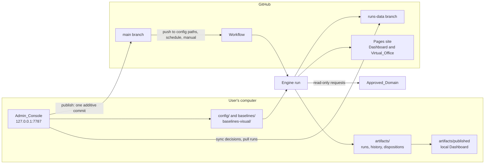
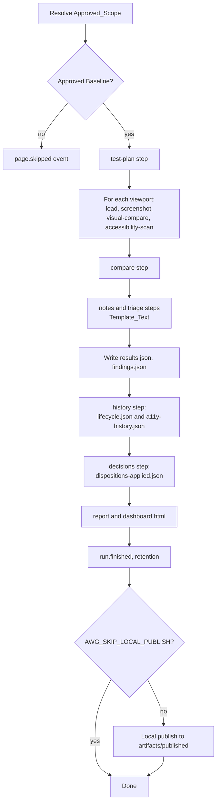
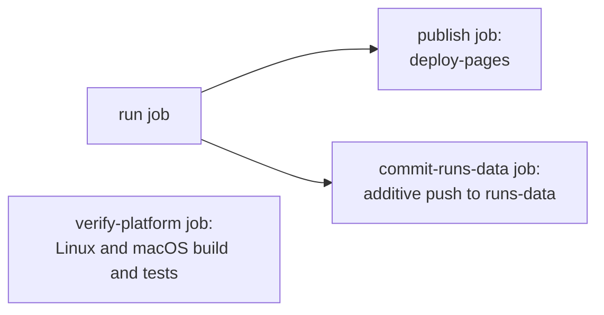

# Design Document

## Overview

Web Guardian has five parts that share one data contract:

1. The **Engine** (src/) scans a human-approved set of pages, compares them with human-approved baselines, classifies outcomes, tracks finding lifecycle, applies reviewer decisions and writes one Run_Directory per run.
2. The **Published_Data builder** (src/publish/) turns raw Run_Directories into a sanitised static JSON tree.
3. The **Admin_Console** (src/admin/ and admin-ui/) is a local, loopback-only web console for setup, approvals, decisions, publishing, scheduling and pulling runs.
4. The **Dashboard** (dashboard/) and the **Virtual_Office** (office/) are build-free static ES-module sites that read only the Published_Data.
5. The **Workflow** (.github/workflows/guardian.yml) runs the Engine in GitHub Actions, assembles the site, deploys it to GitHub Pages and stores raw run history on the runs-data branch.

Design principles, each of which the later sections turn into mechanisms:

- **Deterministic and token-free.** No component calls a model. Template_Text is produced from fixed templates and labelled.
- **Human in control.** Only the Approval_Gate creates a Baseline, and only a typed Reviewer_Name authorises it. No failed check or difference changes a baseline.
- **Honest data.** Facts that a run did not record are shown as "not recorded". Nothing is inferred.
- **Additive data.** Published fields are added, never renamed, so older runs stay readable.
- **Fail closed on publish.** A published file that cannot be confirmed clean is withheld and listed, never written.
- **Gentle on the site.** Concurrency 1, spacing of at least one second, no form submission, one approved domain.
- **Local only for control.** The Admin_Console listens on 127.0.0.1. Published sites are read-only and make only relative requests.

## Architecture

### System context



### Run pipeline



### Publishing pipeline in the Workflow



Within the run job the steps run in this order: checkout, Node from .nvmrc, `npm ci`, Chromium, build, restore of the accessibility history and dispositions, Engine run, restore of earlier runs, published data build, Dashboard copy, Dashboard Self_Scan, Office copy, Size_Gate, build stamp, Office Self_Scan, Pages artifact upload and raw artifact uploads.

### Key design decisions

1. **Raw data stays raw, published data is derived.** The Engine writes everything it knows into the Run_Directory. The Published_Data builder reads only that directory, the frozen Applied_Dispositions of the run and the Lifecycle_History, and writes a separate tree. Re-publishing the same inputs gives the same bytes.
2. **Decisions are frozen per run.** A Run copies the effective Dispositions into dispositions-applied.json when it finishes. Publishing never reads the live Disposition_Log, so a later decision cannot change an earlier run.
3. **One step event per step.** A step.completed event carries start, end and duration. There is no start event, so a crash cannot leave an orphan start, and the event count is half of a start and end pair.
4. **Static sites, relative URLs.** The Dashboard and the Virtual_Office fetch only `./data/...` or `../../data/...` paths, so they work at a Pages project path, at the root and under /local-dashboard/.
5. **Ports for side effects in the console.** Handlers use a deps object (fs, git, jobs, clock, browser launcher) so tests never touch the real disk, network or git.
6. **The Workflow is the schedule.** The cron line in the workflow file is the only place the schedule lives. The console edits that line in the working tree and the user publishes it.
7. **Raw run history lives on its own branch.** Raw Run_Directories never go to main. The Workflow adds them to runs-data additively, and the console reads that branch with a plain fetch.

## Components and Interfaces

### A. Engine (src/)

| Module | Responsibility |
| --- | --- |
| core/orchestrator.ts | `runGuardian(cfg)`: resolves scope, runs pages and viewports, writes run files, records steps, freezes dispositions, writes report, applies retention, publishes locally. Also `buildRunSource`, `writeRunSourceMarker`, `freezeDispositions`, `sanitizeVisual`. |
| core/site-gateway.ts | `SiteGateway.guardUrl`, `isApprovedDomain`, `navigate`. Raises `DomainBoundaryError` for a host outside the Approved_Domain. |
| core/evidence-store.ts | Run_Directory layout, atomic JSON writes, evidence references, `applyRetention`. |
| core/ids.ts | Run, correlation, finding, evidence and review identifiers. |
| core/finding-model.ts | `findingKey`, `findingId`, `collectVisualViews`, `buildRunFindingSet`. Severity, kind and lifecycle types. |
| core/run-lifecycle.ts | `computeLifecycleForRun`: reads raw axe files, applies the run to the history, writes lifecycle.json. |
| core/dispositions.ts | Pure Disposition entries, canonical matchers, content-addressed ids, `mergeLogs`, `effectiveEntries`, `applyDispositions`, `serializeLog`. |
| core/disposition-store.ts | Reads and writes artifacts/dispositions.json and the sync marker. |
| core/analytics.ts | Aggregate counts used by the local reports. |
| agents/comparator.ts | `compare`: failed-check, observed-website-change and visual-finding outcomes. |
| agents/visual-compare.ts | `compareScreenshot` with pixelmatch; proposes a baseline when none exists. |
| agents/template-text.ts | `qualityText`, `visualText`, `triageText`: labelled Template_Text items. |
| agents/test-generator.ts, spec-generator.ts | Generate test source and spec drafts from approved baselines and page inventories. |
| agents/inventory-agent.ts | Extracts a page's titles, headings, links, images, buttons and forms for spec drafts. |
| agents/a11y-lifecycle.ts, a11y-history.ts, a11y-history-store.ts | Pure lifecycle table, history v2, loading and atomic saving, `migrateV1`. |
| agents/scope-store.ts | Reads and writes the approved scope file per domain. |
| approval/approval-gate.ts | `ApprovalGate`: baseline promotion, finding dispositions, setup authorisation, visual baseline approval, all audited and human-only. |
| safety/domain-guard.ts, form-guard.ts, redactor.ts | Domain checks, form rules, secret and personal data redaction. |
| telemetry/* | `TelemetryEmitter`, `AppendOnlyLog`, `FileExporter`, step model, step recorder. |
| config/app-config.ts, domain-config.ts, required-settings.ts | Configuration loading, validation, scope resolution, Display_Title. |
| reporting/* | `report/index.html`, `artifacts/dashboard.html` and `dashboard-data.ts` (legacy dashboard fields). |

Key interfaces:

```ts
// agents/comparator.ts
type OutcomeKind = "failed-check" | "observed-website-change" | "visual-finding";
interface Outcome { findingId: string; kind: OutcomeKind; classification: FindingClassification;
                    detail: string; requiresHumanReview: boolean }
function compare(input: ComparatorInput): { page: string; outcomes: Outcome[]; failedCheckCount: number }

// agents/a11y-lifecycle.ts
type LifecycleState = "new" | "recurring" | "existing-unresolved" | "resolved";
function nextState(prev: LifecycleState | undefined, present: boolean): LifecycleState | undefined

// core/dispositions.ts
type DispositionDecision = "ignore" | "resolve" | "unignore";
type DispositionScope = "element" | "page-rule" | "site-rule" | "finding" | "undo";
interface DispositionEntry { id; decision; scope; matcher; reason; reviewer; at; undoes; source }

// telemetry/step-model.ts
const STEP_NAMES = ["test-plan","load","screenshot","visual-compare","accessibility-scan",
                    "compare","notes","triage","history","decisions"] as const
```

**Scope resolution.** `resolveApprovedUrls(cfg)` returns the approved scope file's pages (capped by `maxApprovedPages`) when `cfg.domain` names a domain whose approved scope file has pages, and the page seed's approved URLs otherwise. It never reads a proposed scope.

**Findings.** For every raw axe file the Engine emits one a11y-rule Finding per page, viewport and rule, with the impact as severity. A failed load check becomes a check Finding. A screenshot that differs, by a diff image or by a recorded `differs`, becomes a visual Finding, and a visual Finding is suppressed when other rules fail for the same page and viewport. The aggregate `a11y-critical-serious` check is dropped when raw axe data exists, because the individual rules already cover it.

**Lifecycle.** `applyRun` follows this table for each Finding_Key. A key that is present is new when it has no state or was resolved, and recurring otherwise. A key that is absent is resolved when its page and viewport were scanned and it was unresolved, and unchanged otherwise. The history only gains runs and keys. `regression` is assigned only by the disposition overlay.

**Dispositions.** Matchers are canonical per scope (unused fields are empty strings), so the id, a hash of the canonical body, is stable. An ignore with scope page-rule matches a page and rule on any viewport. A site-rule ignore matches the rule alone. An element ignore matches a node by CSS target and ignores the Finding only when every node is matched. A resolve removes the Finding from the active set. A later Run in which the Finding returns marks it regression. An unignore undoes an earlier entry from its own time forward.

### B. Published_Data builder (src/publish/)

| Module | Responsibility |
| --- | --- |
| published-data.ts | `buildPublishedData`, `readRunFacts`, `readRunsNewestFirst`, `deriveRunDomain`, origin and trigger markers. |
| build-published-data.ts | Command-line entry used by the Workflow: `node dist/publish/build-published-data.js <outDir>`. |
| run-findings.ts | `loadRawRunInputs`, `buildRunFindings`, `finalizeDecisions`, `loadFrozenDispositions`. |
| evidence.ts | `buildViolationEvidence`, `sanitizeEvidenceText`, `DEFAULT_CAPS`. |
| visual.ts | `buildVisualItems`, `applyDroppedImages`, `deriveDiffMeasure`. |
| guidance.ts | `buildGuidance`: specific, linked Template_Text guidance with a cap per run. |
| pages.ts | `buildPageHistory`, `buildLatestPages`, `buildDashboardAggregates`, `pageGroupOf`. |
| replay-trace.ts | `buildReplayPublication`, `toAsciiJson`, `isEnrichedRun`, `EVENTS_CAP_BYTES`. |
| sanitizer.ts | `sanitizeJson`, `stripPaths`, `sanitizeRun`, `hasResidualPath`, screenshot name checks. |
| size-budget.ts | `selectWithinBudget`, `runsWithImages`, `imageRetentionRuns`. |
| publisher.ts | `publish({ outDir })`: builds in a staging folder, copies the Dashboard, swaps atomically-ish. |

**Per-run publication.** For each Run_Directory the builder (1) reads facts and raw inputs, (2) builds findings with the run's frozen dispositions, (3) compares the applied set with the previous run's to produce the decisions summary, (4) sanitises the allowed legacy JSON files and `events.jsonl` into `events.json`, (5) finalises the replay (compact ASCII events text, `replay`, `producedAt`, `replayT`), (6) builds evidence, visual and guidance, (7) selects files within the size budget and (8) writes everything through `serializeSafe`, which sanitises and rescans for residual paths. Core JSON (run-findings, visual, guidance) is forced: if it cannot be confirmed clean it is withheld and named, and the run still publishes the rest.

**Origin precedence.** The per-run `origin` marker wins when it is exactly `cloud` or `local`, then `AWG_RUN_ORIGIN`, then `local`.

### C. Admin_Console (src/admin/, admin-ui/)

The server (admin-server.ts) is a thin HTTP adapter. It builds a request object, runs `preflight` (host, guard, content length), streams the body against the route's ceiling, calls the router and writes the response with security headers. The router (console-router.ts) matches `RouteDef` entries from `ROUTE_GROUPS`. Every route declares `method`, `pattern`, `mutating`, `maxBodyBytes` and `handler`. A test enforces that `mutating` is true exactly for POST.

| Route group | Routes |
| --- | --- |
| Status and domain | GET /api/status, GET /api/domain, GET /api/setup-log |
| Open | POST /api/open/office, POST /api/open/dashboard |
| Domain setup | GET /api/domain/setup, POST /api/domain/setup/start, /cancel, /confirm |
| URLs | GET /api/urls, POST /api/urls/add, /remove, /edit, GET /api/project/pending, POST /api/project/update |
| Discovery | POST /api/discovery/run, GET /api/jobs/status, GET /api/discovery/candidates, POST /api/discovery/approve |
| Baselines | GET /api/baselines, POST /api/baselines/spec/draft, /visual/capture, /approve, /adopt-cloud, GET /api/baselines/proposals, /image, /cloud-runs |
| Findings and decisions | GET /api/findings, GET /api/dispositions, POST /api/dispositions, POST /api/dispositions/sync, GET /api/dispositions/sync/status |
| Publish | GET /api/publish/status, POST /api/publish, GET /api/git/feedback |
| Schedule | GET /api/schedule, POST /api/schedule |
| Runs | GET /api/runs, /api/runs/:id, /api/runs/:id/log, /api/runs/:id/log/:name, POST /api/sync, GET /api/sync/status |
| Disabled | POST /api/run answers 410 and starts nothing |

The UI is a set of ES modules: console.js, lib/dom.js, lib/shell.js and one module per section: Overview, Domain, Approved URLs, Discovery, Baselines, Findings and decisions, Publish, Schedule, Runs and logs, Setup activity. The server serves only this fixed list.

**Request guard.** `checkHostOnly` accepts Host `127.0.0.1:<port>` or `localhost:<port>`. `checkLocalRequest` adds Origin (if present), Sec-Fetch-Site and the JSON content type. The HTTP layer returns 403 with no detail on any failure.

**Jobs.** `job-runner.ts` runs three fixed scripts (scripts/discover-candidates.mjs, scripts/make-all-drafts.mjs, scripts/capture-baselines.mjs) one at a time, with `shell: false`, an allow-listed environment, a per-kind timeout, a ring buffer of scrubbed output and a persisted status.

**Publish.** `publish-paths.ts` defines the pathspecs. `publish-delta.ts` computes the delta between the working tree and origin/main limited to those paths. `publish-api.ts` builds one commit on top of origin/main and pushes without force. `git-port.ts` is the single place that runs git, with an argument array.

**Decision sync.** `disposition-sync.ts` fetches runs-data, unions the logs, builds one commit with `hash-object`, `write-tree` and `commit-tree` against a temporary index, and pushes with retry. The user's index and working tree are never used.

**Cloud sync.** `cloud-sync.ts` fetches runs-data, lists run ids, copies only absent ids through a temporary folder and a move, and writes `origin` = `cloud` into each.

**Local Dashboard.** `local-dashboard.ts` serves artifacts/published under /local-dashboard/ with a whitelist of plain-name segments and known extensions, refusing symbolic links and directory listings.

### D. Dashboard (dashboard/)

| File | Responsibility |
| --- | --- |
| index.html, style.css | Static shell, header, skip link, live regions. |
| app.js | Bootstrap, router, focus and scroll management, load error panel, lazy view import. |
| data-source.js | `loadStatic`, `loadPublished(relPath)`: relative, validated, encoded URLs. |
| lib/route.js | `parseRoute`, `formatRoute`, `normalizeRoute`. |
| lib/findings.js | `normalizeRun`: tolerant run data normalisation, including legacy runs. |
| lib/pages.js | `buildPageRows`, `filterPages`, `sortPages`, `groupPages`, `groupOfUrl`. |
| lib/severity.js | Severity order, labels and symbols. |
| lib/summary.js, guidance.js, captions.js, ignored.js, domain.js, title.js, office-link.js | Plain-English text, guidance filter, captions and alt text, ignored counts, domain labels, title, Virtual_Office link. |
| rule-catalogue.js | Rule descriptions used by plain-English summaries. |
| views/overview.js | Run selector, KPI cards, run list, page explorer, `legacySummary`. |
| views/charts.js | Trend, severity and lifecycle charts with data tables, using vendored Chart.js. |
| views/run-view.js, filtered-findings.js, findings-list.js, page-detail.js, finding-detail.js, visual-comparison.js, lightbox.js, common.js | The routed views and shared builders. |

Each view module exports `render(container, ctx)`, renders exactly one h2 and uses textContent for all dynamic text. The context gives the view `route`, `state`, `navigate`, `formatRoute`, `loadRun`, `loadEvidence`, `loadPage`, `announce`, `alert`, `isCurrent` and `notFound`.

### E. Virtual_Office (office/)

| File | Responsibility |
| --- | --- |
| index.html, office.css, tokens.css | Static shell and styles. |
| app.js | Bootstrap, store wiring, run loading, URL sync, playback loop, lazy Diorama, fallback. |
| lib/data.js | `dataUrl`, `loadIndex`, `loadEvents`, `loadRunFindings`, `imageUrl`. |
| lib/timeline.js | `buildTimeline`, `stateAt`, `activeAt`, `nextStart`, `prevStart`, `firstEntryForPage`, `producingEntry`, `resultLines`. |
| lib/stations.js | Stations, step names, station and agent mappings. Equal to src/telemetry/step-model.ts. |
| lib/clock.js | Pure playback clock: `play`, `pause`, `seek`, `advance`, `setSpeed`, speeds 1, 2, 5 and 10, frame limit 100 ms. |
| lib/route.js | `parseOfficeRoute`, `formatOfficeRoute`, `clampT`. |
| lib/telemetry.js | Telemetry panel model and totals reconciliation. |
| lib/app-model.js | Pure view models and decisions: initial state, key actions, announce decision. |
| lib/honesty.js | The only file with the zero-AI statements. |
| lib/evidence.js, links.js, store.js, format.js, dom.js, title.js | Evidence thumbnails, deep links, store, formatting, DOM helper, title. |
| views/* | Controls, run picker, stations list, transcript, telemetry panel, swimlane, inspector, notices, help. |
| diorama/* | three.js scene, layout, figures, screens, camera and loop; vendored three.js and OrbitControls in vendor/. |

**Timeline model.** `build(events)` finds run.started, reads `replaySchema`, picks `enriched` or `coarse`, and then walks the events once. An enriched entry is built from a step.completed event (with page, viewport, station, agent, template flag, result summary, finding keys and finding ids). A coarse entry is a bar built from agent.working and agent.completed pairs of known components. Events that are silent by design (publish.*, dashboard.*, audit, run.record, replay.meta and others) are skipped without a note. Every other unreadable event is skipped with a note.

**Playback.** The app owns a store with run id, timeline, time, playing, speed, selection, fallback flag and failed images. A `requestAnimationFrame` loop advances the clock by at most 100 ms of real time per frame.

### F. Workflow (.github/workflows/guardian.yml)

| Job | Condition | Permissions | Timeout |
| --- | --- | --- | --- |
| run | not a pull request, not a fork | contents: read | 30 min |
| verify-platform | not a fork, and (manual, or a pull request from the same repository) | contents: read | 20 min |
| publish | needs run, not a pull request, not a fork | pages: write, id-token: write | 10 min |
| commit-runs-data | needs run, not a pull request, not a fork | contents: write | 15 min |

Triggers: one daily cron line, workflow_dispatch, pull_request, and push to main limited to config/**, baselines/**, baselines-visual/** and the workflow file. Concurrency group `guardian` with cancel-in-progress false, or a per-ref group for pull requests.

### G. Scripts (scripts/)

| Script | Purpose |
| --- | --- |
| run-guardian.mjs | Builds dist/ if missing, loads the config, calls `runGuardian`. |
| run-admin-server.mjs | Starts the console. |
| discover-candidates.mjs, make-all-drafts.mjs, capture-baselines.mjs | The three console jobs. |
| init-config.mjs | Copies each *.example.json to its real name without overwriting. |
| verify.mjs | Invariant checks over runs and code (see Testing Strategy). |
| scan-dashboard.mjs, scan-office.mjs | Axe self-scans of a built site. |
| check-site-sizes.mjs | The Size_Gate. |
| stamp-build-id.mjs | Appends ?v=<short commit> to entry assets. |
| lib/instance-data.mjs | Skip or fail decisions when instance data is absent. |
| dev/scan-history-comments.mjs, scan-secrets.mjs, check-doc-links.mjs, hash-vendored.mjs | Repository scans. |

## Data Models

### Configuration files

| File | Content |
| --- | --- |
| config/app.config.json | approvedDomain, baseUrl, domain (slug), seedFilePath, limits, retention, viewports, optional displayTitle. |
| config/app.config.example.json, page-seed.example.json, domains/*.example.json | Committed templates with example.com values. |
| config/page-seed.json | maxUrls and approvedUrls. |
| config/domains/<slug>.json | domain, baseUrl, approvedSchemes, maxDiscoveryCount, largeScopeThreshold, requestSpacingMs, scopeFile, probePaths. |
| config/scope/<slug>.approved.json | Human-approved pages for the domain. |

```json
{
  "approvedDomain": "www.example.com",
  "baseUrl": "https://www.example.com",
  "domain": "example-com",
  "seedFilePath": "config/page-seed.json",
  "displayTitle": "Example Site Guardian",
  "limits": { "pages": 10, "crawlDepth": 2, "concurrency": 1, "requestSpacingMs": 1000,
              "retries": 2, "navTimeoutMs": 30000, "runTimeoutMs": 600000 },
  "retention": { "maxRuns": 20, "maxAgeDays": 30 },
  "viewports": { "desktop": { "width": 1440, "height": 900 },
                 "mobile": { "width": 390, "height": 844 } }
}
```

### Run directory layout (raw)

```
artifacts/
  a11y-history.json              Lifecycle_History (v2)
  a11y-history.status.json       restored | first-run | unavailable (written by the Workflow)
  dispositions.json              Disposition_Log (schemaVersion 1)
  dispositions.status.json       restored | first-run | unavailable
  audit.jsonl                    append-only audit of approvals
  dashboard.html                 local report page
  published/                     local Dashboard (data/, dashboard files, office/ when copied)
  pending-review/spec-drafts/    spec drafts awaiting approval
  runs/<run-id>/
    events.jsonl                 telemetry events (run.started, step.completed, ...)
    audit.jsonl                  run audit records
    results.json                 per page deterministic checks
    findings.json                outcomes, template items, visual results, awaitingReview
    test-manifest.json           generated tests, repository-relative paths
    lifecycle.json               per-finding lifecycle state of this run
    a11y-history-summary.json    lifecycle summary counts
    dispositions-applied.json    frozen applied Dispositions of this run
    run-source.json              trigger, GitHub run id, commit, event (CI only)
    origin                       "cloud" or "local"
    trigger                      short trigger token
    screenshots/<slug>.<viewport>.png and <slug>.<viewport>.diff.png
    accessibility/<slug>.<viewport>.json
    proposed-visual-baselines/<slug>/<viewport>.png
    traces/  agent-tasks/  report/index.html
```

### Baselines

```
baselines/<slug>/baseline.v<N>.md        approved text baseline, versioned
baselines-visual/<slug>/<viewport>.png   approved visual baseline
```

### Findings

`Finding_Key = <pageUrl>|<viewport>|<ruleId>`. The rule id is the axe rule id for an a11y-rule Finding, `check:<name>` for a check Finding, `visual-diff` for a visual Finding, and `legacy-outcome` for a failed check in a Legacy_Run. A finding id is a prefix (`rf_`, `cf_`, `vf_`) plus the first 12 hexadecimal characters of the SHA-1 of `<runId>#<key>`.

### Disposition_Log (artifacts/dispositions.json)

```json
{
  "schemaVersion": 1,
  "entries": [
    { "id": "d_ab12...", "decision": "ignore", "scope": "page-rule",
      "matcher": { "pageUrl": "https://www.example.com/about", "viewport": "",
                   "ruleId": "color-contrast", "cssTarget": "" },
      "reason": "Known contrast issue in the logo", "reviewer": "Example Reviewer",
      "at": "2025-01-01T00:00:00.000Z", "undoes": null, "source": "admin-gui" }
  ]
}
```

`dispositions-applied.json` in a run holds `schemaVersion`, `runId`, `finishedAt`, `status` (applied or unavailable), `logDigest` (16 hexadecimal characters of a SHA-256 of the serialised log) and `entries`.

### Lifecycle_History (artifacts/a11y-history.json)

```json
{ "schemaVersion": 2, "runs": ["run_1", "run_2"],
  "findings": { "<page>|<viewport>|<rule>": {
      "fingerprint": "...", "ruleId": "...", "pageUrl": "...", "viewport": "desktop",
      "impact": "serious", "firstSeen": "...", "lastSeen": "...", "occurrenceCount": 2,
      "runsSeen": ["run_1", "run_2"], "state": "recurring", "lastSeenRun": "run_2",
      "resolvedRun": null, "resolutionDate": null, "humanDisposition": null } } }
```

### Enriched event (events.jsonl and events.json)

```json
{ "ts": "2025-01-01T00:00:01.000Z", "kind": "step.completed", "runId": "run_1",
  "correlationId": "corr_1",
  "data": { "seq": 3, "step": "accessibility-scan", "agent": "Observation_Runner",
            "template": false, "pageUrl": "https://www.example.com/", "slug": "home",
            "viewport": "desktop", "startedAt": "...", "endedAt": "...", "durationMs": 840,
            "result": { "violations": { "critical": 0, "serious": 1, "moderate": 0, "minor": 2 } },
            "findings": ["color-contrast"], "findingIds": { "color-contrast": "rf_0123456789ab" } } }
```

`run.started` carries `replaySchema: 1`, `pages` and `scopeSource`. `run.finished` carries `health`, `failedChecks` and `pages`. A published events.json is a compact ASCII JSON array of at most 262,144 bytes. When tiers are dropped to fit, a final `replay.meta` event carries `truncated` with `level`, `droppedKinds`, `droppedEvents` and `overCap`.

### Published data layout

```
data/
  index.json                RunsIndex
  dashboard.json            Dashboard contract (aggregates, runs[], latest)
  pages/<slug>.json         history of one page across runs
  runs/<id>/
    summary.json            RunSummary
    events.json             sanitised replay events
    findings.json           sanitised findings.json
    results.json  test-manifest.json  a11y-history-summary.json
    run-findings.json       RunFindingsFile (schemaVersion 2)
    visual.json             visual comparison items
    guidance.json           Template_Text guidance items
    evidence/<slug>.<viewport>.json
    screenshots/<slug>.<viewport>.png  (+ .diff.png)
```

`data/index.json` (RunsIndex):

```json
{ "schemaVersion": 2, "generatedAt": "2025-01-02T00:00:00.000Z",
  "domain": "www.example.com", "displayTitle": "Example Site Guardian",
  "imageRetentionRuns": 10,
  "runs": [ { "runId": "run_2", "finishedAt": "...", "status": "requires-human-review",
              "health": "attention", "pages": 4, "failedChecks": 2, "pendingReview": true,
              "origin": "cloud", "detailLevel": "rule", "hasRunData": true,
              "trigger": "schedule", "hasImages": true, "domain": "www.example.com" } ] }
```

`displayTitle` is always written, with "Web Guardian" as the default. `detailLevel`, `hasRunData`, `trigger`, `hasImages` and `domain` are additive and absent on older data.

`run-findings.json` fields: `schemaVersion`, `runId`, `finishedAt`, `detailLevel` ("rule" or "legacy"), `historyStatus`, `totals` (`all`, `detected`, `ignored`, `bySeverity`, `byLifecycle`, `resolved`), `decisions` (`status`, `appliedCount`, `newThisRun`, `ignoredNewThisRun`, `unignoredNewThisRun`, `resolvedNewThisRun`), `pages` (url, slug, group, title, counts, highest, replayT), `findings`, `resolved`, `ignored`, `omissions` and `replay` (`enriched`, `durationMs`). Each finding has `id`, `kind`, `pageUrl`, `slug`, `viewport`, `ruleId`, `severity`, `title`, `hasElementDetail`, `lifecycle`, `ignoredNodeCount`, optional `legacyFindingId`, optional `suppressedBy` and `producedAt` (`entryId`, `t`, `station`, or null).

`summary.json` repeats the index entry and adds `withheld`, `omissions`, `historyStatus` and `totals`.

`dashboard.json` keeps the older fields (runHealthTrend, findingsByPage, findingsBySeverity, aiItems) and adds `schemaVersion`, `runs[]` (per-run aggregates with origin, trigger, hasImages, domain, detailLevel, historyStatus, severity and lifecycle counts) and `latest` (the latest run's id and page rows), or null when there are no runs.

### Runs-data branch layout

```
artifacts/runs/<run-id>/...          raw Run_Directories, added only
artifacts/a11y-history.json          merged history
artifacts/dispositions.json          Disposition_Log (written by the console sync)
```

### Legacy_Runs

A Legacy_Run is a published run recorded without the data the current shape needs. It stays readable in each part:

| Part | How a Legacy_Run is read | How it is displayed |
| --- | --- | --- |
| Published builder | When no accessibility file of the run can be read, `detailLevel` is "legacy". Each failed load check becomes a Finding with rule id `legacy-outcome`, severity `not-recorded`, lifecycle `not-recorded` and the check's detail text unchanged. No visual Finding is built. | `run-findings.json` carries the legacy detail level and the omissions. |
| Dashboard data | `normalizeRun` accepts missing schema version, rule fields, lifecycle and Ignored_Findings. `dashboard.json` without `runs` and `latest` is read through `legacySummary`, built from runHealthTrend, findingsByPage and findingsBySeverity. | Severity reads "Severity not recorded for this run". A failed-check heading reads "A recorded check failed on <viewport>" without a rule name. Missing figures read "Not recorded". The Ignored cell reads "Not applicable". The pages-scanned card is hidden for the legacy summary. A run without a domain is not labelled and does not break the trend. |
| Lifecycle_History | A v1 fingerprint map is converted by `migrateV1` into a v2 history keyed by page, viewport and rule, and recorded human dispositions are kept. | Not displayed. |
| Virtual_Office | A run with no step events, or with a replay schema above 1, gets a coarse timeline from agent.working and agent.completed pairs of known components. | Each bar reads "<agent> - step, page and viewport not recorded". Jump to page is disabled with a note. The notices list what is not recorded: page, viewport, step name, timing within the agent, result summary and producing step for findings. The telemetry panel shows only run duration and station durations. Totals reconciliation says findings were not recorded per rule. |

Setup agents (Discovery crawler, Inventory_Agent, Specification_Agent) are ignored in a coarse timeline, and unknown agents are skipped with a note. No value is inferred for a Legacy_Run. The Dashboard never reads a severity out of detail text.

## Correctness Properties

*A property is a characteristic or behavior that should hold true across all valid executions of a system. Properties bridge the human-readable requirements and machine-verifiable guarantees. Each property below is covered by a property-based test in tests/property/ using fast-check.*

### Property 1: Published element evidence is clean

*For any* axe-like node whose html, target and failure summary contain arbitrary text, including emails, tokens, long digit runs, Windows, UNC and POSIX paths and control characters, every published evidence field SHALL match no secret pattern, contain no absolute path and no control character other than newline and tab, and any field that cannot be confirmed clean SHALL be published as "[withheld]" and listed in the node's withheld array.

**Validates: Requirements 9.2, 10.4, 10.5**

### Property 2: Evidence caps and counts are exact

*For any* violation with n nodes and arbitrarily long html, the published violation SHALL carry nodeCount n, at most 10 nodes, omittedNodeCount equal to n minus the published nodes, and every html field at most 500 characters plus the truncation marker.

**Validates: Requirements 10.3, 10.4**

### Property 3: One Finding per rule violation with its real impact

*For any* set of axe results, the builder SHALL emit exactly one a11y-rule Finding for each distinct page, viewport and rule, with severity equal to the impact or unrated when the impact is missing or unknown, and every check or visual Finding SHALL be unrated.

**Validates: Requirements 5.2, 5.3**

### Property 4: Counts are conserved

*For any* run, totals.all SHALL equal the number of Active_Findings, the sum of the six severity counts SHALL equal totals.all, and the sum of the lifecycle counts SHALL equal totals.all, with resolved and ignored reported separately.

**Validates: Requirements 10.2**

### Property 5: Suppressed visual Findings name the failing rules

*For any* run, the suppressedBy list of a suppressed visual Finding SHALL equal the ids of the same page's non-visual Findings.

**Validates: Requirements 10.8**

### Property 6: Lifecycle transitions follow the table

*For any* previous state, presence flag and scanned flag, the next state SHALL be new for an absent or resolved key that is present, recurring for an unresolved key that is present, resolved for an unresolved key that is absent and scanned, and unchanged for an absent key that was not scanned. The Finding_Key SHALL be equal exactly when the page, viewport and rule are equal.

**Validates: Requirements 5.1, 5.4, 5.5**

### Property 7: History application is idempotent

*For any* history and run observation, applying the same observation a second time SHALL give a history deeply equal to applying it once.

**Validates: Requirements 5.6**

### Property 8: History only grows and a failed write changes nothing

*For any* sequence of observations, every earlier run id and finding key SHALL remain with its first-seen time unchanged, and a simulated write failure SHALL leave the previous history file bytes unchanged.

**Validates: Requirements 5.6, 5.7**

### Property 9: Lifecycle is deterministic

*For any* history and observation, computing the result twice SHALL give equal results, independent of the current time except through the observation's timestamp.

**Validates: Requirements 5.10**

### Property 10: Unavailable history never fabricates state

*For any* observation processed with the history status unavailable, the snapshot SHALL give every Finding the lifecycle not-recorded, list no resolved items and leave the stored history untouched, and an unreadable history file SHALL load as unavailable and remain unmodified.

**Validates: Requirements 5.8**

### Property 11: Resolved items are complete and scoped

*For any* history and observation, the resolved list SHALL contain exactly the unresolved entries that are absent from the observation and whose page and viewport were scanned, each with page URL, viewport, rule id and severity.

**Validates: Requirements 5.5**

### Property 12: Classification keeps differences and Template_Text separate

*For any* comparison input, a difference without a violated expectation SHALL never be a failed-check, a screenshot difference SHALL be suppressed when a deterministic rule is violated in the same comparison, and Template_Text items SHALL be labelled, linked by relatedFindingId and never deterministic.

**Validates: Requirements 4.1, 4.2, 4.3, 4.8**

### Property 13: Logs are append-only

*For any* sequence of appended records, the log count SHALL only increase, and an attempt to overwrite an entry SHALL be rejected with an integrity error and leave the content unchanged.

**Validates: Requirements 7.2, 7.3**

### Property 14: Telemetry redaction

*For any* record, redaction SHALL remove emails, tokens and sensitive keys at every nesting depth.

**Validates: Requirements 7.5**

### Property 15: Correlation ids and prefixes

*For any* run, every emitted event SHALL carry the run's correlation id, and run ids SHALL start with run_.

**Validates: Requirements 7.4**

### Property 16: Requests never leave the approved domain

*For any* absolute URL on a host that is neither the Approved_Domain nor its subdomain, the domain check SHALL classify the URL as external and not approved.

**Validates: Requirements 1.3**

### Property 17: Matcher scope correctness

*For any* Finding and ignore entry, a page-rule ignore SHALL match exactly when page and rule are equal for any viewport, and a site-rule ignore SHALL match exactly when the rule is equal.

**Validates: Requirements 6.7**

### Property 18: Element-scope ignores account for nodes exactly

*For any* Finding with n nodes and a set of matched nodes, the Finding SHALL be ignored exactly when n is above zero and every node is matched, and otherwise the remaining count SHALL be n minus the matched nodes.

**Validates: Requirements 6.7**

### Property 19: Active and ignored Findings partition the detected set

*For any* detected set and applicable Dispositions, the active and ignored sets SHALL be disjoint, their union SHALL equal the detected set, and no active count SHALL include an ignored Finding.

**Validates: Requirements 6.8**

### Property 20: Log merge is lossless, commutative, associative and idempotent

*For any* logs a, b and c, merging SHALL keep every entry, SHALL give the same result in either order and any grouping, and merging a log with itself SHALL give the same log.

**Validates: Requirements 6.4**

### Property 21: Decision input validation

*For any* entry with an empty or over-long reason or Reviewer_Name, validation SHALL reject it and name the field, and *for any* accepted entry the id SHALL equal the hash of its canonical body.

**Validates: Requirements 6.1, 6.3**

### Property 22: Decisions never change earlier runs

*For any* run and any later change to the Disposition_Log, the published output of the run SHALL not change, and republishing after the change SHALL be byte-identical.

**Validates: Requirements 6.5, 6.6**

### Property 23: Resolved then reappears is a regression

*For any* Finding resolved by a Disposition that appears again in a later run, the Finding SHALL have the lifecycle regression.

**Validates: Requirements 6.9**

### Property 24: Un-ignore restores from its own time

*For any* ignore followed by an unignore, the Finding SHALL be ignored in runs finished before the unignore and active in runs finished after it.

**Validates: Requirements 6.10**

### Property 25: Application of Dispositions is deterministic and order independent

*For any* set of entries in any order, applying them SHALL give the same result.

**Validates: Requirements 6.11**

### Property 26: Decision effect counts are exact

*For any* run and entries, each entry's reported effect count SHALL equal the number of this run's Findings or resolved items it affects.

**Validates: Requirements 6.12**

### Property 27: Published size never exceeds the cap and every drop is recorded

*For any* candidate files with arbitrary roles and sizes, the kept set SHALL total at most the run cap, SHALL keep JSON before evidence before images, SHALL drop any image above the image cap, SHALL never drop forced core JSON, and SHALL produce one dropped record with a reason for every file not kept.

**Validates: Requirements 11.1, 11.2, 11.3, 11.4**

### Property 28: Images are published only for the newest N runs

*For any* list of runs and any N, the retention set SHALL be exactly the minimum of N and the run count most recent runs, SHALL not depend on input order, and the publisher SHALL record an image-retention omission for every dropped image.

**Validates: Requirements 11.5, 11.6, 11.7**

### Property 29: Baselines are published exactly for differing pairs

*For any* set of page and viewport pairs with arbitrary differs flags, baseline image paths in visual.json SHALL correspond exactly to the differing pairs whose baseline exists and is not dropped, and a missing baseline SHALL give a null image with a reason.

**Validates: Requirements 10.6**

### Property 30: Derived difference measure equals the comparer's count

*For any* pair of images, the difference derived from the diff image SHALL equal the pixel count that pixelmatch reported.

**Validates: Requirements 10.7**

### Property 31: Guidance is specific, linked and honest

*For any* built run and cap, every published guidance item SHALL link to a known finding id, SHALL not be generic, SHALL carry no confidence value, and the count SHALL not exceed the cap, and the Dashboard's visible guidance SHALL drop unknown ids, generic texts and confidence fields.

**Validates: Requirements 10.9, 20.6**

### Property 32: Page history agrees with run data

*For any* set of runs and page slug, each entry in the page's history SHALL match the findings of that run for the slug.

**Validates: Requirements 10.10**

### Property 33: Aggregates do not depend on element detail

*For any* run, changing the html, target, failure summary or node count of evidence SHALL not change the aggregate counts.

**Validates: Requirements 10.11**

### Property 34: Published structures are stable JSON

*For any* built run, the published structures SHALL round-trip through JSON and building twice from the same inputs SHALL give equal output.

**Validates: Requirements 9.11**

### Property 35: Page groups partition the pages

*For any* list of page URLs, every page SHALL be in exactly one group, group counts SHALL sum to the page count, the group name SHALL be the lowercased first path segment or "(home)", and the TypeScript and JavaScript group functions SHALL return the same value.

**Validates: Requirements 10.12, 20.1**

### Property 36: Publish stages exactly the configuration delta

*For any* set of changed paths, the selected set SHALL contain only paths inside the pathspecs and SHALL never contain a path under artifacts/, src/ or dashboard/, or a path that is absolute, contains "..", a backslash or a NUL byte.

**Validates: Requirements 17.1, 17.4**

### Property 37: An empty delta disables publishing and creates no commit

*For any* repository state with no configuration delta, the publish request SHALL report nothing to publish and SHALL run no git command that writes.

**Validates: Requirements 17.2**

### Property 38: Only same-origin loopback requests may change state

*For any* combination of host, origin, Sec-Fetch-Site and content type, the guard SHALL accept exactly when the host is loopback with the console port, the origin is absent or the same loopback origin, Sec-Fetch-Site is not cross-site or same-site, and the content type is application/json.

**Validates: Requirements 13.3**

### Property 39: The guard covers every state-changing route

*For any* route, method and path with a failing guard check, the console SHALL answer 403 and record nothing, every route SHALL be mutating exactly when its method is POST, an unknown POST SHALL get 403 when the guard fails and 404 when it passes, a wrong Host on any GET SHALL get 403, and the server source SHALL bind only to 127.0.0.1.

**Validates: Requirements 13.1, 13.2, 13.4**

### Property 40: Oversized bodies are rejected without side effects

*For any* mutating route and any body over its ceiling by byte length, or any declared content length over the ceiling, the console SHALL answer 413 without running the handler, a body at or below the ceiling SHALL never get 413, and malformed JSON within the ceiling SHALL get 400.

**Validates: Requirements 14.1, 14.2**

### Property 41: Anything shown from outside the console is scrubbed

*For any* text, scrubbing SHALL remove injected tokens, Bearer headers, credential URLs, absolute paths, the project root and home folder and control characters other than newline and tab, SHALL cap lines at 2000 characters, SHALL keep 40-character commit hashes, and SHALL be idempotent and total.

**Validates: Requirements 14.6, 14.7**

### Property 42: A new-domain draft changes nothing until it is confirmed

*For any* sequence of draft actions before confirmation, the project configuration and baselines SHALL remain byte-identical, and a cancel SHALL remove the draft and its staging folder.

**Validates: Requirements 15.2, 15.3**

### Property 43: Deep links round-trip

*For any* route with any run id, search text, filters, sort and scope, including spaces, ampersands, hash signs, percent signs and non-ASCII characters, parsing the formatted route SHALL equal the normalised route, and formatting a parsed canonical hash SHALL be stable.

**Validates: Requirements 18.4, 18.5**

### Property 44: Search and filters only narrow the page list

*For any* list of pages, search text and filters, every returned page SHALL satisfy the search and every filter, the result SHALL be a subset of the result with no search text, adding a filter SHALL never increase the result, and the reported count SHALL equal the rows returned.

**Validates: Requirements 20.2**

### Property 45: Row severity and sort order are correct

*For any* page, the highest severity SHALL be the most severe present, and *for any* page list, key and direction, sorting SHALL return a stable permutation in key order.

**Validates: Requirements 20.3**

### Property 46: Filtering and sorting stay within the latency budget

*For any* 500 pages, filter and sort SHALL complete in under 200 ms.

**Validates: Requirements 20.3**

### Property 47: Captions and alt text carry their facts

*For any* evidence context, the caption and the alt text SHALL carry the URL, viewport, role, and the run id and date or "Run not recorded".

**Validates: Requirements 20.7**

### Property 48: Plain-English summaries are complete and never invented

*For any* rule in the catalogue, the summary SHALL state what the rule checks, who it affects and the scope, with no placeholder, and *for any* unknown rule the summary SHALL consist only of the published description, help and the scope sentence.

**Validates: Requirements 20.5**

### Property 49: Every view of a run's counts agrees

*For any* run and any severity or lifecycle state, the KPI value, the chart segment, the table value, the number of Findings the filter returns and the run view list length SHALL be equal.

**Validates: Requirements 19.2**

### Property 50: The same-rule-on-other-pages count is exact

*For any* run and Finding, the count of the same rule on other pages SHALL equal the number of Findings with that rule on other pages.

**Validates: Requirements 20.4**

## Error Handling

| Situation | Behaviour |
| --- | --- |
| Required setting missing or wrong type | The Engine stops and names the setting, the file and the example file. |
| requestSpacingMs below 1000, negative limit, maxApprovedPages above 500, bad displayTitle | Configuration is rejected with a message that names the value. |
| Navigation to a host outside the Approved_Domain | `DomainBoundaryError`; nothing is requested. |
| Page without an approved Baseline | page.skipped event; the run continues. |
| A step throws | step.completed with `failed: true` and no error text, then the error is raised. |
| Report or dashboard generation fails | The Run fails and does not publish. |
| Local publish fails | publish.failed event; the previous artifacts/published stays; the Run stays successful. |
| Lifecycle_History unreadable or not restored | History status unavailable; no state is fabricated; the file is untouched. |
| Disposition_Log unreadable or restore status unavailable | dispositions-applied.json has status unavailable and no entries; the log is not changed. |
| Published file cannot be confirmed clean | The file is withheld and listed in withheld and omissions; the rest publishes. index.json or dashboard.json unclean fails the build. |
| Run over the size budget | Lower-priority files are dropped and recorded with a reason; core JSON stays. |
| Console request fails the guard | 403 with no detail; nothing recorded. |
| Console body too large or malformed | 413 or 400; the handler does not run. |
| Console route not found | 404. POST /api/run answers 410. |
| Second background job while one runs | The start is refused as busy. |
| Git push rejected | Publish reports the reason and the scrubbed git output and changes nothing locally. Decision sync retries from a fresh fetch, at most 3 times, then reports "Not yet synced" and keeps the local log. |
| Cloud pull fails | Local store unchanged; a reason is shown. |
| Dashboard file fails to load | The view shows the file name, HTTP status and Retry; an alert is announced. |
| Dashboard view throws | A visible error panel and an alert; the shell keeps working. |
| Office events missing or unreadable | Empty replay with the reason; other views keep working. |
| Office view throws | Only that view is replaced with an error message. |
| WebGL missing or Diorama fails | Fallback message; the other views stay. |
| Size_Gate over a limit | The Workflow fails before deploy, so the previous site stays online. |
| runs-data push rejected | Fetch, merge the remote tip, push again, at most 3 attempts; no force. |

## Testing Strategy

### Unit tests (tests/unit/)

Unit tests give examples and edge cases for each part. Groupings:

- **Engine and configuration:** run lifecycle, evidence store, test generator, step recorder, display title config, required settings, approval gate, freeze dispositions, run source marker, replay trace, run findings and overlay, publisher fixtures, visual key and origin, retention.
- **Admin_Console:** router, server, open routes, URL, discovery, baselines (including adopting cloud runs), domain confirm and setup, dispositions API and sync, publish API, schedule API and workflow schedule, runs API, git port, sync routes, disabled controls, overview files, remote display, local time format.
- **Dashboard:** view models, routes, ignored counts, office link, domain labels and published domain, rule catalogue, data source, replay pass-through, source scan, contrast.
- **Virtual_Office:** app model, keys, route and clock, timeline (enriched and coarse), telemetry, evidence links, scene layout, diorama (pure helpers and entry), screens, highlight, views for controls, inspector, telemetry and transcript, activity caption.
- **Repository tooling:** package scripts, portable commands, init-config, instance data, check-site-sizes, scan-history-comments, scan-secrets, check-doc-links, hash-vendored, stamp-build-id, security patterns, guardian workflow (hardening rules), self-scan shape, scan-office.
- **Legacy_Runs:** legacy severity labels, legacy dashboard summary, legacy run normalisation, coarse office timeline and its notices, legacy totals reconciliation, v1 history migration.

### Property-based tests (tests/property/)

fast-check tests cover Properties 1 to 50 above. Each is annotated with its property and the requirements it validates, and uses generators that stay inside the input space: Windows, UNC and POSIX paths, secret-shaped tokens built at run time, routes with reserved characters, 500-page lists, run histories and observation sequences. Filesystem-heavy properties use fewer iterations by design.

| Test file | Properties |
| --- | --- |
| evidence-sanitize | 1, 2 |
| run-findings | 3, 4, 5 |
| a11y-lifecycle | 6, 7, 8, 9, 10, 11 |
| classification | 12 |
| telemetry | 13, 14, 15 |
| safety | 16 |
| dispositions-matcher | 17, 18, 19 |
| dispositions-log | 20, 21 |
| dispositions-timeline | 22, 23, 24, 25, 26 |
| size-budget, image-retention | 27, 28 |
| visual-publish | 29, 30 |
| guidance-publish, dashboard-text | 31, 47, 48 |
| published-structure | 32, 33, 34, 35 |
| publish-delta, publish-empty | 36, 37 |
| admin-local-guard, admin-route-guard | 38, 39 |
| admin-oversized-body | 40 |
| admin-scrub | 41 |
| domain-draft | 42 |
| dashboard-route | 43 |
| dashboard-pages | 35, 44, 45, 46 |
| dashboard-counts | 4, 49, 50 |

### Instance tests (tests/instance/)

Instance tests need a configured site: the real configuration loads, and analytics over real runs behave. They are excluded from the export and from a fresh copy.

### Verification script (`npm run verify`)

`scripts/verify.mjs` checks the last two runs and the code: two runs exist, layout is complete, screenshots exist and are non-empty, findings.json has the expected shape, deterministic outcomes stay separate from template items, awaiting-review is set, every outcome requires review, the audit log rejects edits, a baseline exists, the dashboard file exists and every scanned page is on the approved domain. It then runs invariant checks: the sanitizer removes secrets and paths, the console binds to loopback only and refuses a second loopback address, no office character exists without an event that names an agent, step events are well formed and none carries the agent role "ai" in an Enriched_Run, the static sites use relative URLs only, every scanned page is in the approved scope, the workflow is hardened (default read permission, pinned actions, timeouts, concurrency, fork guards, no pull_request_target, no untrusted input in run steps), dependencies are pinned and vendored, and cloud sync is additive. Checks that need instance data report a skip, or fail when GUARDIAN_REQUIRE_INSTANCE_DATA is set.

### Repository scans

- `npm run scan:secrets` looks for secret-shaped strings in tracked files with a reasoned allow file.
- `npm run scan:history` checks comments and docs for requirement numbers, phase, task and stage narration, history words, design narration and non-ASCII text. Files in the product spec folder may state requirement numbers and Validates lines, and every other pattern still applies there.
- `npm run check:links` checks relative links, anchors, npm script names and repository paths in docs.
- `node scripts/dev/hash-vendored.mjs --check` verifies vendored library hashes against docs/VENDORED.md.

### Self-scans and the Size_Gate

The Workflow builds the site in ./_site and then runs `scan-dashboard.mjs` and `scan-office.mjs` (axe scans that write results into the site and the job summary and do not block) and `check-site-sizes.mjs` (blocking). The scans are evidence and not a claim of conformance.

### Cross-platform verification

The verify-platform job runs `npm ci`, `npm run build` and `npm test` on Linux and macOS for pull requests from the same repository and for manual runs. Windows is covered by running the same commands locally. The run job installs Chromium only on Linux.

### Live verification of a deployment

After a push to the default branch or a manual dispatch, the run, publish and commit-runs-data jobs finish, the Pages site loads at its project path, the Dashboard lists the existing runs, the Virtual_Office loads the newest run, and the runs-data branch has gained one additive commit.
