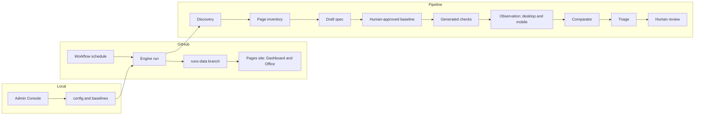

# Web Guardian

Web Guardian is a deterministic website quality monitor. It runs visual, accessibility and functional checks against human-approved baselines, and it comes with a local admin console, a static dashboard and a Virtual Office replay of each run. A GitHub Actions workflow runs it on a schedule and publishes the dashboard and office to GitHub Pages.

## Zero AI tokens

Web Guardian calls no AI model and needs no AI account or API key. Every number, status and finding is computed by code. Any prose in reports, such as summaries and captions, is fixed template text that is clearly labelled as template text.

## Principles

- **Human in control.** Nothing becomes a baseline without explicit approval. Every finding needs human review, and observations never promote themselves to baselines.
- **Facts and template text are separate.** Deterministic facts are stored apart from the labelled template text that describes them.
- **Honest activity.** The Virtual Office shows only real run activity and is idle when nothing runs.
- **Gentle on the site.** Concurrency of 1, at least 1 second between requests, no form submission, no load testing, approved domain only.
- **Evidence kept per run.** Screenshots, traces, accessibility results and an append-only, tamper-evident audit log stay with each run.
- **No paid cloud, no telemetry.** Nothing is sent to external services other than the monitored site and your own Git remote.

## Architecture



The comparator classifies each result as a failed check, an observed change or a visual difference. Observation uses a desktop viewport (1440x900) and a mobile viewport (390x844).

Each run directory holds `events.jsonl`, `findings.json`, `results.json`, `test-manifest.json`, `screenshots/`, `traces/`, `accessibility/`, `report/` and `agent-tasks/`. Accessibility history separates new issues from recurring ones.

## Quick start

Requires Node 22 (see `.nvmrc`).

```bash
npm ci
npm run init-config      # creates config files from the examples
# edit config/app.config.json: set your approved domain and seed URL
npm run build
npm test
npm run console          # opens the local admin console
```

Then follow [docs/SETUP.md](docs/SETUP.md) to enable the scheduled workflow and GitHub Pages. Use `https://example.com` style values until your own site is configured.

## Folder map

| Folder | Contents |
|---|---|
| `src/` | Engine, comparator, reporting and admin server (TypeScript) |
| `admin-ui/` | Local admin console front end |
| `dashboard/` | Static dashboard |
| `office/` | Virtual Office replay |
| `config/` | App configuration, page seeds and per-domain settings |
| `baselines/`, `baselines-visual/` | Approved text and visual baselines |
| `scripts/` | Command-line entry points and checks |
| `tests/` | Unit and property tests |
| `docs/` | Setup and reference documents |
| `.github/workflows/` | Scheduled run and publish workflow |

## Links

- [Setup guide](docs/SETUP.md)
- [Contributing](CONTRIBUTING.md)
- [Security policy](SECURITY.md)
- [Vendored components](docs/VENDORED.md)

## Licence

See [LICENSE](LICENSE). The licence is to be chosen by the project owner.
